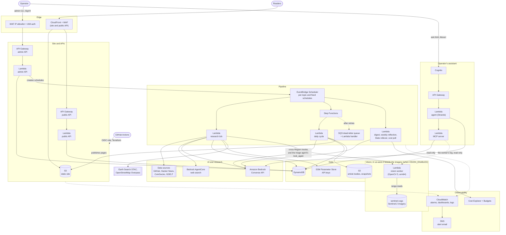

# BloggerBear

An autonomous, multi-domain research-and-publishing platform on AWS. You configure "topics" (a
data source plus an adapter for it); each topic runs two unattended cadences: a research tick
that watches its source for material change, and a daily authoring cycle that turns fresh
findings into a reviewed, published article. A local admin CLI manages topics and moderation. A
public static site serves the results, with RSS for anything that wants to read it by program.

It is open source so you can read it, learn from it, and run your own copy. The original
deployment is live at [bloggerbear.com](https://bloggerbear.com).

> **Judges of the OpenCV AI Competition 2026: start here.** The entry is the Rail Access Monitor
> ([below](#vision-satellite-imagery-and-the-rail-access-monitor)). The
> [technical report](docs/hackathon/technical-report.md) describes it, with every number cited to a
> run file; [REPRODUCE.md](docs/hackathon/REPRODUCE.md) builds and tests it, starting with CI's own
> commands (about ten minutes, no AWS account); the
> [diagrams](docs/hackathon/diagrams/README.md) show the system and the agent's workflow.

## Docs

In the order you are likely to need them.

| Doc | What it is for |
|---|---|
| [Setup guide](docs/setup-guide.md) | Your first deploy, for a first-time forker: installing Terraform and the tools, an AWS account and CLI profile, the bootstrap and the GitHub OIDC roles, your GitHub settings, the first deploy and topic, and what to do when it fails. |
| [Deployment runsheet](docs/deployment-runsheet.md) | Your first deploy: bootstrap, GitHub settings, one AWS account or two, the dev environment, seeding a topic, the model registry, another region, local development. |
| [Separate AWS accounts](docs/deployment-separate-accounts.md) | Dev in one account and production in another: what you do twice, both bootstrap commands, the GitHub OIDC trust for your fork, the firewall, a checklist. |
| [Configuration](docs/configuration.md) | Every setting in one table, and where it goes: GitHub, Terraform, SSM, DynamoDB, your machine. |
| [Cost saving](docs/cost-saving.md) | The firewall switches: what each one saves, what it gives up, how to set it, and why the admin API's allowlist stays on whatever you switch off. Hardened by default; at your own risk. |
| [Admin CLI quick start](scripts/QUICKSTART.md) | `scripts/QUICKSTART.md`: point the CLI at your environment, run your first commands, and where to look when one fails. |
| [Admin CLI reference](scripts/README.md) | Every command: topics, the review inbox, models, pipeline settings, feedback. |
| [COOL benchmark runsheet](docs/cool-benchmark-runsheet.md) | Optional, for the OpenCV competition: the Graviton4 session that times the vision worker under COOL against stock OpenCV 5. |
| [Production runsheet](docs/production-runsheet.md) | Your domain, DNS, the first production release, rolling back, what it costs. |
| [Repository protection](docs/todo/public-repo-runsheet.md) | The GitHub settings for a public repository: rulesets, required reviewers, secret scanning. |
| [Alexa+ add-on](alexa/README.md) | Optional: putting the operator's assistant on Alexa+. |
| [Architecture by feature](docs/architecture/README.md) | The project one feature at a time, across the layers. First: [article research](docs/architecture/article-research.md), from a data source and its API keys to an article in S3. Then [vision](docs/architecture/blogger-vision.md), from a satellite scene to a map on the page, with the rail concepts explained. |
| [Project plan](docs/project-plan.md) | The design and the reasons behind it. Long; read it before a non-trivial change. |
| [Friction log](docs/friction.md) | Problems met while building and deploying this, and what fixed them. |
| [Contributing](CONTRIBUTING.md) and [Security](SECURITY.md) | How to take part, and how to report a vulnerability. |

`docs/enhancements/` holds designs (some built, some not), `docs/risks/` known weaknesses, and
`docs/PROGRESS.md` the build history.

## Architecture

### Branch & release model

- `dev` is the default branch. Every change lands here by pull request, never a direct push.
  Merging to `dev` applies `infra/environments/dev` with no approval gate; dev is meant to be
  broken and rebuilt freely.
- `prod` is promoted from `dev` by pull request when a set of changes is ready to ship. Merging
  into `prod` does **not** deploy anything by itself.
- A production deploy happens only when a GitHub Release is published from a commit on `prod`
  (a semver tag, e.g. `v0.1.0`), gated by the `production` GitHub Environment: it accepts only
  `v*` tags and waits for the required reviewer's approval. A new release replaces whatever was
  deployed before: one Terraform state, no blue/green.
- These are the only two long-lived branches. Nothing is applied without passing the security
  scans, lint and tests first, and the AWS deploy roles trust only the `dev` branch and the
  `production` environment.
- A ruleset on both branches (pull requests only, no force-pushes, no deletions), secret scanning
  and approval for workflows from fork pull requests are GitHub settings, not code. GitHub offers
  them on public repositories or paid plans:
  [docs/todo/public-repo-runsheet.md](docs/todo/public-repo-runsheet.md) has the commands.

## License

The code is licensed under the [Apache License 2.0](LICENSE). Security reports: see
[SECURITY.md](SECURITY.md). Contributions: see [CONTRIBUTING.md](CONTRIBUTING.md).

## Data sources and attribution

BloggerBear writes from other people's data. The licence above covers this repository's code, not
that data: each source has its own terms, and if you run a copy that uses a source, its terms
apply to you. The credits each source asks for are below; keep them wherever the data is shown.

| Source | Used by | Credit and terms |
|---|---|---|
| **CoinGecko** | The crypto adapter (`lambdas/common/adapters/crypto_feed.py`): prices and market data | Data provided by [CoinGecko](https://www.coingecko.com). Their [attribution guide](https://brand.coingecko.com/resources/attribution-guide) asks for one of a few set phrases, linked to their site, "in a visible location, close to where the data is displayed". An API key is optional ([how to store one](docs/deployment-runsheet.md#api-keys-for-the-data-sources)); the credit is required either way. |
| **The GDELT Project** | Web search (`lambdas/common/web_search.py`), for topics that search the news, and the rail triage agent's `web_context` tool | News data from [the GDELT Project](https://www.gdeltproject.org/). Its terms allow any use without fee and say "any use or redistribution of the data must include a citation to the GDELT Project and a link to this website". |
| **GitHub** | The GitHub adapter (`lambdas/common/adapters/github_trending.py`) | Source: [GitHub Trending](https://github.com/trending). The Trending page has no API, so the adapter asks GitHub's documented [REST Search API](https://docs.github.com/en/rest/search/search#search-repositories) the closest question: which recently created repositories have the most stars. Articles link to the repositories they mention. Use of the API is governed by GitHub's [Terms of Service](https://docs.github.com/en/site-policy/github-terms/github-terms-of-service) and [Acceptable Use Policies](https://docs.github.com/en/site-policy/acceptable-use-policies/github-acceptable-use-policies). A token is optional ([how to store one](docs/deployment-runsheet.md#api-keys-for-the-data-sources)). |
| **Hacker News** | The Hacker News adapter (`lambdas/common/adapters/hacker_news.py`) | Stories from [Hacker News](https://news.ycombinator.com/), through its [official API](https://github.com/HackerNews/API). The API's documentation sets no attribution requirement; articles credit and link to the stories they draw on. |
| **Amazon Bedrock AgentCore web search** | Web search, as the fallback and for topics that ask for it | An AWS service, used under the AWS Customer Agreement. Articles link to the pages they cite. |
| **Copernicus Sentinel-2** | The vision topics (`lambdas/common/adapters/satellite_vision.py` and `rail_access.py`): the imagery the vision worker measures | Contains modified Copernicus Sentinel data [year]. Free, full and open under the [Copernicus Sentinel data legal notice](https://sentinels.copernicus.eu/documents/247904/690755/Sentinel_Data_Legal_Notice), which asks derived products to carry that sentence with the year of the data. The credit sits under each vision article and on the About page (the adapters' `sources`); the ship figure carries a "Processed imagery" notice; the rail figure carries the sentence with the year in the strip under the map, and its page caption repeats it. No key. |
| **Registry of Open Data on AWS** | The same: the worker reads Sentinel-2 Cloud-Optimized GeoTIFFs from the public `sentinel-cogs` bucket, and the adapter finds scenes through the Earth Search STAC API | Sentinel-2 Cloud-Optimized GeoTIFFs accessed from the [Registry of Open Data on AWS](https://registry.opendata.aws/sentinel-2-l2a-cogs/), which asks to be cited as the source of the copy. No key. |
| **OpenStreetMap** | The Rail Access Monitor (`lambdas/common/osm.py`, `lambdas/common/adapters/rail_access.py`): rail lines, stations and intermodal points through the Overpass API | Map data © OpenStreetMap contributors, available under the [Open Database Licence](https://www.openstreetmap.org/copyright), which asks for that credit wherever the data is shown: in the rail figure's caption strip (as "(c)": its font has no ©), in its page caption, under each rail article and on the About page (the rail adapter's `sources`). No key. |

Articles are written by a language model through Amazon Bedrock, and every article lists the
sources it drew on and says how it was written and reviewed.

Built with, among others: [Requests](https://requests.readthedocs.io/),
[Beautiful Soup](https://www.crummy.com/software/BeautifulSoup/),
[Python-Markdown](https://python-markdown.github.io/), the
[Model Context Protocol Python SDK](https://github.com/modelcontextprotocol/python-sdk),
[Strands Agents](https://strandsagents.com/) and the
[AWS Lambda Web Adapter](https://github.com/awslabs/aws-lambda-web-adapter). Each is under its own
licence; the pinned versions are in `lambdas/requirements*.txt` and `scripts/requirements.txt`.

BloggerBear is an independent project. It is not affiliated with, sponsored by or endorsed by
CoinGecko, the GDELT Project, GitHub, Y Combinator, Amazon, the Copernicus programme, the
European Space Agency, the OpenStreetMap Foundation or OpenCV. Their names and marks belong to
their owners and are used here only to say where data comes from and what the project runs on.
