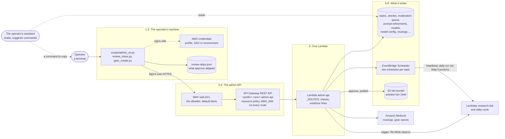

# The admin CLI and the admin API

How a decision the operator types becomes a change in the pipeline: the local script, how it
finds its environment and signs each request, the allowlist and IAM in front of the API, the one
Lambda behind it, and what that Lambda writes: topic rows and their schedules, decisions on
articles, models and settings. Then what each group of commands does, and how the CLI and the
operator's assistant divide the work.

It exists because the admin side is deliberately hard to reach. There is no admin web page. The
admin API takes only IAM-signed requests, from the operator's addresses only, and a browser
cannot hold long-lived IAM credentials safely. A script on the operator's own machine can: it
signs with whatever AWS credentials that machine already has. Topics are runtime data, not
Terraform, so creating, pausing or rescheduling one is a command, not a deploy.

How to set it up and every command's options are in
[scripts/QUICKSTART.md](../../scripts/QUICKSTART.md) and
[scripts/README.md](../../scripts/README.md); every setting the CLI changes, and where it is
stored, is in [configuration.md](../configuration.md#dynamodb-settings-changed-with-no-deploy).
This page does not repeat them.

**In the assistant.** This page has no `feature` entry yet. Ask about its parts by name instead,
`architecture(name="admin-api")`, `"admin-acl"`, `"waf-admin"`, `"admin-api-access"` or
`"topic-schedules"`, or about the layer that holds it (`api`). "Why are my admin calls failing?"
is `api_errors(api="admin")`, and `investigate(symptom="api-errors", api="admin")` says where to
look yourself.

Resource names below use `<prefix>` (your `unique_name_prefix`) and `<env>` (`dev` or
`production`). Both environments build the same API from one module,
[`infra/modules/rest-api/`](../../infra/modules/rest-api/), each with its own URL, Lambda and
allowlist.

## The steps

| # | Step | What happens | Where in the code / infra |
|---|---|---|---|
| 1 | **The command** | A plain Python script on the operator's own machine; it is not deployed anywhere. Nineteen groups of commands (`topics`, `approve`, `models`, `pipeline-config`, ...), each with its own `--help`. It needs two things: the API's URL, from `BLOGGERBEAR_ADMIN_API_URL` or `--api-url` (Terraform's `admin_api_url` output, which ends in the stage name), and the Region, from `--region`, `AWS_REGION` or `AWS_DEFAULT_REGION`. Without either it stops with an error before any request. | [`scripts/admin_cli.py`](../../scripts/admin_cli.py) (`build_parser`, `_resolve_api_url`, `_resolve_region`); [`scripts/requirements.txt`](../../scripts/requirements.txt); [your own machine](../configuration.md#your-own-machine) |
| 2 | **Signing** | Each request is signed with SigV4 for `execute-api` in that Region, with the credentials botocore's default chain finds: an `aws configure` profile, `AWS_PROFILE`, SSO or environment variables, the same chain the AWS CLI uses. No credentials, no request. It is sent with `requests`, a JSON body where there is one, and a 30 s timeout. | `signed_request` in `admin_cli.py`; `review_inbox.Api` wraps the same function for `inbox`, `approve`, `equipment create` and `equipment delete` |
| 3 | **The allowlist** | Only the operator's addresses (`ADMIN_ALLOWED_CIDRS_DEV` / `_PROD`) get in. The API's own **resource policy** denies `execute-api:Invoke` from any other address; it is always on, costs nothing, and with the list empty it denies every call. The regional **WAF web ACL** is a second layer over the same list, with a default action of block; it exists while `WAF_REGIONAL_ENABLED` and `WAF_ADMIN_ALLOWLIST` are on (the default) and logs every request unless `WAF_LOG_ALL_REQUESTS` is off. A refused caller gets a 403 and no Lambda runs. A request the firewall blocked is counted into an `admin-denied` security incident; with the firewall switched off, the resource policy's 403s are counted only with the 4xx answers in step 9. | `local.admin_api_resource_policy`, `aws_wafv2_ip_set.admin_allowlist`, `aws_wafv2_web_acl.admin` in `infra/environments/*/main.tf`; `aws_api_gateway_rest_api_policy.this` in [`rest-api/main.tf`](../../infra/modules/rest-api/main.tf); [the allowlist is always on](../cost-saving.md#the-admin-apis-allowlist-is-always-on) |
| 4 | **IAM and the routes** | One regional REST API, `<prefix>-<env>-admin-api`, its stage named after the environment. Every method has `AWS_IAM` authorization: before the Lambda runs, API Gateway checks the signature, and the caller, an IAM identity in this account, must be allowed the call by its own IAM policy. It has 66 routes, each listed in Terraform, and all proxied to one Lambda. The stage is throttled at 10 requests a second, bursts of 20, which one operator never reaches; it caps what a leaked credential or a runaway script could do. Its access log holds what happened to each request, never an address or user agent. | `module "admin_api"` in `infra/environments/*/main.tf` (`routes`, `authorization = "AWS_IAM"`); [`infra/modules/rest-api/`](../../infra/modules/rest-api/); `/aws/apigateway/<prefix>-<env>-admin-api-access` |
| 5 | **The handler** | `<prefix>-<env>-admin-api` (Python 3.11, 30 s, 256 MB) is built from the pipeline's shared package and runs as its shared execution role. It builds a route key from the method and resource (`"POST /topics"`) and looks it up in `_ROUTES`: one plain function per route. Each checks the request first, and answers 400, 404 or 409 with a reason. A few write in steps, so a later step can still fail: a topic's row is written before its schedules, so a time zone EventBridge Scheduler refuses (the API checks only its shape) answers 500 and leaves the row, perhaps with one schedule; a Re-Write that cannot be started answers 502, and the item goes back to the inbox or the published article stays up as it was. It never raises: anything unexpected is logged and answered with a plain 500. A route that decides about an article, or creates, changes, pauses or resumes a topic, also prints one evidence line, `moderation_decision` or `topic_changed`: what changed and when, never who. | [`lambdas/admin_api_handler.py`](../../lambdas/admin_api_handler.py) (`handler`, `_route_key`, `_ROUTES`); [`lambdas/common/dynamo.py`](../../lambdas/common/dynamo.py); [`lambdas/common/evidence.py`](../../lambdas/common/evidence.py) |
| 6 | **Topics and their schedules** | `topics create` writes the topic's row, with defaults where nothing was given (the `web_search` adapter, an hourly research heartbeat, the daily article at 9 AM `Australia/Sydney`) and the next free stagger slot. Two settings cannot be turned off: a `crypto_feed` topic is always financial, and a `satellite_vision` or `rail_access` topic always goes to a person (`force_manual_review`). Then two EventBridge Scheduler schedules are written in the `default` group: `<prefix>-<env>-<topic_id>-research-tick`, which invokes the research tick (read in UTC), and `-daily-cycle`, which starts the daily cycle's state machine at the topic's daily cadence in its own time zone, each at the minute its slot gives. Both pass `{"topic_id": ...}` and run as the scheduler's own role. The expressions as written go back on the row. `update` rewrites both; `pause` and `resume` set them DISABLED or ENABLED; `delete` removes both and the row. | `_create_topic`, `_update_topic`, `_apply_topic_schedules`, `_set_topic_paused` in `admin_api_handler.py`; [`lambdas/common/scheduler.py`](../../lambdas/common/scheduler.py), [`common/stagger.py`](../../lambdas/common/stagger.py); `aws_iam_role_policy.scheduler_manage` (only `<prefix>-<env>-*` schedules, and PassRole on `scheduler_invoke` alone) |
| 7 | **Running a topic by hand** | `topics trigger` invokes the research tick or the daily cycle's Lambda directly and asynchronously, so the API answers 202 at once. A manual research tick ignores the topic's research interval. A manual daily cycle skips the state machine, so a run that times out or crashes is not retried by it and never reaches the dead-letter queue or `failed-executions`. `--force` (daily cycle only) writes from the topic's whole findings window, not only from what is newer than its last article. `network_prefetch` asks a `rail_access` topic's research tick only to fetch its rail networks. A paused topic is refused with a 409. The CLI then polls the API every 3 s: for a new Finding (up to 30 s) or new candidate ideas (up to 90 s), unless `--no-wait`. It never waits for `network_prefetch`, whose result is a line per site in the research tick's log. | `_trigger_topic`; `_cmd_topics_trigger` in `admin_cli.py`; `aws_iam_role_policy.lambda_invoke_pipeline` (the two pipeline Lambdas only) |
| 8 | **Decisions on articles** | `inbox` counts what is waiting, and `approve` goes through it one key at a time: the moderation queue's pending articles, then the pending prompt changes, each oldest first, up to 30 at a time (`--limit`), with each article's text read from `GET /articles/{article_id}`. Approving an article marks it published by a person, renders its static page into the site bucket (its figures too), writes a musing, and refreshes the Stats snapshot. Rejecting keeps it private and writes a musing that names only the topic. A Re-Write claims the queue item and hands it to the daily-cycle Lambda asynchronously; the result comes back to the inbox as a new item. `articles unpublish` deletes the page, marks the article rejected (its text is kept, so it can be published again), removes its musings and asks CloudFront to drop it. Each choice is sent the moment the key is pressed. A skip changes nothing in AWS: it is kept in a local file. | [`scripts/review_inbox.py`](../../scripts/review_inbox.py); `_resolve_moderation_item`, `_render_published_page`, `_publish_article`, `_unpublish_article`, `_rewrite_article`, `_rewrite_moderation_item`; [`common/static_pages.py`](../../lambdas/common/static_pages.py), [`common/rewrite.py`](../../lambdas/common/rewrite.py), [`common/musings.py`](../../lambdas/common/musings.py) |
| 9 | **The answer** | The API answers JSON, and the CLI prints it indented. A non-2xx answer is printed to stderr and the command exits 1; `inbox` and `approve` say what failed and carry on. `topics schedule` prints a table instead, and `approve` ends with a summary of what was decided, however it ended. The Lambda's log holds each unhandled error and the evidence lines; the access log's 4xx answers, less those the firewall refused, are counted per hour into an `admin-api-errors` incident (20 opens it, 50 makes it medium, 100 high). | `_print_response_and_exit_on_error`, `_print_schedule_table`; `/aws/lambda/<prefix>-<env>-admin-api`; [`lambdas/common/security_events.py`](../../lambdas/common/security_events.py) |

## The commands

Each command makes signed calls to the routes above (`--mock` makes none); nothing in the CLI
reaches DynamoDB or S3 directly. The options are in [scripts/README.md](../../scripts/README.md).

| Commands | What they do | What they write |
|---|---|---|
| `topics` (list, get, create, update, delete, pause, resume, schedule, reschedule, trigger, candidates, findings) | A topic's settings: adapter and config, whether it is financial, cadences and time zone, research interval, findings window, editorial goals and goal rotation, review mode, its own model, its stagger slot. `schedule` shows every topic's schedules in words and as written; `reschedule` rewrites them all after the stagger changes or a topic is added. | `<prefix>-<env>-topics`; EventBridge Scheduler; `musings` (a pause or a resume) |
| `findings list` | A topic's research Findings, newest first; with `--next-article`, exactly what its next article will be written from. | Nothing |
| `inbox`, `approve`, `moderation` | What is waiting for a person, and the decision on each held article and prompt change. `moderation stats` sums up what compliance review has flagged. | `articles`, `moderation-queue`, `prompt-refinements`, `musings`; the site bucket; the Stats snapshot in `stats-history` |
| `articles` (publish, unpublish, rewrite, feedback-lock, feedback-unlock) | A person's override: publish whatever the status, take a published article down, rewrite one to fix what the operator says is wrong, stop or restart feedback on one. | `articles`, `moderation-queue`, `musings`; the site bucket; a CloudFront invalidation; the Stats snapshot in `stats-history` |
| `models`, `model-config` | The model registry (each model's name, provider, price per 1,000 tokens, and whether it is enabled), and the global default and fallback model. A topic's own model is `topics update --model-id`, `--fallback-model-id` or `--model-candidates`. A registered price wins over the built-in one when a call's cost is worked out ([`common/costing.py`](../../lambdas/common/costing.py)). | `<prefix>-<env>-models`; the `default` row of `<prefix>-<env>-model-config` |
| `pipeline-config` | The pipeline-wide settings: the research interval, the fresh-data review's mode and what it does when it cannot run, who may reach the assistant (`assistant_access`), and the stagger. Each is read where it is used, with no deploy; a new stagger also needs `topics reschedule`. | the `pipeline` row of `model-config` |
| `feedback-config` | When the site takes reader feedback: lockdown, rate, daily and per-article limits, the model check's daily limit, verification tokens and proof of work. | the `feedback` row of `model-config` |
| `refinements`, `equipment` | Approving or rejecting a prompt change, and the gear: where each piece is worn, making one by hand, raising its rarity, repairing it, deleting it, and the loot drop on the Musings. | `prompt-refinements`, `musings` |
| `musings` | List the musings, put your own words on one, or have one written again. | `musings` |
| `security`, `sign-ins` | Security incidents, moved from open to acknowledged to resolved, or opened by hand; the assistant's sign-in log, and clearing a lockout. | `security-events`, `sign-ins` |
| `review report`, `lineage`, `stats backfill-articles`, `failed-executions list` | How the fresh-data review is doing; articles with no lineage or cost, and their repair; a one-off fold of past costs into the Stats history; the daily runs the dead-letter queue caught. | `lineage backfill --apply`: `articles` and the Stats snapshot; `stats backfill-articles --apply`: `stats-history`; the rest nothing |

The Lambda's own model calls are few: a musing (on a publish, a reject, a pause or a
resume, a loot drop, or `musings regenerate`) and a name for hand-made gear. A Re-Write's model
calls are made by the daily-cycle Lambda, not by this one.

## Where state lives

| What | Where |
|---|---|
| The API's address and Region | The operator's shell (`BLOGGERBEAR_ADMIN_API_URL`, `AWS_REGION` or `AWS_DEFAULT_REGION`), or `--api-url` and `--region` on each command |
| The credentials | The operator's own AWS configuration; nothing in the repo |
| What `approve` skipped | `~/.bloggerbear/review-skips.json` (or `BLOGGERBEAR_REVIEW_STATE`): each skip hides its item for 24 hours by default. Practice mode (`--mock`) keeps its own file. Never sent anywhere |
| Topics, and the schedules as written | `<prefix>-<env>-topics`: `stagger_slot`, `paused`, `research_schedule`, `daily_schedule` on each row |
| The schedules themselves | EventBridge Scheduler, group `default`; made by the admin API, not by Terraform |
| Pipeline settings, the default model, feedback limits | `<prefix>-<env>-model-config`, rows `pipeline`, `default` and `feedback` |
| The routes | `_ROUTES` in `admin_api_handler.py`, and `routes` in `module "admin_api"` in each environment's `main.tf` |
| Logs | `/aws/lambda/<prefix>-<env>-admin-api`, 90 days; the access log, 30 days; the firewall's `aws-waf-logs-<prefix>-<env>-admin`, 30 days |

## The CLI and the assistant

The [operator's assistant](ops-mcp-agent.md) and the CLI split the work: **the assistant reads,
the CLI writes.** The assistant reads the same tables through its own read-only role and changes
nothing in the pipeline; the changes a person makes go through this API, signed from the
operator's own terminal.

- **A fix on screen.** Each problem the assistant reports carries a suggestion from a fixed
  catalogue: most are an `admin_cli` command with only a checked id filled in, and the rest say
  only where to look. Nothing in it deletes anything. A test parses every command in it with the CLI's
  own parser, so a renamed command or flag fails the build
  ([`suggestions.py`](../../lambdas/ops_mcp/suggestions.py)).
- **"How do I ...?"** The assistant's MCP server cannot import `scripts/`, so it reads
  [`cli_reference.json`](../../lambdas/ops_mcp/cli_reference.json), every command, flag and help
  text, written from `build_parser()` by
  [`generate_cli_reference.py`](../../scripts/generate_cli_reference.py). `cli_help` shows a
  command's own `--help`, `cli_guides` has ten short guides (a first topic, gear, costs, vision,
  ...), and `cli_command` builds one exact command in code, each value one quoted shell word
  ([`cli_guide.py`](../../lambdas/ops_mcp/cli_guide.py)). A command that deletes or takes something
  down (`topics delete`, `articles unpublish`, the rejects, `equipment delete`), or uses `--force`,
  comes back only as a template with `<placeholders>`, and a vision topic's sites config is never
  filled in.
- **Settings for the assistant are made here.** `pipeline-config set --assistant-access` decides
  who may reach it. `sign-ins list` shows each user's sign-ins, failures, refusals and lockouts,
  and `sign-ins unlock` clears a lock.
- **The same views.** The assistant's `topics_overview` puts the topics' settings on screen as a
  table, and `topic_findings` the same window `findings list` prints. The `topic-findings` Claude
  Code skill runs those `findings list` commands itself, read-only.

## Adding a command

1. Write the route as a plain function in `admin_api_handler.py` and add it to `_ROUTES`. Check
   the whole request before writing anything, and answer with `_response` or `_error`.
2. Add the route to `routes` in `module "admin_api"` in both `infra/environments/dev/main.tf` and
   `infra/environments/production/main.tf`: API Gateway serves only the routes listed there. A
   path deeper than four segments also needs a `level5` resource block in the module.
3. If the route needs a new AWS permission, add it to the shared execution role in both
   environments' `main.tf`, scoped to the resources it needs and never to `*`.
4. Add the command to `build_parser()` in `admin_cli.py`, then run
   `python scripts/generate_cli_reference.py` and commit `cli_reference.json` with it; a test
   fails until it is regenerated. If the command deletes or takes something down and its last
   word is not already in `DESTRUCTIVE_VERBS` (in `generate_cli_reference.py`), add the word
   there, so the assistant never fills it in.
5. Describe it in [scripts/README.md](../../scripts/README.md), and in
   [configuration.md](../configuration.md#dynamodb-settings-changed-with-no-deploy) if it changes
   a setting.

## Design history

- [project-plan.md](../project-plan.md) §10 and §11: the admin console API and CLI in the original
  build, then "The review inbox", "Equipment", "Re-Write", "AI lineage, cost tracking, pluggable
  model routing" (the model registry), "Feedback limits" and "Staggered schedules by slot, pausing
  a topic, and the digest's steering".
- [cost-saving.md](../cost-saving.md): the firewall switches, and why the allowlist is also the
  API's resource policy.
- [dailysubject_hook.md](../enhancements/archive/dailysubject_hook.md): the `rotation` keys a topic's
  config carries, set with `topics create` or `topics update`.
- [dispatcher-sqs-enhancement.md](../enhancements/dispatcher-sqs-enhancement.md): proposed, not
  built. One dispatcher and a work queue in place of two schedules per topic, for when twelve
  slots no longer fit an hour.
