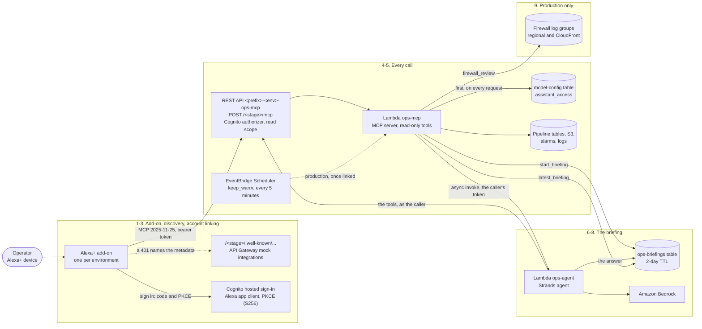

# Alexa+: the assistant by voice

How the operator's assistant is reached by voice through Alexa+: the add-on, how Alexa finds out
how to sign in and links an account, what each call goes through, which tools Alexa gets, how a
briefing reaches a voice that cannot wait for it, the firewall review in production, what is said
aloud and what is not, and the limits.

It was built for the [Amazon Build, Ship, Shape](https://amazonappdev2026.devpost.com) hackathon,
Alexa+ track. The design is [alexa-plus.md](../enhancements/archive/alexa-plus.md), with what changed as it
was built in its "As built" section. The assistant it sits on is
[alexa-plus-operator-assistant-enhancement.md](../enhancements/archive/alexa-plus-operator-assistant-enhancement.md),
and its page here is [the ops agent and its MCP server](ops-mcp-agent.md). A reader's side, "Ask
BloggerBear", was proposed first and parked:
[alexa-plus-mcp-enhancement.md](../enhancements/alexa-plus-mcp-enhancement.md).

The rule this follows: **Alexa is the voice, the Strands agent is the brain, and the ops MCP server
is the only way either of them touches the pipeline.** Alexa+ calls the same server the ask page's
agent calls, with the same tools and two more, the briefing tools, which the agent is never given.
It signs in the same users from the same user pool, through an app client of its own. The server
is read-only on the pipeline for both. Without Alexa+, the ask page's voice button speaks the same
assistant in a browser.

**Where it stands.** Everything below is built and tested in this repository. The one-time
bootstrap that links a real Alexa+ has not been run: Amazon's toolkit is US-only and gated, and the
developer account had no access ([friction.md](../friction.md#10-alexa-and-mcp-2026-10-04), 10.26).
So account linking, Alexa+ calling the server and the briefing pair are untested end to end. The
add-on is ready to link.

**In the assistant.** This page has no `feature` entry yet. Ask about its parts by name instead:
`architecture(name="ops-briefings")`, or `architecture(name="ops-mcp", kind="api")`.

Resource names below use `<prefix>` (your `unique_name_prefix`) and `<env>` (`dev` or
`production`).

## The steps

| # | Step | What happens | Where in the code / infra |
|---|---|---|---|
| 1 | **The add-on** | Amazon's Alexa+ MCP Toolkit (the `alexa-ai` CLI) publishes an add-on: a manifest that points Alexa+ at an HTTPS MCP endpoint, ours being `POST <stage URL>/mcp`. There is one per environment, `BloggerBear Ops (dev)` and `BloggerBear Ops`, each pointing at its own environment's server and signing in to its own user pool. The name never holds the word "Alexa", which Amazon allows only descriptively. A helper reads one environment's Terraform outputs, checks that every URL is https and that all of them belong to that environment, and prints them or writes the manifest from our template. | [`alexa/addon-package/addon.template.json`](../../alexa/addon-package/addon.template.json); [`scripts/alexa_addon_values.py`](../../scripts/alexa_addon_values.py) (the client secret only with `--show-secret`); the outputs `ops_mcp_url`, `ops_oauth_*` and `ops_alexa_client_*` |
| 2 | **Discovery** | Alexa+ finds out how to sign in from the server, as the MCP authorization spec (`2025-11-25`) says. A request with no token gets a 401 from API Gateway whose `WWW-Authenticate` header names the Protected Resource Metadata (RFC 9728). That names the authorization server, whose metadata (RFC 8414, also served as OpenID discovery) must list `S256` in `code_challenge_methods_supported`. Both documents are ours, static JSON from API Gateway mock integrations under the stage: no Lambda, and nothing secret. Two reasons: Cognito's own discovery document does not list `S256`, though it enforces it, and on an execute-api URL the first path segment is the stage, so the spec's root paths cannot be served. The issuer is the stage's URL; the endpoints are Cognito's hosted domain. The documents are there whether Alexa is linked or not. | [`infra/modules/ops-assistant/alexa.tf`](../../infra/modules/ops-assistant/alexa.tf) (`well_known`, and the 401's header, `www_authenticate`), which `aws_api_gateway_gateway_response.cors` in [`agent.tf`](../../infra/modules/ops-assistant/agent.tf) adds to the 401 |
| 3 | **Account linking** | Alexa+ signs the operator in on Cognito's hosted page with the authorization code grant and PKCE, through an app client of its own, `<prefix>-<env>-ops-mcp-alexa`. It exists only once Alexa's redirect URLs are set (`ops_alexa_redirect_uris`, in the environment's tracked `terraform.tfvars`). It has a client secret on top of PKCE by default (Alexa's linking sends one; `alexa_client_secret` turns it off for a toolkit that registers a public client), only the scope `bloggerbear-ops/read` (no `openid`, so no ID token), no password flow, an access token of an hour and a refresh token of 30 days (`alexa_refresh_token_days`, 1 to 90). Its own client can be revoked alone, and a linked device does not need linking again every day, as the page's one-day refresh token would make it. Production's pool requires MFA at sign-in, and so at link time. | `aws_cognito_user_pool_client.alexa` in `alexa.tf`; the `alexa_*` variables in [`variables.tf`](../../infra/modules/ops-assistant/variables.tf) |
| 4 | **The call** | Every call is `POST /<stage>/mcp` with the bearer token. API Gateway's Cognito authorizer checks the token and the read scope before anything runs. One throttle covers the whole API, the page, the agent and Alexa+ together: 5 requests a second (bursts of 10, set in each environment's root). The Lambda runs the MCP SDK's web app under uvicorn, behind the Lambda Web Adapter. The first thing it checks, on every request and never cached, is the operator's `assistant_access` switch: `open` (the default), `allowlist` or `off`; a setting it cannot read refuses, with a 403. The SDK then checks the Host header. The server is stateless and answers plain JSON: one POST, one JSON object, no session and no stream. Alexa+ speaks MCP `2025-11-25` and opens with `initialize`; the pinned SDK answers that, and `2026-07-28`, which needs no handshake. `initialize`, `notifications/initialized`, `tools/list` and `tools/call` are each answered as a request of its own. | [`main.tf`](../../infra/modules/ops-assistant/main.tf) (`<prefix>-<env>-ops-mcp`) and `run.sh`; `create_app` in [`lambdas/ops_mcp/server.py`](../../lambdas/ops_mcp/server.py); [`lambdas/ops_mcp/access.py`](../../lambdas/ops_mcp/access.py); the sequence is held by a test in [`lambdas/tests/test_ops_mcp_server.py`](../../lambdas/tests/test_ops_mcp_server.py) |
| 5 | **The tools** | Alexa+ gets every tool the server lists in its environment: the 26 every environment has (the pipeline's health, the inbox, alarms, spend, the model catalog, the logs, the vision pipeline, a topic's Findings, the Admin CLI guide, the architecture, and the assistant's own list), the two briefing tools, and `firewall_review` in production (in dev only when `OPS_FIREWALL_REVIEW_DEV` is on). Alexa+'s own model picks which to call. The server's instructions carry the same workflow the agent's prompt holds, for a client that reads only them. A tool knows who is asking from the claims API Gateway verified: the Cognito subject, the same user as on the page, so what Alexa+ is asked to watch or to leave is on that user's one list. It knows how they read from the app client: only the page's client reads a screen, so Alexa+, and a briefing it starts, are voice callers. | `build_server` and `_INSTRUCTIONS` in `server.py`; `user_id_from_headers` and `screen_caller` in [`lambdas/ops_mcp/memory.py`](../../lambdas/ops_mcp/memory.py) (`OPS_SCREEN_CLIENT_IDS`) |
| 6 | **Starting a briefing** | A briefing, the agent following leads across the tools, takes ten to twenty-five seconds. Alexa+ wants an answer in well under a second. So `start_briefing` makes one conditional write, marking a briefing as running for this user, and invokes the agent's Lambda asynchronously with the caller's own bearer token. It returns at once: "I've asked the assistant to look into it. Ask me for the briefing in about a minute." It is refused while one that started under two minutes ago is still running, and the invoke is never retried, so one start is at most one run. | `start` in [`lambdas/ops_mcp/briefings.py`](../../lambdas/ops_mcp/briefings.py); `<prefix>-<env>-ops-briefings` and both roles' rights to it in [`briefings.tf`](../../infra/modules/ops-assistant/briefings.tf) |
| 7 | **The agent's run** | The agent's handler knows the event by its `source` and by having no HTTP method and no request context: only a direct invoke can look like that. It applies `assistant_access` with no address to judge (`open` admits; `allowlist` and `off` refuse), counts the run against the user's daily questions, asks "What needs my attention?", and calls the tools with the token it was passed: as that user, and as a voice caller. It may make up to 8 tool calls and 10 model calls, a briefing's budget. It writes the answer, its tool calls and up to 20 findings, and only if its run is still the latest. It has the same 29 seconds as on the page. A failed run is never retried, and an event that has waited five minutes is dropped. Every briefing asked on the page is written to the same table, so Alexa+ can read that one back too. | `_briefing_run` in [`lambdas/ops_agent_handler.py`](../../lambdas/ops_agent_handler.py); `record` in `briefings.py`; `aws_lambda_function_event_invoke_config.ops_agent` in `briefings.tf` |
| 8 | **Reading it back** | `latest_briefing` is one read. It says the answer with its age ("That briefing was from 3 minutes ago."), or that one is still being put together, did not finish, or was never asked for. A run still marked running two minutes after it started did not finish. The table holds text a model wrote after reading logs and drafts, so it is not the memory table: the agent's role may write it but never read it, and every item expires after two days. | `latest` in `briefings.py`; `<prefix>-<env>-ops-briefings` (hash key `user_id`, TTL `expires_at`) |
| 9 | **The firewall review** | Production always; dev only when the operator turns it on. `firewall_review` says what the firewall allowed, blocked and counted in the last 1 to 72 hours (24 by default), per firewall: blocks by rule, and the most-blocked paths and addresses, against the median day of the seven before, scaled to the window. Blocks over twice that, and at least 50, are a finding. Where a firewall blocked at least 50 and one address is behind half of them or more, that address is said too, by its last part. Dev's root gives its assistant log groups only when `OPS_FIREWALL_REVIEW_DEV` is on ([configuration.md](../configuration.md#github-secrets-and-variables)), and then only dev's own regional ones. The shared CloudFront log carries both sites' visitors, so it is held to production three ways, any one enough to keep dev out: the module refuses it for an assistant without account-wide data, and the role may start a query only on the groups it is given; the function registers the tool only with groups it accepts; and it refuses a group that is neither its own environment's nor the shared one, and the shared one where it may not report account-wide data. The queries are fixed in code. It is a deep dive: the agent is never offered it on a briefing, but Alexa+ may call it when asked about the firewall. | [`lambdas/ops_mcp/firewall.py`](../../lambdas/ops_mcp/firewall.py); [`firewall.tf`](../../infra/modules/ops-assistant/firewall.tf); `waf_log_groups` in [`infra/environments/production/main.tf`](../../infra/environments/production/main.tf) and, behind `ops_firewall_review`, in [`infra/environments/dev/main.tf`](../../infra/environments/dev/main.tf) |

## What is said, and what is not

Every tool's result has `spoken`, a sentence or two to say, and the `findings` and data behind it.
The server's instructions tell any client to say `spoken` briefly; never to read a command aloud or
invent one; never to repeat anything under an `untrusted` key (text a model wrote from the web, or
a blocked request); and never to say an e-mail, a whole address, a token or a key. Alexa+ is given
the findings as data, but the cards and tables are drawn by the ask page only.

- **The vision pipeline and a topic's Findings.** `vision_status` and `topic_findings` give a voice
  caller counts, ages and reasons in fixed words. A site's name, an error's text and what a
  Finding's summary says are only in the page's "(unverified)" columns, which a voice caller is
  never sent ([ops-assistant-vision.md](../enhancements/archive/ops-assistant-vision.md)).
- **The vision evidence.** `vision_evidence` reads evidence lines that hold only codes, ids and
  numbers, so Alexa+ hears what the page shows ([vision](blogger-vision.md#asking-the-assistant)).
- **Addresses.** The log tools and `firewall_review` give an address only masked, `123.XXX.XXX.34`,
  said as "an address ending in .34". A blocked path is under `untrusted`, and never said.
- **A briefing.** Alexa+ says the agent's own answer, which its prompt keeps under about 120
  words in plain sentences, with no lists and no ids, and then its age. If the model ran out of
  turns, was cut off or repeated text from outside the project, the answer is the tools' own
  `spoken` summaries instead. Either way it has passed a sweep for personal data.

## Each environment's Alexa+

| | Dev | Production |
|---|---|---|
| The add-on | `BloggerBear Ops (dev)`, dev's MCP URL | `BloggerBear Ops`, production's MCP URL |
| Sign-in | dev's user pool, MFA optional (for the judges' shared login) | production's user pool, MFA required |
| `keep_warm` | never | on once `ops_alexa_redirect_uris` is set |
| `firewall_review` | not registered, and no right to any firewall log group | registered, where its firewall logs exist |
| The AWS bill in `spend` | not reported | reported (`account_wide_data`) |

A token from one environment's pool is refused by the other's API. Each role reads only its own
environment's resources; production's also reads what is tagged `shared`, the AWS bill and the
CloudFront firewall's log, which cover both environments
([`isolation.tf`](../../infra/modules/ops-assistant/isolation.tf)).

## Limits

- **Gated, and US only.** The toolkit needs an Amazon developer account in the US marketplace that
  Amazon has admitted to it. Two questions wait for the first link: whether Alexa+ follows the
  401's `resource_metadata` URL, and whether Cognito's hosted page accepts the RFC 8707 `resource`
  parameter Alexa may send. If it does not, the fallback is a small redirector Lambda that drops
  it; that is not built.
- **Latency.** Alexa+'s limit is about the MCP function's cold start more than anything the tools
  do. Production keeps one instance warm once it is linked: an EventBridge Scheduler invoke every
  five minutes, which the Web Adapter hands to `POST /events` (about 8,600 invocations a month).
  Like any request it reads the access switch first, then gets a 204 and nothing else; unless the
  switch is `open` it is refused, with a log line each time. Dev never does. A log read waits up to
  15 seconds for Logs Insights, which can be longer than Alexa+ waits; a briefing reads the logs in
  the background instead.
- **`allowlist` refuses Alexa+.** It calls from Amazon's addresses, not the operator's, so
  `assistant_access` must be `open`, or unset. Open still needs a token from this environment's
  pool with the read scope. `off` stops everything, Alexa+ included.
- **A briefing's cost is bounded.** One at a time per user, and each run counts against the user's
  daily questions (100 by default, `agent_daily_question_cap`), the same count as the page's,
  kept in the briefings table ([`ops_agent/quota.py`](../../lambdas/ops_agent/quota.py)). Each run
  makes at most 8 tool calls and 10 model calls, and its cost goes on the week's Stats row. A
  briefing the agent cannot finish in its 29 seconds is reported as not finished. A tool Alexa+
  calls itself runs no model of ours (the MCP server's role cannot call Bedrock), and is bounded by
  the stage's throttle.
- **Read-only.** A linked device can hear about the pipeline, not change it. The only things
  Alexa+ can write are the user's own list of suggestions and watches, and a briefing, by
  starting one.
- **A device in a room speaks.** Anyone near a linked device hears the answers, and anyone who can
  talk to it can ask. Link only devices in places you control.

## Setting it up

The one-time bootstrap, per environment, by a person on their own machine, is
[alexa/README.md](../../alexa/README.md): read the outputs, link in two halves (Alexa's redirect
URLs first, then the client, then the rest of linking), check `assistant_access`, write the
manifest, deploy and test. Nothing in it runs in CI. Unlinking and revoking are there too: unlink
in the Alexa app, sign the user out everywhere, or remove the Alexa client by setting
`ops_alexa_redirect_uris` back to empty.

## Checking it

Alexa+'s calls go to the function's log, `/aws/lambda/<prefix>-<env>-ops-mcp`, and the stage's
access log, `/aws/apigateway/<prefix>-<env>-ops-mcp-access` (one line per request). Neither says
who called or from which app client, so Alexa+'s requests look the same as the page agent's. A
request the switch refused is one line, `ops_access: ops_mcp request refused (<reason>)`; the
caller gets the same 403 whatever the reason. Each background briefing is one line in
`/aws/lambda/<prefix>-<env>-ops-agent`: how many tool calls and findings it had and whether it was
written, or why it was refused or failed. The token is never logged. The assistant reads these
itself, through Alexa+ or the page: `api_errors` with `api` "assistant", `log_review` with
`function` "ops-mcp" or "ops-agent", and `investigate("assistant")` for where to look.
