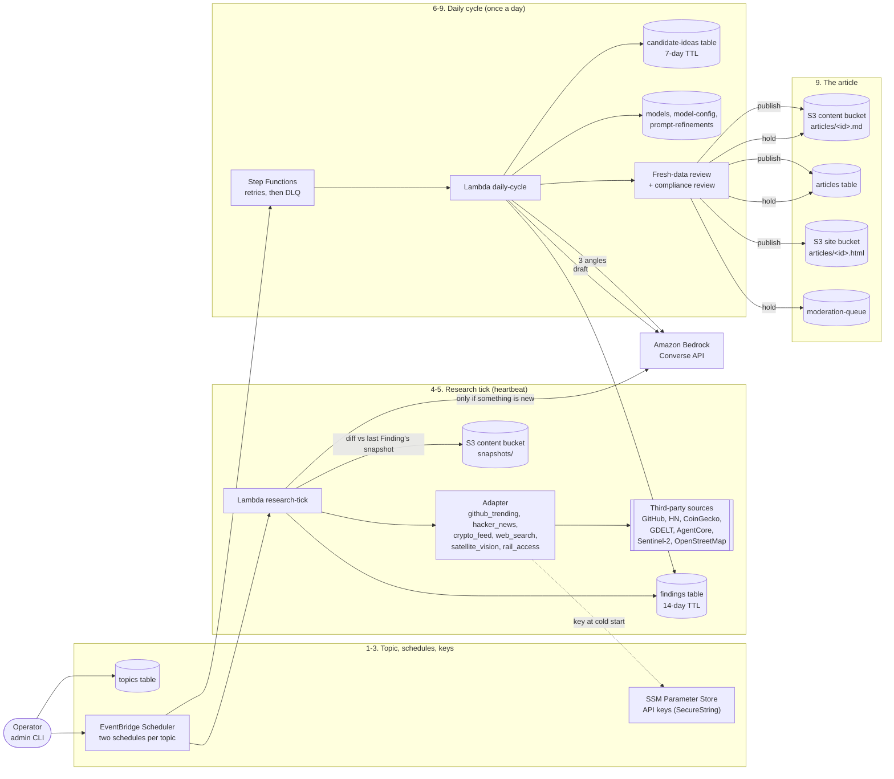

# Article research

How a topic's data source becomes a published article: where the adapters, the third-party API
keys, the Lambdas, the findings and the candidate ideas each come in, how they end up as an
article in S3, and where the AI agents fit.

The operator's assistant explains the same thing, with this environment's resource names on
screen. Ask it "how is an article researched?" (it calls `architecture` with `feature`
`article-research`). The rules this follows are in the [project plan](../project-plan.md#2-hard-constraints):
research is diff-first, nothing is published without a review, a financial topic's article is
never published when it is drafted, and new sources are added as adapters.

Resource names below use `<prefix>` (your `unique_name_prefix`) and `<env>` (`dev` or
`production`).

## The steps

| # | Step | What happens | Where in the code / infra |
|---|---|---|---|
| 1 | **Topic and adapter** | A topic is a row of settings created with the admin CLI: which adapter reads its source and with which `adapter_config` ([the keys](../configuration.md#adapter-settings)), how often to research, its editorial goals, its model ([which model a call uses](../models.md#which-model-a-call-uses)) and review mode. The adapter is the only code that knows anything about the source. | `topics` table; `lambdas/common/adapters/` (`base.py` is the contract, `registry.py` maps names to classes) |
| 2 | **Schedules** | Creating a topic creates two EventBridge Scheduler schedules: a research heartbeat (`research_cadence`, every hour by default), which invokes the research tick, and the daily cycle at its time and timezone, which starts the daily cycle's state machine. The heartbeat is not the research interval: each tick decides for itself whether the topic is due (step 4). Each topic has a slot in the stagger (`stagger_slot`), so the heartbeat runs at the slot's minute past the hour (slot 1 at :05, slot 2 at :10) and the daily cycle after every topic's heartbeat, one slot apart; the schedules as written are on the row, and `topics schedule` lists them. A paused topic's schedules are disabled. Topics are runtime data, not Terraform. | `lambdas/common/scheduler.py` and `common/stagger.py`, called by `admin_api_handler.py`; `<prefix>-<env>-<topic_id>-research-tick` / `-daily-cycle` |
| 3 | **Third-party sources and their keys** | API keys are SecureStrings in SSM Parameter Store. Terraform sets an environment variable that holds each parameter's *name*, and the Lambda reads the value at cold start. Keys are never in code, tables or logs. Both keys are optional. News search uses GDELT, which needs no key, and falls back to Bedrock AgentCore web search, which the Lambda's IAM role authorises. The vision topics' sources need no key either: Sentinel-2 scenes through the Earth Search STAC API and the public `sentinel-cogs` bucket (`satellite_vision`, `rail_access`), and OpenStreetMap's rail lines and stations through the Overpass API (`rail_access`); their measuring is done by the vision worker ([vision](blogger-vision.md)). | `COINGECKO_API_KEY_PARAMETER` (`crypto_feed.py`), `GITHUB_API_TOKEN_PARAMETER` (`github_trending.py`), `lambdas/common/web_search.py`, `lambdas/common/vision_sites.py`, `lambdas/common/osm.py`; [how to store a key](../deployment-runsheet.md#api-keys-for-the-data-sources) |
| 4 | **Research tick: diff first** | If the topic is due and not paused, the adapter fetches its source and `material_diff` compares what came back with what the topic has already reported. If nothing is new, the tick returns `no_change` and no model is called ([in detail](#4-research-tick-diff-first)). | `lambdas/research_tick_handler.py` (`_not_due`, `_merge_seen`); `lambdas/common/research_schedule.py`; `Adapter.known_keys` in `common/adapters/base.py` |
| 5 | **Findings** | Bedrock summarises only what is new. The tick then stores the raw snapshot and a Finding that holds the summary ([in detail](#5-findings)). | `lambdas/research_tick_handler.py` (`_build_prompt`); `common/editorial_resolver.py`, `common/relevance.py`; `<prefix>-<env>-content` bucket, `snapshots/<topic_id>/<captured_at>.json` (expires after 21 days); `<prefix>-<env>-findings` (expires after 14 days); `GET /topics/{topic_id}/findings` |
| 6 | **Candidate ideas** | Once a day, the daily cycle reads the topic's Findings since its last article, within its findings window. Bedrock is asked for three angles, which are stored as candidate ideas, and the first is selected ([in detail](#6-candidate-ideas)). | `lambdas/daily_cycle_handler.py` (`_run_daily_cycle`, `_select_goal_and_findings`, `_pick_rotation_goal`, `_ideate`); `common/findings_window.py`, `common/editorial_goals.py`, `common/goal_rotation.py`; `<prefix>-<env>-daily-cycle` state machine; `<prefix>-<env>-candidate-ideas` (expires after 7 days) |
| 7 | **Drafting** | Bedrock drafts the article from the selected angle and the Findings' summaries, with the topic's model. The title is a separate call, made from the angle alone ([in detail](#7-drafting)). | `lambdas/daily_cycle_handler.py` (`_draft_article`, `_draft_title`); `lambdas/common/model_routing.py`, `equipment.py`, `compliance.py`; `models`, `model-config`, `prompt-refinements` tables |
| 8 | **Reviews** | A fresh-data review checks the draft against the source's data as it is now, then a compliance review checks it for PII, fabricated claims and investment advice. Either can hold the article, and a financial topic's article is always held ([in detail](#8-reviews)). | `lambdas/common/fresh_review.py` (`run_review`, `enforcement_action`, `run_revision`), `lambdas/common/compliance.py` (`review_draft`, `invented_figures`); `daily_cycle_handler.py` (`_run_fresh_review`, `_enforce_review`) |
| 9 | **The article in S3** | The body is written to the content bucket, and the article's row records its lineage, cost and review. A published article gets a static page in the site bucket; a held one waits in the moderation queue ([in detail](#9-the-article-in-s3)). | `daily_cycle_handler.py` (`_publish_or_moderate`, `_record_article_written`); `articles/<id>.md` (and `articles/<id>.original.md`) in the content bucket; `articles` table; `articles/<id>.html` in the site bucket (`common/static_pages.py`); `common/musings.py`; `moderation-queue`; `common/reviewer.py`; `stats-current` |

## The steps in detail

Steps 1 to 3 are all in the table. These are steps 4 to 9 in full.

### 4. Research tick: diff first

A paused topic (`topics pause`) stops here: nothing is fetched until it is resumed.

So does a topic that is not due (`not_due`). A tick does work only once the topic's research
interval has passed since the topic was last checked, less 5 minutes for scheduler jitter. That
interval is `research_interval_hours`: the topic's own, else the pipeline-wide one, else 1 hour. A
manual `topics trigger --pipeline research_tick` always skips that check.

Otherwise the adapter fetches the source, and a fetch that answers stamps the topic's
`last_research_at`; one that fails stamps nothing, so the next heartbeat tries again.

`material_diff` then compares what came back with the snapshot of the topic's last Finding, not
with the last fetch. The vision adapters are the exception. They set `keeps_running_state`, so they
compare with their running state: the state saved by their last tick, whether or not that tick
found anything (a tick that fails saves nothing). They use the last Finding's snapshot only when
there is no running state yet, or it has expired with the snapshots.

"New" means new to the topic: every stored snapshot carries the items already reported (`_seen`,
from the adapter's `item_keys`, each kept 7 days, at most 2,000), so an item that drops out of a
feed and comes back is not reported again. If nothing is new, the tick returns `no_change`: no
model is called, and no snapshot or Finding is stored (a vision adapter still saves its running
state).

### 5. Findings

Bedrock summarises only what is new. The prompt carries the topic's editorial goal (its own
`editorial_goals.primary_focus`, else its adapter's default, else a global one, with its
`exclusion_criteria` on top) and a relevance rule keyed to the topic's name; an adapter may supply
its own prompt instead (`build_summary_prompt`, as the crypto feed does). Only once the summary is
back is the raw snapshot stored, so a summary call that fails stores nothing, and the next due tick
reports the same change again.

The Finding then holds the summary, where its snapshot is (`raw_snapshot_s3_key`), its source
references, the summary call's model and tokens (`research_call`, counted into the article it later
feeds), and, when the adapter gives any, its `figures`, `planner_notes` and `subjects`.

To look at a topic's Findings: ask the assistant ("what did research find for X?",
`topic_findings`), run `python scripts/admin_cli.py findings list <topic_id>` (with
`--next-article` for what the next article reads), or use the `topic-findings` Claude Code skill.

### 6. Candidate ideas

Once a day, the schedule starts the daily cycle's state machine, which runs the daily-cycle Lambda
(for retries, see [below](#runs-that-write-nothing-and-runs-that-fail)).

The cycle reads the topic's Findings since its last article (`last_article_at`), within three
limits:

- never from further back than its findings window (`findings_window_hours`, 24 hours by default,
  at most 336)
- at most 48 Findings, newest first
- at most 40,000 characters of their summaries, the oldest dropped first

A manual `topics trigger --pipeline daily_cycle --force` ignores the last article and reads the
whole window. With nothing in the window, the run stops with `no_findings` before any model call.

Three kinds of topic narrow what they read:

- A crypto topic writes under the day's editorial goal (one of four, drawn from the UTC date, or
  pinned with `adapter_config.editorial_goal`) and keeps only the Findings captured that UTC day;
  with none from today, it follows the newest Finding's day and that day's goal.
- A topic whose adapter rotates through several subjects (one city a day or a week;
  `Adapter.day_subject`, `common/day_subject.py`) writes about the day's subject only: it reads from
  that subject's last article, keeps the findings that report it (`subjects` on the Finding), and
  stops before any model call if there are none.
- A topic with a goal rotation (`editorial_goal_rotation`) takes its goals in turn and does not stop
  when nothing is new: it revisits its last set of Findings under a goal not yet used on them, and
  stops with `no_findings` only when there is no set to revisit, every goal has had it, or its
  Findings have expired ([the setting](../configuration.md#dynamodb-settings-changed-with-no-deploy)).

Bedrock is then asked for three angles, under the topic's editorial goal. For a goal-rotation
topic, the picked goal's focus stands in for the topic's own. For a crypto or rotating-subject
topic, the day's goal or the day's subject adds its own mandate on top.

The relevance rule is not step 5's. Ideation has its own, also keyed to the topic's name
(`ideation_relevance_rule` in `common/relevance.py`), and `MANDATE_ALIGNMENT_RULE`
(`common/editorial_resolver.py`) holds every angle to that goal.

Bedrock is also shown the topic's last five published titles, so a story already told is not told
again. The angles are stored as candidate ideas and the first is selected. A reply with no usable angle in it
(a refusal, or no text at all) ends the run with `no_usable_angles`, and the topic's model may move
on ([rotation](../models.md#rotation-trying-several-models)).

### 7. Drafting

Bedrock drafts the article from the selected angle and the Findings' summaries, with the topic's
model from the model registry ([which model](../models.md#which-model-a-call-uses)). The draft's
prompt also folds in:

- the topic's editorial goal and a relevance boundary
- the day's article style, for a crypto or rotating topic
- the topic's approved prompt refinements (the bear's gear, `equipment.py`)
- an excerpt of a top-voted past article
- financial guidance, where it applies
- what the topic's adapter says its articles must always do (`figure_guidance` and
  `drafting_guidance`); for the crypto feed, that means approximate figures and a closing "At a
  glance" table and "Key takeaways"

The title is a separate call, made after the body, from the angle alone: it never sees the article.
It must be one line of at most 20 words, not a refusal or a request for clarification; it is
retried once, and if it still fails the article is held (step 8). A draft cut off at its token
limit, after one retry with more room, is held too.

### 8. Reviews

The fresh-data review runs first: the adapter re-reads its source (`review_evidence`), and a model
is asked which claims in the title and body that fresh data shows to be stale, contradicted or
unsupported. What happens next depends on the mode ([the modes](../../scripts/README.md#usage)):

- `off` skips the review.
- `shadow`, the default, only records the result.
- `enforce` acts on it. Minor problems get one revision pass, which plain code checks: no new
  figure or link, about the same length, the same number of headings. A major problem, or a
  revision that fails those checks, holds the article. So does a review that could not run, unless
  `review_on_unavailable` is `note`.

Next, a financial topic's draft gets its standing "not financial advice" disclaimer, appended in
code.

Then the compliance review: the model only nominates items (PII, a fabricated claim, investment
advice), each with a quote from the draft, and code decides which of them hold the article. Code
also holds the article for any figure over 20, other than a year, that is not within 3% of any
figure in the Findings' summaries.

The review, both the model and those code checks, sees only the first 12,000 characters of the
summaries (the newest Findings), while the draft is written from up to 40,000. So in a busy window,
a real figure or claim the draft took from an older Finding can hold the article
([a proposed fix](../enhancements/topic-token-limit-and-proof-of-work.md)).

A financial topic makes no compliance call at all: its article is always held. So is an
article with a hold reason from earlier (a truncated draft, a title that is not one, the
fresh-data review), and every article of a topic with `force_manual_review` (the vision topics),
whose compliance review still runs and is recorded.

### 9. The article in S3

The body is written to the content bucket; when an enforced review's revision replaced it, the
original is kept beside it. The article's row records its lineage, tokens and cost, its review, the
gear it was written with, its source credit and its figures, and the week's totals go to the Stats
tables.

Every model call an article is written from goes through `lambdas/common/bedrock.py`. Its
`invoke_model_tracked` returns each call's text, its canonical model id and its tokens, and records
nothing itself. `common/costing.py` turns those tokens into a cost: `build_lineage` prices the
article's own calls, and `build_research_lineage` prices the `research_call` stored on the Findings
behind it (both through `calculate_lineage_cost_aud`). The lineage is stored on the article's row,
and `common/stats_tracking.record_article_lineage` adds its cost to the week's Stats totals. That is
how each article's lineage, and the public Stats page, know what an article cost. The vision topics'
triage agent (`common/vision_triage.py`) is the exception: it calls Converse through bedrock.py's
client, counts its own tokens, and records them on the Stats page under `vision_triage`
(`record_model_usage`), not on an article. Which model a call uses, and its fallback, is in
[models](../models.md).

A published article also gets a static page in the site bucket and a musing; the page says it was
checked against current data only when the review was enforced (`common/fact_check.py`). A held
article waits in the moderation queue with its reasons, for a person (`admin_cli approve`) or for
the reviewer bear: once it has waited 48 hours he may read it and approve it himself, and a
financial article he approves is flagged for a person to check. A topic with `force_manual_review`
always waits for a person, as does one he may not approve for (`reviewer_may_approve`,
`may_approve`; [the reviewer bear](../configuration.md#the-reviewer-bear-professor-grizzlewick)).

Published or held, the topic's `last_article_at` (and, for a rotating topic, the day's subject's
stamp) is set to the run's start, so the next window begins there, and the Stats page's Articles
figures are rebuilt.

## Runs that write nothing, and runs that fail

A research tick returns `paused`, `not_due`, `no_change` or `material_change`; only the last writes
a Finding. A daily cycle that writes no article returns `paused`, `no_findings` or
`no_usable_angles`: it stores no article and stamps no `last_article_at`, so the next run still
reads from the last article, within its findings window.

Neither handler raises: each catches its own errors and returns `"status": "error"` with the
reason. What happens next depends on how the run started:

- **A research tick.** Its schedule invokes it directly, so a failed tick is tried again at a later
  heartbeat.
- **A daily cycle from its schedule.** The state machine counts only a timeout (the Lambda has 300
  seconds) or a crash as a failed invocation. It retries a failed invocation twice (after 30
  seconds, then 60) and then sends it to the pipeline dead-letter queue, which
  `admin_cli failed-executions list` shows. To Step Functions a caught error is a successful
  invocation: it is not retried and never reaches the queue. It shows in the execution's output,
  and the guard also prints it to the daily-cycle log (`run failed for topic_id=...`).
- **A daily cycle from `topics trigger --pipeline daily_cycle`.** This invokes the Lambda directly,
  without the state machine, so a failure there never reaches the queue and leaves no
  FailedExecutions record.

A daily cycle that fails after it has stored the article (its static page, its musing or its
moderation item) has still stamped `last_article_at`, and its goal rotation's state: both are set
the moment the article's row is written (`on_stored` in `_publish_or_moderate`). So the next day's
run does not write up the same Findings again, and nor does a retry after a timeout, with two
exceptions:

- A topic with a goal rotation may revisit those Findings at once under its next goal, as it
  would on a later day.
- A `--force` run ignores the stamp. A manual trigger is an asynchronous Lambda invoke, which
  Lambda retries on a timeout (twice, by default), so a forced run that times out after storing
  its article can write up its whole window again.

The run's result names the stored article (`article_id`, with `article_stored: true`), the
daily-cycle log says `article_id=... was stored, then a later step failed`, and the Stats page's
Articles figures are rebuilt as for any article. A held article whose moderation item could not
be written is not in the review inbox: find it with `admin_cli articles get <article_id>`.

## Where the AI agents are

None of the model calls above is an agent. Each one is a single Bedrock Converse request made by a
Lambda: a summary, three angles, a draft, a title, the reviews and a revision. The pipeline
decides what happens next in code, not by asking a model, which is why rules like "diff first"
and "a financial article is never published when it is drafted" cannot be talked around.

There are two agents. The **operator's assistant** is a Strands agent (`<prefix>-<env>-ops-agent`)
that calls the MCP server's read-only tools (`<prefix>-<env>-ops-mcp`). Those tools read the same
topics, findings, candidate ideas and articles described here. They report what needs attention
and suggest admin CLI commands, but change nothing. The **vision triage agent** runs inside a
vision topic's research tick (step 4), only after a measured change has passed its thresholds: it
looks at the worker's figure, may re-measure or check the news with a few bounded tools, and
answers "real" or "artefact"; anything unsure is an artefact, and no Finding is written. Its page
is [vision](blogger-vision.md).

## Adding a source

A new source is a new adapter, registered in `registry.py`:

- It implements `fetch_state`, `material_diff` and `source_refs`, and declares the `sources` it
  credits.
- If its source is made of items, give it `item_keys` too, and in `material_diff` count an item as
  new only when its key is not in `self.known_keys(old_state)`. The tick stores the seen-set
  (step 4) from `item_keys`, but only that check in `material_diff` reads it. Without both,
  `material_diff` has only the last Finding's snapshot to compare against, and an item that drops
  out of the feed and comes back is reported again.
- Each source it credits must also be in the "Data sources" list on `frontend/about.html`, with
  the same sentence and link. `lambdas/tests/test_attribution.py` fails for an adapter with no
  `sources`, and for a source the About page does not name.
- If it needs a key, the key goes in a new SSM parameter whose name Terraform passes to the
  function.

Nothing in steps 4 to 9 changes. See "Adding an adapter" in
[docs/project-plan.md](../project-plan.md) §6.
