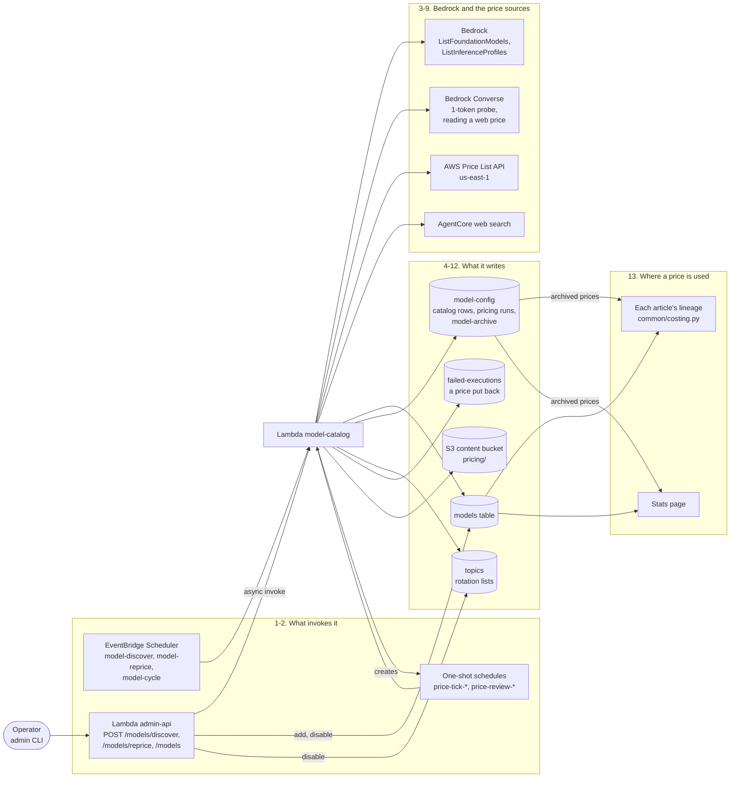

# The model catalog: discovery, prices and the model fleet

How the Models registry keeps itself current: one Lambda that finds the models the account can
call, looks their prices up again, puts a doubtful price back, keeps the registry under its cap,
and keeps the topics' model rotations working. This page follows that work across the layers:
the schedules and the admin API that start it, Bedrock and the two price sources it reads, the
rows it writes, and where a price ends up being used.

It exists because the registry is what every article's cost and the Stats page are priced from,
and what rotation and routing choose among. Filled only by hand, a price goes stale without
anyone noticing, and a new model is never tried. The catalog does that work with the project's
rules: it is diff-first, it never puts a model in use by itself (a discovered model starts
switched off), it puts a price back when it is not confident, it spreads its calls out instead of
firing them in a burst, and you can pause each job or change its limits with no deploy.

The operator's side is [models.md](../models.md): which model a call uses, rotation, every
setting with its default, the commands, and what to do when something looks wrong. The two
environment variables are in [configuration.md](../configuration.md#the-model-catalogs-environment-variables),
and each command's options in [scripts/README.md](../../scripts/README.md#usage). The reasons
behind the design, including the throttling after its first run in dev, are in the archived
design, [model-catalog-refresh.md](../enhancements/archive/model-catalog-refresh.md). This page
does not repeat them.

**In the assistant.** There is no step-by-step walkthrough of this feature (no
`architecture(feature=...)` entry). Ask about its parts by name instead:
`architecture(name="model-catalog")` for the Lambda, or the same call with `name` set to
`"models"`, `"model-config"`, `"failed-executions"` or `"content"`. These help too:

- `model_catalog` says whether each of the three jobs is paused, what each last did, and the
  pricing run under way, with how many models it has left or when its next check is. Model ids
  are on screen only, never spoken.
- `pipeline_health` adds a `model_pricing_reverted` finding for each review that put prices back in
  the last 7 days, and suggests `models reprice`.
- `cli_guides(topic="model-prices")` puts the catalog's commands on screen, each with a suggested
  command under it.

Resource names below use `<prefix>` (your `unique_name_prefix`) and `<env>` (`dev` or
`production`).

## Contents

- [The steps](#the-steps)
- [What invokes it](#what-invokes-it)
- [Discover](#discover)
- [Reprice](#reprice)
- [The reviews](#the-reviews)
- [One run at a time, and what cannot hold it up](#one-run-at-a-time-and-what-cannot-hold-it-up)
- [The weekly cycle](#the-weekly-cycle)
- [Disabling a model in use](#disabling-a-model-in-use)
- [Routing around an inactive model](#routing-around-an-inactive-model)
- [How a price is used](#how-a-price-is-used)
- [Where state lives](#where-state-lives)
- [Permissions](#permissions)
- [Where in the code](#where-in-the-code)
- [Design history](#design-history)



## The steps

| # | Step | What happens | Where in the code / infra |
|---|---|---|---|
| 1 | **What invokes it** | Three fixed schedules start its jobs: discover and reprice every second day, the rotation cycle on Fridays. The admin API starts discover or reprice on demand, and a pricing run starts its own ticks and reviews on one-shot schedules ([in detail](#what-invokes-it)). | `lambdas/model_catalog_handler.py`; `handle` in `lambdas/common/model_catalog.py`; `aws_scheduler_schedule.model_catalog_discover`, `_reprice` and `_cycle` in each environment's `main.tf`; `_start_model_catalog_job` in `lambdas/admin_api_handler.py` |
| 2 | **Catch up first** | Before any job, a pricing run whose next tick or review is more than 30 minutes late is run on the spot, and a run slot left by a run that died is freed ([in detail](#one-run-at-a-time-and-what-cannot-hold-it-up)). | `settle_overdue`, `is_overdue`, `_release_orphaned_slot` in `model_catalog.py` |
| 3 | **Discover: list** | Bedrock is asked for every active model and system inference profile in the region, from every provider. Models the registry has, pruned ones and recently denied ones are left out ([in detail](#listing)). | `account_models`, `discover` in `model_catalog.py`; `ModelCatalogRead` in the Lambda role |
| 4 | **Discover: probe, then add** | Each new text model is called once for one token. One the account cannot call is not added and not tried again for 30 days; up to 5 others are added, switched off and unpriced ([in detail](#the-access-probe-and-adding)). | `probe_access`, `recently_denied`, `recheck_access` in `model_catalog.py`; `add_model_if_missing` in `lambdas/common/dynamo.py` |
| 5 | **Discover when full: prune** | Once the registry holds `max_models`, discover lists nothing and removes models instead, never one in use. Each pruned model's price is archived first ([in detail](#pruning-once-the-registry-is-full)). | `prune`, `prune_order`, `protected_models` in `lambdas/common/model_fleet.py`; `archive_models` in `dynamo.py` |
| 6 | **Reprice: the queue and its ticks** | Reprice claims the one run slot and queues up to 50 models, the one looked up longest ago first. It checks 5 at once, then 5 more on a one-shot schedule 5 minutes later, until the queue is empty ([in detail](#the-queue-and-its-ticks)). | `queue_order`, `reprice`, `advance`, `schedule_tick` in `model_catalog.py`; `<prefix>-<env>-price-tick-*` schedules |
| 7 | **Reprice: looking a price up** | The AWS Price List first, with no model call; then an AgentCore web search read by a model, skipped when the results are the same as last time ([in detail](#where-a-price-comes-from)). | `PriceList`, `WebPrices`, `PriceLookup` in `model_catalog.py`; `AgentCoreProvider` in `lambdas/common/web_search.py` |
| 8 | **A changed price applies at once** | A price that differs is written to the model's row straight away and recorded on the run with the old one, so it is on probation ([in detail](#applying-a-changed-price)). | `price_models` and `set_model_fields`; the `pricing-run#<run id>` row of `<prefix>-<env>-model-config` |
| 9 | **The reviews** | 1 and 2 hours after the queue is done (by default), each changed price is looked up again on its own and checked. One that fails goes back to its old price at once, and each review that put a price back writes one row to FailedExecutions as it ends ([in detail](#the-reviews)). | `schedule_reviews`, `review`, `_review_tick`, `_check`, `_revert`, `_end_pass`, `_record_failure` in `model_catalog.py`; `<prefix>-<env>-price-review-*` schedules; `<prefix>-<env>-failed-executions` |
| 10 | **The run closes** | A price put back quietly at the last review, because every lookup of it errored, gets no FailedExecutions row. The old prices of the models that kept their new one go to the content bucket, and the run slot is freed ([in detail](#put-back-or-kept)). | `_end_pass`, `_finalise`, `write_snapshot` in `model_catalog.py`; `pricing/` in `<prefix>-<env>-content` |
| 11 | **The weekly cycle** | Every topic with a rotation list loses the models that are switched off or that the account cannot call, and gains one new model while it has room ([in detail](#the-weekly-cycle)). | `cycle`, `rotation_picks` in `model_fleet.py` |
| 12 | **Disabling a model, and routing around one** | Disabling a model takes it out of every topic and the shared pool at once. A call whose topic still names a switched-off model is routed to another ([in detail](#disabling-a-model-in-use)). | `_put_model` in `admin_api_handler.py`; `deactivated`, `application_roles` in `model_fleet.py`; `_route_around` in `lambdas/common/model_routing.py` |
| 13 | **Where a price is used** | Each article's cost is worked out from its calls' tokens once, when it is written; the Stats page works every call out again each time it is rebuilt ([in detail](#how-a-price-is-used)). | `pricing_for`, `calculate_lineage_cost_aud` in `lambdas/common/costing.py`; `build_stats` in `lambdas/common/stats.py`; `list_priced_models` in `dynamo.py` |

## What invokes it

One Lambda, `<prefix>-<env>-model-catalog`, is started five ways:

| What invokes it | Event | What it does |
|---|---|---|
| `<prefix>-<env>-model-discover`, `cron(0 2 1/2 * ? *)` Australia/Sydney | `{"job": "discover", "trigger": "schedule"}` | Discover, unless `discover_enabled` is `false` |
| `<prefix>-<env>-model-reprice`, `cron(0 3 1/2 * ? *)` Australia/Sydney | `{"job": "reprice", "trigger": "schedule"}` | Reprice, unless `reprice_enabled` is `false` |
| `<prefix>-<env>-model-cycle`, `cron(0 4 ? * FRI *)` Australia/Sydney | `{"job": "cycle", "trigger": "schedule"}` | The rotation cycle, unless `cycle_enabled` is `false` |
| `POST /models/discover` and `POST /models/reprice` (`models discover`, `models reprice`) | `{"job": ...}` | That job now, even when it is paused |
| A run's own one-shot schedules | `{"job": "tick", ...}` or `{"job": "review", "run_id": ...}` | The next tick of a run's queue, or its next review |

The first two run on odd days of the month, the closest EventBridge cron comes to every second
day, so the 31st and the 1st run back to back. Their times are in Terraform, not settings: to move
them, change each environment's `main.tf`.

The admin API invokes the Lambda asynchronously and answers `202` at once, because a reprice can
take far longer than API Gateway's 29 seconds. It refuses `models reprice` with `409` while a
pricing run is under way, unless that run's next step is overdue. The cycle has no route of its
own: it runs only on its schedule.

A pause flag stops only its job's scheduled run. The ticks and reviews of a run that has already
started still run, so pausing reprice never leaves an applied price unchecked while their
schedules fire (a lost one waits for the next job that runs, see
[what cannot hold it up](#one-run-at-a-time-and-what-cannot-hold-it-up)). The settings are
the `model-catalog` row of `<prefix>-<env>-model-config`, read on every invocation; a setting that
is unset or invalid takes its default ([the settings](../models.md#settings)).

The handler never raises. It logs the real error to `/aws/lambda/<prefix>-<env>-model-catalog` and
returns `"status": "error"`, so the function's errors alarm sees only a timeout (it has 600
seconds) or a crash.

## Discover

### Listing

Discover first counts the registry. If it already holds `max_models` (50), discover skips the
listing and prunes instead ([below](#pruning-once-the-registry-is-full)).

Otherwise it asks Bedrock in the deployment's region for:

- every foundation model whose lifecycle is `ACTIVE` and that can be called on demand
  (`ListFoundationModels`);
- every system-defined inference profile (`au.`, `apac.`, `global.`, ...) that is active and
  routes to an active foundation model (`ListInferenceProfiles`).

Each comes back shaped as a registry row: its id, the model's name and provider (for a profile,
its base model's), and a `pricing_unit` of `tokens` for a model that writes text, or `other` for
an image, video, speech or embedding model. Only `tokens` models are ever priced.

Left out are the models the registry already has, the ones the fleet pruned (the `model-archive`
row) and the ones a probe found denied in the last 30 days. What is left is sorted text models
first, then by id.

### The access probe and adding

Being listed does not mean the account can call a model: access may never have been granted, or a
provider's agreement or use-case form not accepted. So before it adds a text model, discover
makes one Converse call with a one-token limit (`probe_access`). That is how the pipeline calls
every text model, so a model that answers is usable. The probe's tokens are counted on the Stats
page under Model pricing.

| The probe | Result | What happens |
|---|---|---|
| Answers | `access: granted` | Added |
| `AccessDeniedException`, `ResourceNotFoundException` or `ValidationException` | denied | Not added. Kept in the `model-access-denied` row, and not probed or added again for 30 days |
| Any other error (throttling, an outage, a timeout) | `access: unknown` | Added, and probed again on a later run |

Discover adds at most `discover_max_added` (5), and never more than the registry has room for.
Each is written only if no row has its id yet, with `enabled: false`, no price, the region and
`discovered_at`: discovery never puts a model in use. An image, video, speech or embedding model is
added without a probe.

Probes come out of `access_checks_per_run` (10). When they run out, adding stops at the next text
model, so the models after it wait for the next run too. The probes left over re-check registry
text models whose access is not known to be granted: never checked first, then unknown, then
denied, the longest ago first in each group. Each probe writes `access`, `access_checked_at` and
any `access_error` on the row. A full registry still makes these re-checks.

### Pruning, once the registry is full

`model_fleet.prune` removes models until the next discover has room again: down to
`max_models` less `discover_max_added` (45 by default), at most `prune_max_per_run` (20) in one
run. It takes them in this order:

1. models a probe found the account cannot call;
2. switched-off models before active ones;
3. unpriced models, which includes every image, video, speech and embedding model;
4. then by `prune_mode`: `value_for_money` removes the most expensive (input plus output price per
   1,000 tokens), `frontier` the cheapest.

It never removes a model in use. Protected, by canonical id:

- the application's default and fallback: the `default` row of `model-config`, and
  `BEDROCK_MODEL_ID`;
- every topic's `model_id`, `fallback_model_id` and `model_id_candidates`;
- every model in the shared rotation pool (the `model-rotation` row);
- any row with `price_locked`.

A run that cannot reach its target because of that says so (`short_by`).

Before a model's row is deleted, its name, provider and prices go into the `model-archive` row
of `model-config`, which nothing prunes. The articles that used it keep their cost (step 13), and
discover never adds it back. `models add` does, by hand.

## Reprice

### The queue and its ticks

Reprice takes every model that is token-priced (a row with no `pricing_unit` counts) and not
`price_locked`, enabled or not, and sorts them by when they were last looked up
(`price_attempted_at`, else `price_checked_at`). A model never looked up, such as one discover just
added, comes first. The first `reprice_max_queued` (50) become the queue, so runs that each check
only some of the models still reach every one in turn.

It then claims the one run slot (`active_run_id` on the `model-catalog-state` row, set only if it
is empty) and writes a new `pricing-run#<run id>` row. The run id is the start time in UTC and six
random hex digits. With nothing to price it stops before claiming (`nothing_to_price`); with the
slot taken it stops with `review_pending` ([below](#one-run-at-a-time-and-what-cannot-hold-it-up)).

The queue is worked through by **ticks**. Each tick checks the next 5 models (`CHECKS_PER_TICK`)
and, while any are left, saves the run and creates a one-shot schedule for the next tick 5 minutes
later (`TICK_MINUTES`). The first tick runs in the invocation that started the run. So a full
queue of 50 is 10 ticks, about 45 minutes.

Each tick's schedule is `<prefix>-<env>-price-tick-<run id>-<pass>-<n>`, where the pass is `p`
for pricing or `r<n>` for a review. It fires `at()` a time in UTC, invokes the Lambda's own ARN
through the scheduler role, and deletes itself once it has fired. A tick that fires for a pass that
has moved on does nothing (`stale`), and so does one more than a minute early (`not_due`).

### Where a price comes from

Each model is looked up in two sources, in order. A source that cannot price it leaves it as it
is.

1. **The AWS Price List API.** `GetProducts` through the us-east-1 endpoint, filtered to the
   deployment's region, read once per tick. Bedrock's prices are read under three service codes
   (`AmazonBedrock`, `AmazonBedrockFoundationModels` and `AmazonBedrockService`); one that does
   not exist reads as nothing.
   - Only the plain on-demand input and output token prices are read. Batch, cached,
     provisioned, latency-optimised, priority, flex, reserved, custom, training, storage and
     long-context prices are left out.
   - A product is matched to a row by its model name against the row's `display_name`, ignoring
     case, spaces and punctuation.
   - A price per million tokens is turned into one per 1,000.
   - A model that matches more than one price for a side is not priced from here: a wrong price is
     worse than none.
2. **The web.** The AgentCore web search gateway is asked for the model's Bedrock price (up to 8
   results, from the last year), and a model reads the results.
   - The model is the global default (`resolve_model` with no topic), with no fallback. It is told
     the results are untrusted text, and answers in JSON only, with a price per million tokens for
     each side, or `null` for one the results do not state for that exact model. A `null` on
     either side, or a price of zero or less, is no web price, and so is anything else: like the
     Price List, the web prices both sides or neither.
   - Its tokens are counted on the Stats page under Model pricing.
   - **Diff-first.** The results are hashed. When the hash matches the row's
     `price_evidence_hash`, the model is not asked again and the price is left as it is. The
     search itself was still made.
   - **The cap.** A run makes at most `max_web_lookups` (10) searches, across all its ticks, each
     a paid AgentCore query. Once they are used up, the rest of the queue is priced from the Price
     List only.

A search or a model call that fails is a lookup error, counted on the run (`lookup_errors`). In the
reprice it leaves the price as it is.

### Applying a changed price

Every model looked up gets `price_attempted_at`, whatever was found. Then:

- **The same price:** only `price_checked_at` and the evidence hash move on (`confirmed`).
- **A different price:** the two prices, `price_source` (`price-list` or `web-search`),
  `price_checked_at` and the evidence hash are written at once, but only if the row's prices are
  still the ones that were read. The run records the change with the old price and its fields,
  so it can put them back. That model is now **on probation**.
- **No price found:** the model keeps what it has, and is listed as `unpriced` if it has none.

A changed price is in use from that moment: the next article that calls the model is priced with
it.

## The reviews

### When they run

When the pricing pass ends with nothing changed, the run closes at once (`no_change`). Otherwise
its status becomes `reviewing`, and one one-shot schedule is created per entry of
`review_after_hours` (by default 1 and 2 hours after the queue was done):
`<prefix>-<env>-price-review-<run id>-<n>`, at a time in UTC, deleting itself once it has fired.
A run started from the CLI gets its own reviews, exactly like a scheduled one.

A review queues every model still on probation and works through it by ticks, 5 every 5 minutes,
like the reprice. When a review's schedule fires, the review:

- does nothing if the run is no longer the one under way (`stale`);
- waits if the run is still ticking through a pass, and starts at the next tick after that pass
  ends (`busy`);
- does nothing if it fires more than 5 minutes before its time (`not_due`).

**A saturated review is skipped.** Before it queues anything, a review counts the models still on
probation. At half of `reprice_max_queued` or more (25 by default) it is skipped, unless it is the
run's last review, and recorded in `reviews_done` as `{"skipped": <count>}`. So a run that changed
many prices is checked once, at its last review, not at every review.

### What a review checks

For each model on probation, the review first reads the row. A row that no longer holds the run's
new price (someone changed it since, for example with `models add`) is left alone and dropped from
the run, with a note. Otherwise the price is looked up again, ignoring the evidence hash and
with no search cap: a review must confirm the price itself, and its searches do not count against
the reprice's `max_web_lookups`. It fails the model if any of these is true:

- **Out of range:** an input or output price not above 0, or above 0.5 USD per 1,000 tokens
  (`PRICE_CEILING_PER_1K`).
- **Moved too far:** an input or output price more than `max_change_factor` (10) times the old
  one, or less than the old one divided by it. A model with no old price skips this check.
- **Not confirmed:** the fresh lookup found no price, or one more than `review_tolerance_pct` (5 %)
  from the applied one. Not being able to confirm is a failure on purpose: the rule is to go back
  when the catalog is not confident.

A lookup that **errored** (Bedrock or the search unavailable, throttled or timed out) says nothing
about the price, so on its own it is not a failure: a price that is in range and has not moved too
far stays on probation for the next review. The first two checks do not need the lookup, though.
They judge the applied price against the ceiling and the old price, so a price out of range or
moved too far is put back even when its lookup errored. They are what catches a misread price,
which the reprice applies without checking its range.

### Put back, or kept

A failed model goes back at once: its old prices, `price_source`, `price_checked_at` and evidence
hash are put back, or removed if it had none. The write happens only if the row still holds the new
price; if not, the model is dropped instead. A reverted model leaves the later reviews.

Each review that put a price back writes one row to `<prefix>-<env>-failed-executions`:
`kind: "model_pricing"`, no topic, `error` `ModelPricingReverted` with each model and why, and the
reverted models in `raw_message`. It expires after 7 days. `failed-executions list` shows it
beside failed daily cycles, and the assistant's `pipeline_health` reports it.

At the last review, a model whose lookups all errored goes back to its old price **quietly**: no
FailedExecutions row, but the run lists it under `unconfirmed`, and a later reprice looks it up
again. One that an earlier review confirmed keeps its new price.

The run closes after its last review, or as soon as no model is left on probation. Its status is
`passed`, `partly_reverted`, `reverted` or `dropped`. If any model kept its new price, the old
prices are written to the content bucket as `pricing/<YYYY-MM-DD>-<run id>.json`:

```json
{
  "written_at": "...",
  "run_id": "...",
  "applied_at": "...",
  "models": [{"model_id": "...", "old": {"input": 0.0, "output": 0.0}, "new": {"input": 0.0, "output": 0.0}}]
}
```

Prices are USD per 1,000 tokens, and `old` is `null` for a model that had no price before. No
lifecycle rule expires `pricing/` (the one that expires objects is for `snapshots/`), and each
run writes its own key, so these are kept. The run's row gets `expires_at`, 14 days on, for the
table's TTL, and the run slot is freed.

## One run at a time, and what cannot hold it up

Only one pricing run is under way at a time, so two runs never hold different "old" prices for one
model. The slot is `active_run_id` on the `model-catalog-state` row, claimed with a conditional
write before any price is written, and released when the run closes. Discover and the cycle never
price and never take it.

A reprice that finds the slot taken does not start:

- on its schedule, it records `review_pending` as its last result and runs again at its next
  schedule, two days on;
- from the CLI, the admin API refuses it with `409`, unless the run's next step is overdue.

Two things could hold repricing up for good, and the catalog clears both before every job it runs
(discover, reprice or the cycle, from a schedule or from you):

- **A lost schedule.** A tick or review whose schedule could not be created, or never fired, is
  more than 30 minutes overdue (`OVERDUE_AFTER`). The job runs it then and there, and each step
  after it that is also overdue, in turn, and lists them in its result (`overdue_steps`).
- **A dead run.** A slot that names a run with no row (the run died between claiming it and writing
  the row) is freed once the run id's start time is more than an hour old (`ORPHAN_AFTER`).

A paused job's schedule runs no job, so it clears neither: it stops before catching up. While one
job is still on, its next scheduled run does the catching up. With all three paused, a lost tick or
a lost last review (and the prices that run applied, unchecked meanwhile) waits until you run
`models discover` or `models reprice`, or until you turn a job back on and its schedule fires. So
does a dead run's slot. The admin API lets a reprice through once the run's next step is overdue,
and a dead run never makes it refuse one. An earlier lost review does not wait: the next review's
own schedule runs it.

If a run fails while it starts (writing its row, or its first tick), it is marked `failed` and the
slot is released before the error goes to the log.

## The weekly cycle

On Fridays at 04:00 Sydney time, `model_fleet.cycle` goes through every topic that has a rotation
list (`model_id_candidates`). A topic with no list is left alone.

1. It removes the models the registry marks switched off or a probe found denied. A model with no
   registry row is kept.
2. If the list then holds fewer than `rotation_max` (10), it adds one model it does not have: an
   active, priced text model not found denied, that is nobody's fallback (the `default` row's or
   any topic's). The cheapest in `value_for_money` mode, the most expensive in `frontier`.

So a list grows by at most one model a week. Discovered models start switched off and unpriced,
so the cycle draws on one only once you have enabled it and it has a price. What the cycle changed
is `last_cycle_result` on the state row (`topics_changed`, `added`, `dropped_inactive`).

## Disabling a model in use

`models disable --model-id <id>` and `models add ... --disabled` both send `POST /models` with
`enabled: false`.

- If the model is the application's default or fallback (the `default` row's model or fallback,
  or `BEDROCK_MODEL_ID`), the admin API refuses with `409` and `confirm_required`, naming the role.
  The CLI asks "are you sure?" (`--yes` skips it) and sends again with `confirm: true`.
- Once the row is written, `model_fleet.deactivated` takes the model out of every topic's rotation
  list, putting in its place the model the cycle would add next, if there is one. It clears the
  model where it is a topic's `model_id` or `fallback_model_id`, and removes it from the shared
  rotation pool. The response lists what changed (`rotations`).

A topic left with no model of its own falls through to the default. Disabling never changes the
`default` row itself: [models.md](../models.md#which-model-a-call-uses) says how to move it first.

### Enabling a model, or adding it again

Enabling a model through `POST /models` probes it there and then, unless it is already known to be
callable. A model the account cannot call is still saved, switched on, with a warning.

A `models add` writes the whole row again, and so does `models disable`, which reads the row and
sends it back through the same `POST /models`. Both keep what discovery recorded (region,
`discovered_at`, `pricing_unit`, access) but not the catalog's price fields (`price_source`,
`price_checked_at`, `price_attempted_at`, `price_evidence_hash`). So unless the row is
`price_locked`, the next reprice treats it as never looked up and checks it among the first.
`models disable` keeps `price_locked`; `models add` keeps it only if you pass `--lock-price` again.
Re-adding a locked model without it, say to change a price you set by hand, unlocks the row: the
next reprice may replace that price, and pruning no longer protects it.

## Routing around an inactive model

This part runs in the other Lambdas, at the moment a call picks its model
(`resolve_model` in `common/model_routing.py`). Only a topic's own model, its rotation pick or its
`model_id`, is checked against the registry. When the registry marks that model `enabled: false`,
the call goes to:

1. the fallback, unless it is switched off too;
2. else the default, unless it is switched off too;
3. else a random active text model from the registry that a probe has not found denied.

Only the third is written back to the topic, in place of the switched-off model in its rotation
list or as its `model_id`, so the next run starts there. A model with no registry row counts as
active, and a registry that cannot be read routes as if nothing were switched off. Which calls
follow this routing, and which always use `BEDROCK_MODEL_ID`, is in
[models.md](../models.md#what-follows-the-routing-and-what-does-not).

## How a price is used

Every model call records its model and tokens, on the Finding or the article's lineage. A cost is
priced from the first of these that has a price for the model (`pricing_for` in
`common/costing.py`). A row or archive entry with no price is passed over:

1. the model's registry row, by the id as given, then by its canonical id. A row with no price yet,
   as every discovered model starts, falls through, so a new geographic profile of Claude Haiku
   4.5 is still priced from the built-in entry;
2. the archived price of a model the fleet pruned (`model-archive`);
3. the built-in entry (`DEFAULT_MODEL_PRICES` in `common/model_pricing.py`), which holds Claude
   Haiku 4.5 only, for every geographic profile of it.

One call that nothing prices leaves the whole cost unknown, never part-summed and never $0.

An article's cost is worked out once, when it is written, and stored with its lineage. So a price
the catalog changes or puts back reaches the articles written after it, not the ones already
stored; `lineage backfill --apply` works those out again. The Stats page is different: each time it
is rebuilt, it prices every call again from the registry and the archive (`list_priced_models`),
so it moves with the registry.

## Where state lives

| What | Where | Written by | Kept |
|---|---|---|---|
| Each model: enabled, prices, `pricing_unit`, `price_source`, `price_checked_at`, `price_attempted_at`, `price_evidence_hash`, `price_locked`, access | `<prefix>-<env>-models` | discover (adds), reprice and reviews (prices), pruning (deletes), the admin API (`models add`, `models disable`) | until pruned or deleted |
| The settings and pause flags | `model-catalog` row of `<prefix>-<env>-model-config` | the admin API (`model-catalog set`) | as set |
| What each job last did, and the run slot | `model-catalog-state` row | the Lambda only, so saving the settings never wipes it | each job's entry until its next run |
| One pricing run: its queue, changes with old and new prices, reviews due and done, what was put back | `pricing-run#<run id>` row | the Lambda | 14 days after it closes (TTL) |
| Pruned models' prices | `model-archive` row | pruning | for good; nothing prunes it |
| Models a probe found denied | `model-access-denied` row | discover | each one counts for 30 days |
| A topic's rotation list, model and fallback | `model_id_candidates`, `model_id`, `fallback_model_id` on its `<prefix>-<env>-topics` row | the cycle, `deactivated`, routing; you | as set |
| A price put back | a `model_pricing` row in `<prefix>-<env>-failed-executions` | each review that put one back | 7 days (TTL) |
| Old prices a run replaced | `pricing/<date>-<run id>.json` in `<prefix>-<env>-content` | the run, when it closes | for good |
| The catalog's own model calls | `model_pricing` on the Stats page (Model pricing) | `tracked_claude` and `record_model_usage` in `common/stats_tracking.py` | as the Stats rows are |

## Permissions

The Lambda runs on the shared Lambda role (`aws_iam_role.lambda_exec`), with the same environment
as the other pipeline functions (`local.lambda_env_variables`). Its parts of that role, in both
environments' `main.tf`:

| Grant | For |
|---|---|
| `DynamoDBAppTables`: get, put, update, query, scan, delete and batch-get on every app table (`module.app_data.table_arns`), the role's general grant | The models table (adding, pricing, the probes' access fields, pruning's deletes), the `model-config` rows (settings, state, pricing runs, archive, denied list, rotation pool), the topics (read to protect the models in use, and their rotation lists written by the cycle), the `model_pricing` row in failed-executions, and the Stats tally of its own calls |
| `ModelCatalogRead`: `bedrock:ListFoundationModels`, `bedrock:ListInferenceProfiles`, `pricing:GetProducts`, on `*` | Listing the models and reading the Price List. None of the three supports resource-level permissions |
| `BedrockInvoke`: `bedrock:InvokeModel` on every foundation model and the account's inference profiles | The probes and the reading of web prices. A denied probe is the account's access, not IAM's. The role has no Marketplace permissions, so a probe can never subscribe the account to a model |
| `aws_iam_role_policy.lambda_web_search`: `bedrock-agentcore:InvokeGateway` on the one gateway | The web search (`module "web_search"`, `infra/modules/web-search/`) |
| `ContentBucket`: `s3:GetObject`, `s3:PutObject` on the content bucket's objects | The `pricing/` snapshot |
| `aws_iam_role_policy.scheduler_manage`: create, update, get and delete schedules named `<prefix>-<env>-*` in the `default` group, and `iam:PassRole` on the scheduler role | The one-shot tick and review schedules |
| `aws_iam_role_policy.lambda_invoke_pipeline`: `lambda:InvokeFunction` on the model-catalog function | The admin API starting a job |

The scheduler role (`aws_iam_role.scheduler_invoke`, passed in as `SCHEDULER_INVOKE_ROLE_ARN`) has
`InvokeModelCatalog`, which every schedule that targets the Lambda uses: the three fixed ones and
each run's ticks and reviews. The one-shot schedules invoke the Lambda's own ARN, which it reads
from its invocation context, unless `MODEL_CATALOG_FUNCTION_ARN` points them elsewhere.

## Where in the code

| Part | Code | Infra |
|---|---|---|
| The Lambda and its invocations | `lambdas/model_catalog_handler.py`; `handle`, `run_job`, `run_review`, `run_tick` in `lambdas/common/model_catalog.py` | `aws_lambda_function.model_catalog` (`<prefix>-<env>-model-catalog`, Python 3.11, 600 s, 256 MB) |
| The schedules | `schedule_tick`, `schedule_reviews`, `_schedule_once` | `aws_scheduler_schedule.model_catalog_discover`, `_reprice`, `_cycle`; `aws_iam_role.scheduler_invoke` |
| Discover and the probes | `account_models`, `discover`, `probe_access`, `recheck_access` | `ModelCatalogRead`, `BedrockInvoke` |
| Reprice and its sources | `queue_order`, `reprice`, `advance`, `price_models`, `PriceList`, `WebPrices`, `PriceLookup`; `common/web_search.py` | `module "web_search"`; `aws_iam_role_policy.lambda_web_search` |
| Reviews, reverts and the snapshot | `review`, `_review_tick`, `_check`, `_revert`, `_end_pass`, `_finalise`, `write_snapshot`, `_record_failure` | the content bucket's `pricing/`; `<prefix>-<env>-failed-executions` |
| One run at a time | `settle_overdue`, `is_overdue`, `_release_orphaned_slot`; `claim_config_field`, `release_config_field` in `common/dynamo.py` | the `model-catalog-state` row |
| Pruning, the cycle, disabling | `prune`, `cycle`, `deactivated`, `application_roles` in `lambdas/common/model_fleet.py`; `archive_models`, `get_model_archive` in `dynamo.py` | `<prefix>-<env>-models`, `<prefix>-<env>-topics` |
| Routing around an inactive model | `resolve_model`, `_route_around` in `lambdas/common/model_routing.py` | |
| How a price is used | `pricing_for`, `calculate_lineage_cost_aud` in `lambdas/common/costing.py`; `DEFAULT_MODEL_PRICES`, `canonical_model_id` in `lambdas/common/model_pricing.py`; `build_stats` in `lambdas/common/stats.py` | |
| The admin API's routes | `_put_model`, `_start_model_catalog_job`, `_get_model_catalog_config_route`, `_put_model_catalog_config_route` in `lambdas/admin_api_handler.py` (`POST /models`, `POST /models/discover`, `POST /models/reprice`, `GET` and `PUT /model-catalog-config`) | `routes` of `module "admin_api"` in each environment's `main.tf` |
| The commands | `models list\|add\|disable\|discover\|reprice`, `model-catalog get\|set` in `scripts/admin_cli.py` | |
| The assistant's view | `model_catalog_status` in `lambdas/ops_mcp/model_prices.py`; `_pricing_findings` in `lambdas/ops_mcp/tools.py` | |

## Design history

- [model-catalog-refresh.md](../enhancements/archive/model-catalog-refresh.md): the design, with
  why each choice was made. It covers the two jobs and their reviews, why SQS was not used for the
  ticks, the throttling after the first discover in dev added 84 models at once, and pruning,
  cycling and the access probes. Its "Not done here" lists what is still not built: automatic
  prices for image, video, speech and embedding models, prompt-cache prices, and geo-profile
  premiums, which you set by hand with `--lock-price`.
- [project-plan.md](../project-plan.md#ai-lineage-cost-tracking-pluggable-model-routing-and-a-public-stats-page)
  §11, "AI lineage, cost tracking, pluggable model routing, and a public Stats page": the registry
  and the routing the catalog keeps current.
