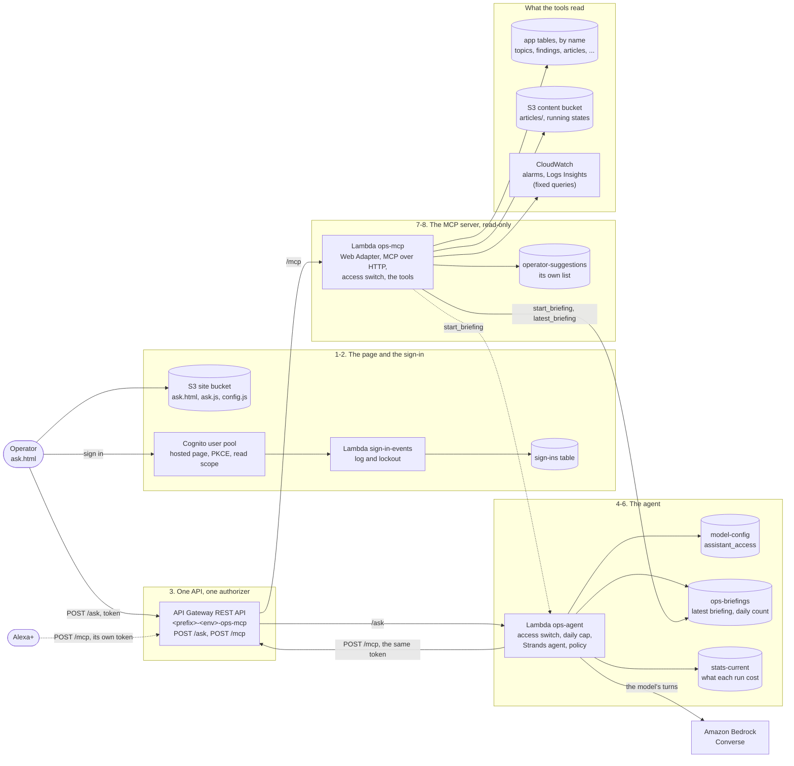

# The operator's assistant: the ops agent and its MCP server

How a question the operator asks, out loud or typed, becomes a short spoken answer with the fixes
on screen: the page and its sign-in, the one API in front, the Strands agent on Bedrock, the MCP
server's read-only tools, what they read, and what comes back. Then what it can and cannot do, how
"read-only" is held in IAM and not only in code, and what it costs.

It exists because the admin side is deliberately hard to reach. The admin API takes IAM-signed
requests from the Admin CLI, from the operator's addresses only, so no browser ever holds
credentials. The operator still wanted to ask "what needs my attention?" and "how do I ...?" from
a page, by voice, and be told the answer. So the assistant has its own sign-in and its own roles,
reads the pipeline directly, and never changes it. Where a problem has a fix, it puts the
`admin_cli` command that would fix it on screen, and the operator runs it in their own terminal if
they agree.

The design is
[alexa-plus-operator-assistant-enhancement.md](../enhancements/archive/alexa-plus-operator-assistant-enhancement.md);
the rounds that followed are under [Design history](#design-history). Alexa+ is a second client of
the same MCP server ([below](#alexa)).

**In the assistant.** This page has no `feature` entry yet. Ask about its parts by name instead,
`architecture(name="ops-agent")`, `"ops-mcp"`, `"operator-suggestions"` or `"ops-briefings"`, or
about the layers that hold it (`ai`, `identity`, `api`). "How can I check the assistant myself?"
is `investigate("assistant")`.

Resource names below use `<prefix>` (your `unique_name_prefix`) and `<env>` (`dev` or
`production`). Both environments deploy it from one module,
[`infra/modules/ops-assistant/`](../../infra/modules/ops-assistant/), each with its own user pool,
API, roles and tables.

## The steps

| # | Step | What happens | Where in the code / infra |
|---|---|---|---|
| 1 | **The page** | `ask.html` is a static page on the site, linked from nowhere and marked `noindex`. Until there is a token it shows a sign-in and nothing else. Its settings come from `config.js`, which Terraform writes at deploy. "Push to talk" uses the browser's own speech recognition where there is one; typing always works. Everything the API returns is put on the page as text, never as HTML. | [`frontend/ask.html`](../../frontend/ask.html), [`frontend/ask.js`](../../frontend/ask.js); `aws_s3_object.frontend_config` in `infra/environments/*/main.tf` |
| 2 | **Sign-in** | Cognito's hosted page, authorization code with PKCE (S256) and no client secret. The access token carries the `bloggerbear-ops/read` scope, lasts an hour, and lives in a variable in `ask.js` only, so a reload signs out. Nobody can sign up: users are made by hand. MFA is optional in dev by default and required in production. Every sign-in passes through `sign-in-events` before and after the password check: it logs each attempt and locks a user out after five failures in fifteen minutes. As the operator signs in, the page sends one wake call (`{"warm": true}`), which starts both Lambdas and calls no model. | `aws_cognito_user_pool.this` (`<prefix>-<env>-ops-assistant`) and `aws_cognito_user_pool_client.page` in [`main.tf`](../../infra/modules/ops-assistant/main.tf); [`lambdas/sign_in_events_handler.py`](../../lambdas/sign_in_events_handler.py), [`lambdas/common/sign_ins.py`](../../lambdas/common/sign_ins.py); [creating a user](../deployment-runsheet.md#5-after-the-first-deploy) |
| 3 | **One API** | One regional REST API, `<prefix>-<env>-ops-mcp`, with two routes behind one Cognito authorizer, each requiring the read scope: `POST /ask` (the agent) and `POST /mcp` (the MCP server). No token is a 401 and a token without the scope a 403, from API Gateway, before any Lambda runs. Two things have no authorizer: `OPTIONS /ask`, for the browser's preflight, and the OAuth metadata documents under `/.well-known/` (static JSON for Alexa+, which a 401's `WWW-Authenticate` header points to). The stage is throttled (5 requests a second, bursts of 10, in both environments), and its access log holds no address, user agent or token. | [`main.tf`](../../infra/modules/ops-assistant/main.tf) (the API, `/mcp`, the stage), [`agent.tf`](../../infra/modules/ops-assistant/agent.tf) (`/ask`), [`alexa.tf`](../../infra/modules/ops-assistant/alexa.tf) (the metadata documents); `/aws/apigateway/<prefix>-<env>-ops-mcp-access` |
| 4 | **The agent's gate** | `<prefix>-<env>-ops-agent` reads the `assistant_access` switch first, on every request but the browser's preflight: `open` (the default), `allowlist` (only from the operator's addresses, by the address API Gateway recorded) or `off`. The operator changes it with `admin_cli pipeline-config set --assistant-access`, with no deploy, and anything that goes wrong refuses. Then the route, the bearer token and the body. The page's wake call (`{"warm": true}`) and its Dismiss button come this way too: neither calls the model or counts against the cap, and Dismiss calls the MCP server's `dismiss` tool directly. A question is at most 500 characters, with at most six earlier turns, which the tab sends with it. Then the daily cap: 100 questions per user per UTC day, counted before the model is called. | [`lambdas/ops_agent_handler.py`](../../lambdas/ops_agent_handler.py); [`ops_mcp/access.py`](../../lambdas/ops_mcp/access.py) (the rule); [`ops_agent/quota.py`](../../lambdas/ops_agent/quota.py); the `pipeline` row of `model-config` |
| 5 | **The agent** | A Strands `Agent` on Bedrock Converse, with the model the pipeline Lambdas are given as `BEDROCK_MODEL_ID` (here `OPS_AGENT_MODEL_ID`), not streamed, its reply capped at 600 tokens. The model chooses which tools to call and which lead to follow; code decides the rest. The first question in a tab is a briefing: up to 8 tool calls, and no deep dive offered. A later one is a follow-up: up to 3. A call over the budget is refused, and the model reads that as "answer now"; its turns are capped at the budget plus two. Nothing is kept between questions. | [`lambdas/ops_agent/agent.py`](../../lambdas/ops_agent/agent.py) (the prompt, the model, the hooks), [`lambdas/ops_agent/policy.py`](../../lambdas/ops_agent/policy.py) (the turn, the budget, what is offered) |
| 6 | **Calling the tools** | The agent is an MCP client like any other. Strands' MCP client calls this API's own `POST /mcp` over Streamable HTTP with the operator's own token, so the authorizer checks it again and the server sees the same user. It lists the server's tools and is given those the turn allows, so a tool added to the server needs no change here. With each request its own access check has admitted, it also sends the operator's address and a key only it and the server hold (Terraform makes one per environment), so that `allowlist` judges the operator's address and not Lambda's. With no key set, nothing is vouched for, and `allowlist` refuses every question asked through the agent. | `mcp_client` and `list_tools` in [`agent.py`](../../lambdas/ops_agent/agent.py); `_vouching_headers` in [`ops_agent_handler.py`](../../lambdas/ops_agent_handler.py); `forwarding_headers` in [`access.py`](../../lambdas/ops_mcp/access.py) |
| 7 | **The MCP server** | `<prefix>-<env>-ops-mcp` runs the MCP SDK's own web app under uvicorn, behind the Lambda Web Adapter, from a package of its own. It is stateless: each POST gets one JSON answer, with no session and no stream. It speaks MCP `2026-07-28`, and still answers a client that opens with `initialize` at `2025-11-25` or earlier. It checks the access switch again, first, and refuses a Host that is not the API's own. Then the tool runs. | [`lambdas/ops_mcp/server.py`](../../lambdas/ops_mcp/server.py), [`access.py`](../../lambdas/ops_mcp/access.py); [`run.sh`](../../infra/modules/ops-assistant/run.sh); [`requirements-ops-mcp.txt`](../../lambdas/requirements-ops-mcp.txt) |
| 8 | **What a tool returns** | Every result has the same shape: `spoken`, a few sentences built by code from counts and fixed words (`latest_briefing`'s is the agent's own answer, already swept as in step 9); `findings`, each with a `suggestion` from a fixed catalogue, most of them an `admin_cli` command with only a checked id filled in and some only what to look at; and the data behind them for the page, often a `table`. Text nobody here wrote (titles, review notes, log lines) goes under `untrusted`, or in a table column titled "(unverified)", and never into `spoken`. Anything read from a log passes `redact.scrub` first: e-mails, tokens, keys and account ids out, addresses masked, and a line that reads like instructions withheld. Findings with a command, and the root causes a log tool found, are noted on the assistant's own list, so the next briefing can follow them up. | [`tools.py`](../../lambdas/ops_mcp/tools.py) (the shape), [`suggestions.py`](../../lambdas/ops_mcp/suggestions.py), [`redact.py`](../../lambdas/ops_mcp/redact.py), [`memory.py`](../../lambdas/ops_mcp/memory.py); `<prefix>-<env>-operator-suggestions` |
| 9 | **The answer** | The spoken answer is the model's own words, unless it ran out of turns, was cut off, or repeated text a tool marked as written outside this project: then it is the tools' own `spoken` summaries. Either way it passes a last sweep for personal data. What the page shows (the findings and the tables) is copied from the tools' results by code, never from what the model wrote; a tool call is shown by its name and only the plain arguments (numbers and single words) the model gave it. The page speaks the answer in the browser's own voice and shows a card per finding, with Copy where it carries a command and Dismiss where a tool found it (not on help the operator asked for). The agent's log line holds the turn's kind, the tools called and counts: never the question, the answer or the token. A first question that was a briefing is kept for `latest_briefing`, and the run's tokens and cost go on the week's Stats row. | `run` and `_answer_text` in [`agent.py`](../../lambdas/ops_agent/agent.py), `Ledger` in [`policy.py`](../../lambdas/ops_agent/policy.py), `redact.sweep_answer`; [`ask.js`](../../frontend/ask.js); `record_assistant_run` in [`common/stats_tracking.py`](../../lambdas/common/stats_tracking.py) |

## The tools

Each is registered in [`server.py`](../../lambdas/ops_mcp/server.py) and written as a plain
function in its own module, so it is tested like any other code.

| Tools | What they answer | Where |
|---|---|---|
| `pipeline_health`, `admin_inbox` | Per topic, whether research ran on time and what became of its daily run in the last 26 hours; the articles waiting for approval, and why each is held. | [`tools.py`](../../lambdas/ops_mcp/tools.py) |
| `content_checks` | Published articles and musings that look wrong: a blank musing, markup in a title, a body that is one code block, a musing whose article is not published. | [`content.py`](../../lambdas/ops_mcp/content.py) |
| `security_events`, `alarms`, `spend` | Open security incidents; this environment's alarms that are firing; AI spend this week or month, and in production the AWS bill too. | [`account.py`](../../lambdas/ops_mcp/account.py) |
| `sign_ins` | Who signed in to the assistant, who failed, and who is locked out. | [`sign_in_tool.py`](../../lambdas/ops_mcp/sign_in_tool.py) |
| `model_catalog` | The model catalog: whether discover (every second day, 02:00 Sydney), reprice (03:00) and the rotation cycle (Fridays, 04:00) are paused, what each last did, and the pricing run under review with when its next check is. A price it put back is a `pipeline_health` finding (`model_pricing_reverted`); how to pause or rerun it is the `model-prices` guide. | [`model_prices.py`](../../lambdas/ops_mcp/model_prices.py) |
| `log_review`, `api_errors` | The Lambdas' errors and their root cause (a code fix, a settings change or just time), and the APIs' failed requests by status and by who answered, with the queries to check it yourself. | [`log_review.py`](../../lambdas/ops_mcp/log_review.py), [`api_errors.py`](../../lambdas/ops_mcp/api_errors.py), [`logs.py`](../../lambdas/ops_mcp/logs.py) |
| `firewall_review` | Production always, dev only when `OPS_FIREWALL_REVIEW_DEV` is on (its own firewall logs, never the shared CloudFront one); never on a briefing: what the firewall blocked, by rule, against a typical day. | [`firewall.py`](../../lambdas/ops_mcp/firewall.py) |
| `vision_status`, `vision_evidence`, `topic_findings` | The vision worker and each vision topic's sites; what the vision pipeline measured and decided; a topic's research Findings and what its next article will be written from ([vision](blogger-vision.md#asking-the-assistant)). | [`vision_status.py`](../../lambdas/ops_mcp/vision_status.py), [`vision_evidence.py`](../../lambdas/ops_mcp/vision_evidence.py), [`topic_findings.py`](../../lambdas/ops_mcp/topic_findings.py) |
| `table_sample` | A table's newest row, redacted, and whether it is being written on time. | [`samples.py`](../../lambdas/ops_mcp/samples.py) |
| `architecture`, `investigate` | What each AWS resource is for, the layers, and the feature walk-throughs; and a runsheet of where to look for what no tool reads, such as metrics. | [`architecture.py`](../../lambdas/ops_mcp/architecture.py), [`runsheets.py`](../../lambdas/ops_mcp/runsheets.py) |
| `cli_reference`, `cli_help`, `cli_guides`, `cli_command`, `topics_overview` | The Admin CLI: a command's own help, short guides to a feature, one exact command built in code, and the topics' settings as a table. | [`cli_guide.py`](../../lambdas/ops_mcp/cli_guide.py), [`cli_reference.json`](../../lambdas/ops_mcp/cli_reference.json) |
| `follow_up`, `watch_list`, `dismiss`, `watch`, `unwatch` | What it suggested before and whether each is fixed; what it was asked to watch, and how each is now. These change only the assistant's own list. | [`memory.py`](../../lambdas/ops_mcp/memory.py) |
| `start_briefing`, `latest_briefing` | For Alexa+, which cannot wait for the agent: start a briefing in the background, and read the latest back. Never offered to the agent. | [`briefings.py`](../../lambdas/ops_mcp/briefings.py) |

## Where state lives

| What | Where |
|---|---|
| The conversation | The browser tab: an array in `ask.js`, sent back as `history` with each question, gone with the tab |
| The access token | A variable in `ask.js`; never in storage or a cookie |
| What it suggested, and what it is watching | `<prefix>-<env>-operator-suggestions`, per user: kinds, ids, booleans and timestamps, never text a model wrote or a command; each row expires 30 days after it was last mentioned |
| Each user's latest briefing, and their questions today | `<prefix>-<env>-ops-briefings`: overwritten by the next briefing, gone after two days; the agent writes it and never reads it back |
| Sign-ins | The sign-ins table, 120 days |
| The access switch | The `pipeline` row of `model-config` |
| The model catalog it reports | The `model-catalog`, `model-catalog-state` and `pricing-run#<id>` rows of `model-config`; a price put back, the `failed-executions` table |
| What each run cost | The week's Stats row, category `assistant` |
| Logs | `/aws/lambda/<prefix>-<env>-ops-agent` and `-ops-mcp`, 90 days; the API's access log, 30 days |

## Read-only, and how that is held

"Read-only" is true of the roles, not only of the code. Each Lambda has its own package and its
own role; neither is the role the pipeline Lambdas share, which may write and delete on every
table.

| Role | What it may do |
|---|---|
| The MCP server, `<prefix>-<env>-ops-mcp-lambda-exec` | Read the eleven app tables the environment names in `tables`, and their indexes; Query and Scan any `<prefix>-*` table tagged with this project's tags and an environment it may read (`table_sample`); read article bodies under `articles/`; list alarms; run Logs Insights on its environment's Lambda and API log groups, by tag. Where vision is on, also the worker's log in `vision_region` and each `snapshots/<topic>/running-state.json`. In production, also the firewall's log groups. It writes two tables of its own, `operator-suggestions` and `ops-briefings` (to mark a briefing started), and may invoke the agent, for `start_briefing`. No Bedrock: a tool that could spend money is not read-only. |
| The agent, `<prefix>-<env>-ops-agent-lambda-exec` | Call the model (`bedrock:InvokeModel`); read the access switch's row; write `ops-briefings` and the week's Stats row. No other table and nothing in S3: it learns about the pipeline only by asking the MCP server, with the operator's token. |

Dev and production can share one AWS account (the original deployment does), so each assistant is
kept to its own environment in four layers
([`isolation.tf`](../../infra/modules/ops-assistant/isolation.tf)): Allows by name; a Deny on both
roles for anything tagged with another Environment; filters in code where IAM cannot help (alarms
are asked for by `<prefix>-<env>-` only); and the account's own data, the AWS bill and the
firewall, only where `account_wide_data` is on, which is production. Dev's assistant reads dev's;
production's reads production's and what is `shared`. The module's tests
([`infra/modules/ops-assistant/tests/`](../../infra/modules/ops-assistant/tests/)) and
`lambdas/tests/test_terraform_wiring.py` hold each role to its list.

## What it can and cannot do

It **can**:

- say what needs attention across the pipeline, the inbox, published content, security incidents,
  sign-ins, alarms, spend and the vision pipeline, and follow a lead from one tool into the next;
- read this environment's Lambda and API logs and say why the errors happened;
- remember what it suggested and follow it up, and watch a topic, a function, an incident, spend
  or a table;
- explain the Admin CLI and the architecture, and build an exact command for the operator to copy;
- put a table's newest row, a topic's Findings or the topics' settings on screen.

It **cannot**:

- change anything in the pipeline: nothing is approved, published, paused, triggered, deleted or
  restarted. Its only writes are its own list, the briefings table and the Stats row;
- run a command. A command that deletes or takes something down comes back as a template with
  `<placeholders>`, and a vision topic's sites config is never filled in;
- read a command aloud or write one itself: a command reaches the screen only from a tool;
- change its list on text it has just read: once a tool in the turn has returned text written
  outside this project, `dismiss`, `watch` and `unwatch` are refused for the rest of the turn (the
  page's Dismiss button still works). That rule is the agent's: Alexa+ calls the tools directly,
  and for it only the server's instructions say so;
- read the other environment's data. Dev's has no firewall deep dive and no AWS bill;
- read metrics or dashboards: `investigate` says where to look instead.

## Costs and limits

- **The model.** Every run's tokens and cost go on the week's Stats row under `assistant`, shown
  as "Operator assistant" on the Stats page and in `spend`'s AI spend, whether the run answered,
  was cut off or failed.
- **Per question.** 8 tool calls on a first question and 3 after it; model turns capped at the
  budget plus two; a reply of at most 600 tokens. Each Bedrock call has a 5 s connect and a 20 s
  read, with one retry. The agent stops at 29 s, which is when API Gateway gives up anyway; the
  MCP server has 30 s, and its log queries wait at most 15 s.
- **Per user.** 100 questions a UTC day (`agent_daily_question_cap`), briefings Alexa+ starts
  included; past it, a 429 until midnight UTC. One briefing at a time: a start is refused while
  one started under two minutes ago is still running.
- **Per API.** 5 requests a second, bursts of 10. By default the agent has no reserved concurrency
  (`agent_reserved_concurrency` is -1): Lambda always keeps 10 unreserved, and a new account's whole
  quota is often just that (the original deployment's was), so nothing can be reserved there and
  the throttle is the bound. Set a number once the quota is raised.
- **The rest** (Lambda, API Gateway, DynamoDB on demand, Cognito, Logs Insights) is on the
  account's AWS bill, in the part the Stats page calls "Hosting, data and monitoring". Logs Insights
  is charged by the data a query scans; the queries are fixed and their windows clamped.
  Production keeps the MCP function warm once Alexa's redirect URLs are set (an invoke every five
  minutes, about 8,600 a month); dev never does.

## Alexa+

Alexa+ is a second client of the same MCP server, not of the agent. It signs in with its own
Cognito app client, made only once Alexa's redirect URLs are set (`alexa_redirect_uris`), and
finds Cognito's sign-in through the OAuth metadata documents API Gateway serves under the stage
([`alexa.tf`](../../infra/modules/ops-assistant/alexa.tf)). It calls the tools directly. A
briefing takes the agent ten to twenty-five seconds, far longer than Alexa+ will wait, so it calls
`start_briefing`, which runs the agent in the background as the same user, then
`latest_briefing`. It is a voice caller: it never gets a table's "(unverified)" columns, and under
`allowlist` it is refused, since it calls from Amazon's addresses. The add-on and its set-up are in
[alexa/README.md](../../alexa/README.md).

## Adding a tool

1. Write it as a plain function in a module under `lambdas/ops_mcp/`, returning `spoken`,
   `findings` and the data behind them. Outside text goes under `untrusted`, never in `spoken`.
2. Register it in `server.py` as read-only, and pass it through `remembered` if its findings carry
   commands. A new command goes in the catalogue in `suggestions.py`, whose test parses every
   command with the Admin CLI's own parser. Add its name to the matching set in
   `lambdas/tests/test_ops_mcp_server.py`, which pins the tools the server always lists.
3. Give the MCP server's role only the read it needs, in `infra/modules/ops-assistant/`, and add
   any new action to the tests that hold the role to its list (the module's
   `tests/ops_assistant.tftest.hcl` and `lambdas/tests/test_terraform_wiring.py`).
4. The agent sees it with no change. Add a line to `SYSTEM_PROMPT` in `agent.py`, and to
   `_INSTRUCTIONS` in `server.py` for Alexa+, if the question that should reach it is not obvious.
   A deep dive goes in `DEEP_DIVE_TOOLS` in `policy.py`, and is then never offered on a briefing.

## Design history

- [alexa-plus-operator-assistant-enhancement.md](../enhancements/archive/alexa-plus-operator-assistant-enhancement.md):
  the design. The MCP server, the agent, suggestions, memory, the sign-in, two deployments and the
  page.
- [alexa-plus.md](../enhancements/archive/alexa-plus.md): Alexa+ on top. The voice on the page, OAuth for
  account linking, the async briefing, each environment's Alexa, and what it costs.
- [ops-assistant-architecture-expert.md](../enhancements/archive/ops-assistant-architecture-expert.md):
  `architecture`, `investigate` and `table_sample`.
- [ops-assistant-log-reader.md](../enhancements/archive/ops-assistant-log-reader.md): `log_review` and
  `api_errors`, and what using dev beside production changed.
- [ops-assistant-vision.md](../enhancements/archive/ops-assistant-vision.md): `vision_status`,
  `topic_findings`, the worker's log in its own Region, and two rules moved from the prompt into
  code.
- [vision-evidence.md](../enhancements/archive/vision-evidence.md): the evidence lines `vision_evidence`
  reads.
- [alexa-plus-mcp-enhancement.md](../enhancements/alexa-plus-mcp-enhancement.md): parked. A
  reader-facing assistant, not built.
