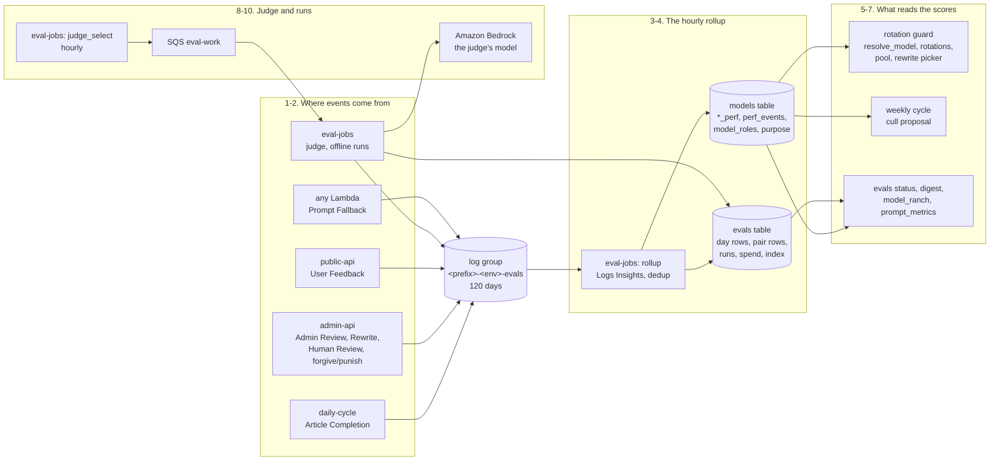

# Prompts as assets and continuous evals: the Model Ranch

How the text a model is given is chosen, and how every model and every prompt version is scored
on what it wrote. The first half follows a prompt: its template in the code, the asset files
published to their own bucket, the checks a Lambda makes before it serves one, A/B splits, and
what an article's lineage records. The second half follows a score: the events the pipeline
writes, the hourly rollup that adds them up, the gates that keep a badly scoring model out of the
candidate lists, culling, the LLM judge and its calibration against people, offline scoring runs,
call traces, and what the operator reads back in the CLI, the assistant and the Friday digest.

It exists because prompts were inline constants: changing one needed a code deploy, no version was
recorded, and nothing measured which model or which prompt wrote good articles. Model selection was
random, by price or by access. Now a prompt can change without a deploy, behind its own gated
workflow, with the code's copy always there to fall back on; every article says which version of
each prompt wrote it; and every model is rated by what people, readers and a calibrated judge say
of its work, so the rotation stops drawing a model that keeps doing badly.

Every setting, with its default, is in
[configuration.md](../configuration.md#the-queue-platform-prompts-and-evals); the enable order,
the `production-prompts` environment, rolling a prompt back and the failure-day recipes are in the
[production runsheet](../production-runsheet.md#the-queue-platform-prompts-and-evals); the alarms,
the evals log group and the ranch-and-prompts dashboard are in
[observability.md](../observability.md#the-queue-platforms-and-evals-alarms); the rules for
editing the prompts tree are in [prompts/README.md](../../prompts/README.md); each command's
options are in [scripts/README.md](../../scripts/README.md). The design, and the reasons behind it,
are in [model-ranch-prompt-assets-evals.md](../enhancements/archive/model-ranch-prompt-assets-evals.md).
This page does not repeat them.

**In the assistant.** `architecture(feature="prompts-and-evals")` walks through both halves' steps
with this environment's resource names on screen. It tells them in eleven: the prompts half's nine
in three (the template and its files, the gates and the publish with what it writes, and the checks,
the draw, lineage and a fallback as serving a prompt), and the evals half's eleven in eight (events
and where they come from, the rollup and the models row, and the gates and the rewrite picker are
one step each). Ask about a part by name for more: `architecture(name="prompts")` (the bucket),
`"prompt-hashes"`, `"evals"` (the table, or with `kind="log_group"` the log group), `"eval-jobs"`,
`"eval-work"`, `"eval-rollup"`, `"eval-judge"` or `"ranch-and-prompts"` (the dashboard). Where
evals are on, `model_ranch` and `prompt_metrics` answer how the models and the prompt versions are
doing ([below](#the-assistant-model_ranch-and-prompt_metrics)).

Resource names below use `<prefix>` (your `unique_name_prefix`) and `<env>` (`dev` or
`production`). The two halves are built from [`infra/modules/prompts/`](../../infra/modules/prompts/)
and [`infra/modules/evals/`](../../infra/modules/evals/), both always instantiated, each behind its
own switch.

## Contents

- [The two switches](#the-two-switches)
- [Prompts as assets](#prompts-as-assets)
  - [The steps](#the-steps)
  - [Templates and the registry](#templates-and-the-registry)
  - [get_prompt: the checks, in order](#get_prompt-the-checks-in-order)
  - [The bucket and the hash table](#the-bucket-and-the-hash-table)
  - [The publisher and its release order](#the-publisher-and-its-release-order)
  - [Pausing a version, the kill switch, and rolling back](#pausing-a-version-the-kill-switch-and-rolling-back)
  - [A/B splits: one draw per run](#ab-splits-one-draw-per-run)
  - [Lineage versions](#lineage-versions)
  - [Code-only prompts](#code-only-prompts)
  - [The reviewer bear's blocks](#the-reviewer-bears-blocks)
  - [When a prompt falls back](#when-a-prompt-falls-back)
- [Continuous evals and the Model Ranch](#continuous-evals-and-the-model-ranch)
  - [The steps](#the-steps-1)
  - [Events and their scores](#events-and-their-scores)
  - [Where events come from](#where-events-come-from)
  - [The rollup and the windows](#the-rollup-and-the-windows)
  - [Gates and the rotation guard](#gates-and-the-rotation-guard)
  - [The rewrite picker](#the-rewrite-picker)
  - [Culling: a proposal, then an apply](#culling-a-proposal-then-an-apply)
  - [Forgive, punish, ungate, revoke](#forgive-punish-ungate-revoke)
  - [The judge](#the-judge)
  - [Calibration](#calibration)
  - [Human review](#human-review)
  - [Offline scoring runs and the spend cap](#offline-scoring-runs-and-the-spend-cap)
  - [Call traces](#call-traces)
  - [evals status and the digest](#evals-status-and-the-digest)
  - [The assistant: model_ranch and prompt_metrics](#the-assistant-model_ranch-and-prompt_metrics)
- [Flows](#flows)
- [Where state lives](#where-state-lives)
- [Permissions](#permissions)
- [Where in the code](#where-in-the-code)
- [Design history](#design-history)

## The two switches

| Switch | Off (the default) | On |
|---|---|---|
| `PROMPT_AS_ASSET_ENABLED` (a GitHub variable, the Terraform variable `prompt_as_asset_enabled`, the Lambdas' environment variable of the same name) | Every prompt is the copy in the code, with no read of S3 or DynamoDB and no fallback line. The publish jobs are skipped. The bucket and the hash table exist, empty. | The Lambdas serve published assets that pass every check. The publish jobs run on a merge to `dev` and on a release. |
| `EVALS_ENABLED` (a GitHub variable, the Terraform variable `evals_enabled`) | No event is written, nothing is gated, the assistant has no ranch tools. The evals table and log group exist; eval-jobs, its schedules, eval-work and the dashboard do not. | Events are written, the hourly rollup and the judge run, the gates apply, and the assistant offers `model_ranch` and `prompt_metrics`. |

The publish jobs read the repository's value of `PROMPT_AS_ASSET_ENABLED`, because a job's `if:`
is decided before it enters an environment. A `production` environment value of `false` keeps
production's Lambdas on their code copies while the repository value lets the prompts publish.

## Prompts as assets

```mermaid
flowchart LR
    dev(["Operator<br/>a PR to prompts/"])
    subgraph repo["1-2. The repository"]
        tree["prompts/&lt;lambda_id&gt;/&lt;name&gt;/<br/>latest/vN.txt, archive/"]
        registry["common/prompts_registry.py<br/>a PromptSpec per prompt"]
    end
    subgraph publish["3-4. .github/workflows/prompts.yml"]
        gates["gates: lint, PII, gitleaks,<br/>trufflehog, pytest, trivy, checkov"]
        pub["publish-dev / publish-production<br/>scripts/publish_prompts.py"]
    end
    subgraph store["5. What is published"]
        bucket[("S3 &lt;prefix&gt;-&lt;env&gt;-prompts<br/>latest/, versions/, releases/")]
        hashes[("&lt;prefix&gt;-&lt;env&gt;-prompt-hashes<br/>approved sha256s")]
        row[("model-config<br/>prompts row: kill switch,<br/>paused versions")]
    end
    subgraph serve["6-9. A Lambda's call"]
        get["common/prompts.get_prompt<br/>checks, A/B draw, cache"]
        call["the model call<br/>lineage: prompt_id, prompt_version"]
        fb["prompt_fallback line<br/>+ Prompt Fallback event"]
    end
    operator(["Operator<br/>prompts list, pause, set"])

    dev --> tree --> gates
    registry --> gates
    gates -- "merge to dev; a release" --> pub
    pub --> hashes & bucket
    operator --> row
    get --> bucket & hashes & row
    registry -- "the vanilla" --> get
    get --> call
    get -. "any check fails" .-> fb
```

### The steps

| # | Step | What happens | Where in the code / infra |
|---|---|---|---|
| 1 | **The template** | Every prompt the code sends is a `PromptSpec` in the registry: its id `<lambda_id>/<prompt_name>`, the code's own template (the **vanilla**) with its version and pinned sha256, the placeholders it takes, and whether it may be read from S3 at all ([in detail](#templates-and-the-registry)). | [`lambdas/common/prompts_registry.py`](../../lambdas/common/prompts_registry.py) (`all_specs`); `PromptSpec` in [`lambdas/common/prompts.py`](../../lambdas/common/prompts.py) |
| 2 | **The asset files** | `prompts/<prompt_id>/latest/vN.txt` in the repository is what should be served: one file is the prompt, two or more an A/B split. Retired files move to `archive/`. | [`prompts/`](../../prompts/), [`prompts/README.md`](../../prompts/README.md) |
| 3 | **The gates** | A pull request that touches the tree runs the workflow's own gates, with no secret of any kind ([in detail](#the-publisher-and-its-release-order)). | the `gates` job in [`.github/workflows/prompts.yml`](../../.github/workflows/prompts.yml); [`scripts/prompt_lint.py`](../../scripts/prompt_lint.py) |
| 4 | **The publish** | A merge to `dev` publishes dev's bucket; a release, or a dispatch under `production-prompts`, publishes production's. Each run is one release, written in an order that keeps the last release serving if it stops part-way ([in detail](#the-publisher-and-its-release-order)). | `publish-dev`, `publish-production` in `prompts.yml`; [`scripts/publish_prompts.py`](../../scripts/publish_prompts.py) |
| 5 | **What is published** | The bucket holds the files and a record of each release; the hash table holds the sha256 of every file the publisher approved; the `prompts` row of model-config holds the kill switch and the paused versions ([in detail](#the-bucket-and-the-hash-table)). | `aws_s3_bucket.prompts`, `aws_dynamodb_table.prompt_hashes` in [`infra/modules/prompts/main.tf`](../../infra/modules/prompts/main.tf) |
| 6 | **The checks** | `get_prompt` serves the run's asset only when every check passes, and otherwise the vanilla with the code that says why. It never raises over the asset ([in detail](#get_prompt-the-checks-in-order)). | `get_prompt`, `_read_asset`, `validate` in `prompts.py` |
| 7 | **The draw** | With a split, the arm is a salted hash of the run's key, so one run lands on one side of each prompt's split ([in detail](#ab-splits-one-draw-per-run)). | `bind_run`, `arm_index` in `prompts.py` |
| 8 | **Lineage** | Every call that rendered through `get_prompt` records the prompt id and the version it was given on the article's or the Finding's lineage ([in detail](#lineage-versions)). | `lineage_fields` in `prompts.py`; [`common/costing.py`](../../lambdas/common/costing.py) |
| 9 | **A fallback** | A failed check writes a `prompt_fallback` evidence line, which the fallback alarm counts, and a Prompt Fallback event to the evals log ([in detail](#when-a-prompt-falls-back)). | `_fallback`, `_count_fallback` in `prompts.py`; `aws_cloudwatch_metric_alarm.prompt_fallback` in [`infra/modules/observability/main.tf`](../../infra/modules/observability/main.tf) |

### Templates and the registry

A template holds two kinds of placeholder, in a strict form: `{{name}}`, a value the call site
works out at run time, and `{{locked:name}}`, a block from the code that an asset can place but
not change. Anything else, `{"verdicts"` in a reply contract included, is literal text. Rendering
is one pass and never scans a value again, so a draft that contains `{{x}}` stays `{{x}}`.

A template is accepted (`prompts.validate`) only when:

- every `required` placeholder is there, and every placeholder is one the spec names;
- every locked block is there exactly once, in the spec's order;
- the locked blocks form the template's tail: free text may come before them, never after, so the
  guardrails always end the prompt;
- the template is no longer than `max_chars`. The template is measured, not the rendered text:
  the caller's values are the same whichever template renders them.

The same function holds the lint's check of each file, `get_prompt`'s check of each asset it reads,
and each spec's check of its own vanilla when the registry is loaded, with the pinned sha256, so a
vanilla cannot drift from its version unnoticed. A value whose empty form is zero bytes is how a
block that is sometimes absent (the gear's guidance, an article style) is written; a locked block
may legally render empty (the financial guidance on a topic that is not financial).

The registry holds every prompt the code sends: the daily cycle's ideation, draft and title; the
reviews' adversarial review and revision; the research summaries (the research tick's and the crypto
feed's, rail access's and satellite vision's); the rewrite; the reviewer bear's three questions; the
gear's; the weekly reflection; the model catalog's web price reading; the musings; and the code-only
prompts ([below](#code-only-prompts)). A spec with `asset=True` has its vanilla as
`prompts/<prompt_id>/latest/v1.txt`, byte for byte, until someone publishes a v2.

### get_prompt: the checks, in order

`get_prompt(prompt_id, values, locked)` returns a `Prompt`: the rendered text, its `version` (an
asset's `v2`, or `vanilla:v1`), its `source` (`asset` or `vanilla`) and a `fallback_code` when the
vanilla was served in an asset's place. The checks run in this order, each with the code it fails
with:

| # | Check | Fails with |
|---|---|---|
| 1 | A code-only spec is the vanilla, with no code and no read at all | (none) |
| 2 | The deployment's switch: `PROMPT_AS_ASSET_ENABLED`, with a bucket and a hash table named | `assets_off`, with no fallback line |
| 3 | The kill switch: `prompt_assets` on the `prompts` row | `assets_off` |
| 4 | The prompt's `latest/` listing | `s3_error`, `no_files` |
| 5 | The drawn file's `version` object tag | `s3_error`, `no_version_tag` |
| 6 | The pause list: `<prompt_id>@<version>` in `paused_versions` | `paused` |
| 7 | The file's body, as UTF-8 | `s3_error`, `decode_error` |
| 8 | The hash table: the row for the body's sha256 says `live`, or `retired` no more than 300 seconds ago | `hash_lookup_failed`, `hash_unapproved` |
| 9 | The template rules | `missing_placeholder`, `unknown_placeholder`, `locked_missing`, `locked_order`, `too_large` |

**The cache.** Each container keeps the listing, the tags, the bodies by sha256, the hash rows and
the `prompts` row for 300 seconds, so a warm container reads each prompt's files at most once every
five minutes. A pause or the kill switch, read from the cached `prompts` row, therefore lands within
300 seconds; a superseded version is served for at most 600 seconds: the cache plus the retire grace.

**An unreadable `prompts` row** is not read as its defaults, since a paused or killed version's
hash row still says `live`. A container that cannot read the row keeps the settings it last read,
even past the cache's 300 seconds; a cold one that has read none serves the code's copies
(`assets_off`) until it can.

### The bucket and the hash table

| Key in `<prefix>-<env>-prompts` | What it is |
|---|---|
| `<prompt_id>/latest/vN.txt` | What is served, tagged `version`, `release` and `sha256` |
| `<prompt_id>/versions/<sha256>.txt` | Every file ever published, written once and kept |
| `releases/<release_id>.json` | What one publish held (`release_id` is `<env>-<yyyymmddThhmm>-<short sha>`) |
| `releases/current.json` | `{"release_id": ..., "pinned_release": ... or null}`: the release in place, and the one a rollback holds to |

The bucket is versioned, encrypted with S3's own keys, private and TLS-only; noncurrent versions
go after 90 days. Terraform owns the bucket, never what is in it. With a publisher role named, its
policy refuses every object write (put, delete, tag) by any principal but that role, by a condition
on `aws:PrincipalArn`.

`<prefix>-<env>-prompt-hashes` has one row per approved file, keyed by its sha256 (`prompt_hash`):
`prompt_id`, `version`, `release`, `approved_at`, `status` (`pending`, `live` or `retired`) and
`retired_at`. No TTL: it is the record of every version this deployment has published, and the
publisher refuses a tree that would give a version new bytes, or bytes a new version.

### The publisher and its release order

The workflow [`.github/workflows/prompts.yml`](../../.github/workflows/prompts.yml) has three jobs:

- **`gates`**, on a pull request that touches `prompts/**`, `lambdas/common/prompts*.py`, the lint,
  the publisher or the workflow: the prompt lint, the personal-data denylist, trufflehog and
  gitleaks, the lint's and the publisher's tests, trivy and checkov. No secret is read.
- **`publish-dev`**, on a push to `dev` that touches the same paths, or a dispatch from `dev` asking
  for dev, in no GitHub environment (its role trusts `refs/heads/dev`).
- **`publish-production`**, on every published release (under `production`, so prompts and code
  never drift) or a dispatch from `dev` asking for production (under `production-prompts`, whose
  required reviewer is the owner). Either way the owner approves the run before it starts.

Both publish jobs run the lint again on what they publish, and one publish per deployment runs at
a time. The lint ([`scripts/prompt_lint.py`](../../scripts/prompt_lint.py)) holds the tree to the
registry: folders are registered asset prompts, files are `vN.txt`, UTF-8 with LF line endings,
pass `prompts.validate`, hold no phrase that contradicts a locked block, never repeat another
file's bytes, and keep each version to one text across `latest/`, `archive/` and the previous
tree. Its second pass imports the **latest release's** registry from a `git worktree`, since that
is the code production runs, and flags `skip-at-production` any prompt that release cannot read
yet; a production publish leaves such a prompt exactly as it is in the bucket.

The publisher ([`scripts/publish_prompts.py`](../../scripts/publish_prompts.py)) writes one release
in this order, so a run that stops part-way leaves the previous release serving:

1. for each new file: its hash row as `pending`, only if there is none (the write-once guard, a
   conditional put), then the file to `versions/<sha256>.txt`. A pending row is never served;
2. every file of the release: its row `live`, naming the release;
3. `latest/`: each file copied from `versions/` and tagged, then every `latest/` object the release
   does not hold deleted. Added first, removed after;
4. every other `live` row: `retired`, with `retired_at`. The Lambdas still accept it for 300
   seconds, so a container that listed the old files keeps serving them;
5. `releases/<release_id>.json`, then `releases/current.json`.

Nothing is deleted outside `latest/`. `--dry-run` prints the plan and writes nothing; nothing
printed holds a prompt's text.

### Pausing a version, the kill switch, and rolling back

| To | Do | Effect |
|---|---|---|
| Stop serving one version | `prompts pause <prompt_id> <version>` (`resume` undoes it) | Within five minutes, a run that draws that version gets the vanilla (`paused`); runs that draw the split's other files keep them |
| Stop serving every asset | `prompts set --assets off` (`--assets on` undoes it) | Within five minutes, every asset prompt is the vanilla (`assets_off`), with no deploy |
| Go back to an earlier release | `git revert` and a publish; or the workflow's `release_id` input | A revert publishes the old files as a new release. `release_id` pins an earlier release: its files are made live and synced into `latest/` again, every other live row is retired, and `current.json` names it as `pinned_release`. Every later publish, a merge or a release, publishes the pin again until a run with `clear_pin` publishes the tree |

The pause and the kill switch are fallbacks like any other: every call they affect writes a
`prompt_fallback` line (with `--assets off`, on every asset prompt's call), so
`<prefix>-<env>-prompt-fallback` is in alarm for every hour that has one. While one is in place it
can also clear, with an email, in an hour with no affected call (a research tick with nothing new
calls no model; the daily cycle runs once a day), and the next affected call sets it off again: both
emails are expected, and an OK email does not mean the fallbacks have stopped. Once the pause or the
kill switch is lifted and the caches have read it (up to five minutes), the next hour with no
fallback line clears it for good.
`prompts list` shows each prompt's files under `latest/` with their version, release, sha256, hash
status and pause state, and whether the deployment serves assets at all; `prompts releases` shows
what each publish did, and which release is in place or pinned. Both read the bucket fresh, never
from a cache.

### A/B splits: one draw per run

With n files under `latest/`, the arm is `sha256("<run key>|<prompt_id>") % n` over the sorted
keys. Every prompt one run renders lands on the same side of its own split, different prompts land
on independent sides, and the split is even across runs. The run key is bound with `bind_run` at
the run's boundary:

| Where | Run key |
|---|---|
| The daily cycle | its run id: the Step Functions execution's ARN, or the request id of a direct invoke |
| A Re-Write | its `rewrite_id` |
| The research tick, the admin API, the weekly reflection | the Lambda request id |
| The reviewer bear | the article's id, so the questions he asks about one article land on the same side, on every run |
| The model catalog's web prices | the pricing run's id |
| An offline scoring run | `<run_id>:<item>` |

With no key bound, the arm is random.

### Lineage versions

Every call that renders through `get_prompt` adds `prompt_id` and `prompt_version` to its lineage
call (`prompts.lineage_fields`): the article's own calls on the article's row, the research call on
the Finding (`research_call`), carried into the article's lineage by
`costing.build_research_lineage`. So an article says which version of each prompt wrote each part
of it, and a version that served the vanilla says `vanilla:v1`. Continuous evals read those ids to
credit each prompt in an article's lineage ([below](#where-events-come-from)).

### Code-only prompts

Five kinds of prompt are never read from S3 (`asset=False`): the compliance review (rule 3's
gate), vision triage (its safety rules), comment screening (its rules on personal data), the ops
agent's system prompt (its role reads no prompt asset, so its isolation rule cannot widen), and the
evals rubrics (the judge's two and the offline runs' comparison). Each is registered so its version
is known: lineage records it as `vanilla:vN` like any other, and a change to one is a code PR that
bumps its version and pin. The lint refuses files for them. The operator's assistant takes its
system prompt with `prompts.vanilla_prompt("ops_agent/system")`, which reads nothing: its rules
live in `ops_agent/system` in `common/prompts_registry.py`: version 2 gained its rule on reasoning
by model and prompt cell, and version 3 named the queue platform's and this page's walk-throughs.

### The reviewer bear's blocks

Professor Grizzlewick's three questions (`reviewer/skeptic`, `reviewer/published`,
`reviewer/defang`) are version 2. His approval publishes, so the article and its flags reach the
model only inside two blocks that `common/reviewer.py` builds and defangs:

- `article_block`: the title, and the text cut to 8,000 characters, inside `<article_text>` tags;
- `flags_block`: the flags, each closed up onto one line and numbered in code (the verdicts answer by
  those numbers), inside `<review_flags>` tags.

Any `<article_text` or `<review_flags` tag inside the material is broken (`_break_delimiters`), so
nothing can close a block early. Each block is a value with its tags inside it, so an asset can
place a block but can neither rename its tags nor set the material down outside them; each JSON
reply contract is locked at the end. The v1 files are in `archive/`. Until the publish that retires
them, a deployment still serving v1 falls back to the v2 vanilla, with `prompt_fallback` lines,
because v1 no longer passes v2's spec. More in [the reviewer bear](reviewer-bear.md#his-prompts).

### When a prompt falls back

Every fallback except the deployment switch's writes two things:

- **a `prompt_fallback` evidence line** (`lambda_id`, `prompt_name`, `version`, `code`) in the
  Lambda's log. The observability module's metric filter on every pipeline log group, eval-jobs'
  included, counts them as `PromptFallback`; `<prefix>-<env>-prompt-fallback` emails on the first in
  an hour, and again when it clears;
- **a Prompt Fallback event** in the evals log (while evals are on): `fallback:<request id>:<prompt
  id>`, scoring 0, naming the version that fell back and no model, since `get_prompt` does not know
  which model the prompt goes to. The rollup counts it on that version's `prompt#` day row only. Its
  `source` is the running Lambda's code, and its request key the bound run key; the reviewer bear
  binds `<run_id>:<article_id>` (`bind_request`), so a held article that keeps falling back counts
  once on each of his runs. `evals status` shows the last 24 hours' fallbacks, and the assistant's
  `prompt_fallback` card reads the counts of the last three days, today and the two before
  (`FALLBACK_DAYS`): longer than the reviewer bear's every-second-day cadence, so neither his card
  nor its follow-up reads as fixed on the day between his runs.

## Continuous evals and the Model Ranch



### The steps

| # | Step | What happens | Where in the code / infra |
|---|---|---|---|
| 1 | **An event** | Something says a model or a prompt did well or badly. The code that knows writes one JSON event, ids and codes only, to the evals log group ([in detail](#events-and-their-scores)). | `SCORING`, `emit`, `parse` in [`lambdas/common/evals.py`](../../lambdas/common/evals.py); `aws_cloudwatch_log_group.evals` in [`infra/modules/evals/main.tf`](../../infra/modules/evals/main.tf) |
| 2 | **Where they come from** | An article stored, a person's approve, reject or rewrite, a reader's vote, the judge, a person's review of a Finding, an offline run with `--record`, an operator's forgive or punish, and a prompt's fallback ([in detail](#where-events-come-from)). | [`common/evals_emission.py`](../../lambdas/common/evals_emission.py), [`common/eval_judge.py`](../../lambdas/common/eval_judge.py), [`common/human_review.py`](../../lambdas/common/human_review.py), [`common/eval_score.py`](../../lambdas/common/eval_score.py), [`common/evals_adjust.py`](../../lambdas/common/evals_adjust.py), `prompts.py` |
| 3 | **The rollup** | Hourly, eval-jobs reads the log from its watermark with Logs Insights, drops duplicates and revoked sources, and writes each day's totals per model, per prompt version and per pairing of the two ([in detail](#the-rollup-and-the-windows)). | [`common/evals_rollup.py`](../../lambdas/common/evals_rollup.py); [`lambdas/eval_jobs_handler.py`](../../lambdas/eval_jobs_handler.py); `aws_scheduler_schedule.rollup` |
| 4 | **The models row** | For every model, the windows are summed from its day rows and written to its models row, with its roles; a model with no purpose yet is classified. | `update_models`, `windows`, `classify_unclassified` in `evals_rollup.py` |
| 5 | **The gates** | A model whose daily, weekly or total score is below its gate, with enough events behind it, is left out of every candidate list until it recovers ([in detail](#gates-and-the-rotation-guard)). | `Guard`, `filter_healthy` in [`common/model_ranch.py`](../../lambdas/common/model_ranch.py) |
| 6 | **The rewrite picker** | A Re-Write offers the usable models the gates have not held back, best first by how their work has been judged ([in detail](#the-rewrite-picker)). | `rank_rewrite_models` in [`scripts/review_inbox.py`](../../scripts/review_inbox.py) |
| 7 | **Culling** | The weekly cycle proposes the models whose total is below the total gate, with enough events behind it, that play no role; an operator's `evals cull --apply` archives and deletes some of them ([in detail](#culling-a-proposal-then-an-apply)). | `cull_proposal` in [`common/model_fleet.py`](../../lambdas/common/model_fleet.py); [`common/model_cull.py`](../../lambdas/common/model_cull.py) |
| 8 | **The judge** | Hourly, once its interval is up, a selector picks unjudged Findings and articles and queues them; the consumer asks a model that wrote none of the item whether it is good ([in detail](#the-judge)). | `select`, `consume` in `eval_judge.py`; `aws_scheduler_schedule.judge`; `aws_sqs_queue.eval_work` |
| 9 | **Calibration** | The judge's verdicts count towards the gates only while it agrees with people often enough, over enough pairs ([in detail](#calibration)). | `judge_agreement`, `calibrated` in `evals_rollup.py`; `human_review.py` |
| 10 | **Offline runs** | `evals score` redrafts past articles with other models or prompt versions, and the judge compares each with the live version's draft, under a daily spend cap ([in detail](#offline-scoring-runs-and-the-spend-cap)). | `start`, `consume` in `eval_score.py` |
| 11 | **Reading it back** | `evals status` and `evals digest`, the Friday digest email, the assistant's two tools, call traces, and the ranch-and-prompts dashboard ([in detail](#evals-status-and-the-digest)). | [`common/evals_status.py`](../../lambdas/common/evals_status.py), [`common/evals_digest.py`](../../lambdas/common/evals_digest.py), [`lambdas/ops_mcp/model_ranch.py`](../../lambdas/ops_mcp/model_ranch.py), [`common/call_traces.py`](../../lambdas/common/call_traces.py) |

### Events and their scores

An event is one line in `<prefix>-<env>-evals` (`schema` `evals/1`), with fields of fixed kinds:
`event_id`, `timestamp`, `model_id` (canonical), `prompt_id`, `prompt_version`, `performance`
(`good`, `bad` or `neutral`, matching the sign of the delta), `rating_delta`, `reason`, `subject`
(an article's id, or `<topic_id>#<captured_at>` for a Finding), `topic_id`, `source` (the emitting
Lambda's code) and `by` (`human`, `judge` or `system`). A field that fails its kind refuses the
whole event, and a field the schema does not name is never written, so free text has nowhere to
go. `emit` never raises, writes nothing while evals are off, and gives Logs one second to connect
and one to answer, with one retry: an event that cannot be written is lost, with one log line, and
the work goes on. Each container writes its own stream a day,
`<function>/<yyyy-mm-dd>/<container id>`.

What each reason is worth (`SCORING` in `common/evals.py`):

| Reason | Delta | Counts for | Gates |
|---|---|---|---|
| Article Completion | +2 | the model, and each prompt in the article's lineage | yes |
| Article Rewrite | −2 | the model | yes |
| User Feedback | ±1, or ±3 with a comment the screening kept | the model, and its cells | never |
| Admin Review | ±2, a person's approve or reject | the model and the prompts | yes |
| Research Review, Article Review | ±2, the judge's | the model and the prompt | only while the judge is calibrated |
| Human Review | ±2, a person's review of a Finding | the model and the prompt | yes |
| Offline Review | ±2, the judge's in a `--record` run | the combination scored | only while the judge is calibrated |
| Admin Forgive, Admin Punish | ±N, at most 100 without `--allow-cull` | the named model or prompt version | the total only |
| Prompt Fallback | 0 | the prompt version | counted, never scored |

`event_id` is what the rollup deduplicates by, so a retried invocation counts once, and a reason
written per prompt gets one event per prompt: `completion:<article_id>:<prompt_id>`,
`admin:<queue_id>:<decision>:<prompt_id>`, `rewrite:<rewrite_id>`, `vote:<feedback_id>`,
`judge:<subject>:<run_id>`, `human:<subject>:<ts>`, `offline:<run_id>:<item>:<combination>`,
`adjust:<ts>:<target>`, `fallback:<request_id>:<prompt_id>`.

### Where events come from

| Reason | Written by | When |
|---|---|---|
| Article Completion | the daily cycle (`_stored`) | the moment an article's row is written, held or published |
| Admin Review | the admin API | a person's approve or reject; Professor Grizzlewick's decisions take the same routes and are left out |
| Article Rewrite | the admin API | a person sends an article back; his rewrites are left out too |
| User Feedback | the public API | after the vote is stored and the response built |
| Research Review, Article Review | eval-jobs | the judge's verdict on a Finding or an article |
| Human Review | the admin API | a person's verdict in `approve --source findings` |
| Offline Review | eval-jobs | a scoring run started with `--record` |
| Admin Forgive, Admin Punish | the admin API | `evals forgive`, `evals punish`, `models restore` |
| Prompt Fallback | any Lambda that renders a prompt | a check of `get_prompt` failed |

**An article's prompts** are every prompt id its lineage names: its own calls and the research of
the Findings it was written from. Two marks leave a call out: every call of a rewrite that failed
(`failed`), whose text was thrown away, and the research of a Finding the article's editorial goal
set aside (`set_aside`). A daily-cycle revision the guards turned down is not marked: it is part of
the run that wrote the text. Lineages stored before the marks existed carry none and count every
call. A prompt sent more than once gets one event carrying its most recent version.

**An article's model** is the one that wrote its text as it stands: its latest finished rewrite's,
else its draft's. Every event of one article carries that model, and the rollup credits the model
once per article. A reader's vote names no prompt: the rollup joins it to the article's completion
events by subject to reach the pairings' rows, never a prompt's own row.

### The rollup and the windows

eval-jobs runs the rollup at five past every hour (Australia/Sydney), and on demand with
`evals rollup` (from the watermark, or `--from` and `--to` to add those days up again). A run:

1. reads the evals log with Logs Insights, from the start of the newest final day to now, splitting
   any window that returns 10,000 rows (the query's ceiling) in two;
2. parses each line exactly as `emit` wrote it (one that fails is skipped), keeps the earliest copy
   of each `event_id`, and leaves out the sources `excluded_sources` names;
3. adds each day up per entity and writes the day rows with a plain put: `model#<id>`,
   `prompt#<prompt_id>#<version>` and `cell#<model>#<prompt_id>#<version>` (each with `perf`,
   `events`, `good`, `bad`, `by_reason`), so a repeated run, or two at once, write the same rows;
4. sums every model's windows from its day rows and writes them to its models row, conditional on
   the row existing, so a culled model is never written back;
5. classifies each model with no purpose from one Bedrock listing (`model_catalog.listed_models`);
6. computes the judge's agreement from the `pair#` rows;
7. moves the watermark (`last_rolled_day`) and prints `rollup_done`, which the heartbeat alarm
   counts.

**Days, not running totals.** Days are those of the evals settings' `timezone` (Sydney by default),
and windows are summed when they are read, never carried forward, so neither a month boundary nor a
retried run counts anything twice. A day becomes final two hours after the midnight that ends it.
An event written after its day was final is late: counted in `late_dropped`, which `evals status`
shows, and in no day row. A first run, with no watermark, adds up 118 days, what the log group still
holds whole.

**The windows on a models row:** `daily_perf` today, `weekly_perf` the last seven days,
`monthly_perf` the calendar month so far, and `total_perf` every day plus the model's `adjust#`
rows; `perf_events` holds the count behind each. They hold only what gates: never readers' votes,
and the judge's verdicts only while it is calibrated. Beside them, `perf_good` and `perf_bad` hold
the good and bad counts behind each window (Article Completion and Prompt Fallback left out, votes
and verdicts in), which the rewrite picker ranks by.

A rollup that cannot read the log or read and write the tables raises, so eval-jobs' errors alarm
fires at once; one that stops running is caught by `<prefix>-<env>-eval-rollup-heartbeat`, which
fires after three hours without a `rollup_done` line. A judge or scoring job that waits on eval-work
for more than two hours fires `<prefix>-<env>-eval-work-age`.

### Gates and the rotation guard

A model is **gated** while one of its windows is below its gate with at least `min_events` events
behind it, unless its row's `ungated_until` is still ahead:

| Window | Gate (default) |
|---|---|
| `daily_perf` | −50 |
| `weekly_perf` | −100 |
| `total_perf` | −1,000 |
| (each) | applies only with at least `min_events` (10) events in the window |

The gates and `min_events` are DynamoDB-only settings: no CLI flag sets them, and a change is an
edit of the `evals` row itself. A gated model is left out of every candidate list until its windows
recover: `resolve_model`'s rotation draw and the model it routes an unfit one to, the models a
rotation may gain in the weekly cycle, the shared pool's roll forward, and the rewrite picker.
Nothing is removed from a rotation or a pool.

- **Never gated:** the default (the model-config default row's model, and `BEDROCK_MODEL_ID`), the
  fallback and the judge. Each time one the gates would hold back is served, a
  `model_gated_protected` evidence line says so. A topic's own single `model_id` is never gated
  either: only lists are filtered.
- **All gated:** a draw whose every candidate is gated falls to the topic's `model_id`, then to the
  default, never back to the whole list.
- **Fails open:** a row that cannot be read, or an evals or default row that cannot be read, gates
  nothing.
- **Off with evals:** while `EVALS_ENABLED` is off, nothing is filtered and nothing is read.

`evals ungate --model <id> --hours 48` holds a model's gates open (`--hours 0` ends it).

### The rewrite picker

`approve`'s Re-Write offers the models a rewrite may use: enabled, callable, text models the gates
have not held back. While evals are on, those with at least `min_events` good
and bad events come first, by the Wilson lower bound of good / (good + bad), then by blended price,
then id; the rest follow by price. Each is shown with its score, `n` and interval. `articles
rewrite` with no `--model` takes the best-ranked one, and only while one is ranked; otherwise the
API picks the topic's own model as it always has. The rewrite routes refuse a model that is
unsuitable, disabled, denied or gated with a plain 400.

### Culling: a proposal, then an apply

**The proposal.** The weekly cycle (Fridays, 04:00 Sydney) proposes, after refreshing the
rotations, every registry model whose `total_perf` is below `total_gate` with at least `min_events`
events behind it, that plays no role (worked out live: default, fallback, a topic's model or
fallback, a rotation, the pool, the judge), is not `price_locked` and has no `ungated_until`
holding its gates open, worst first. It writes them as
`cull_proposal` on the `model-catalog-state` row, with `expires_at` the next cycle's time, an empty
proposal too, and deletes nothing. It is made whenever evals are on, whatever `cull_enabled` says,
and only while the weekly cycle runs (`model-catalog set --cycle on`).

**The apply.** `evals cull --apply` (`POST /evals/cull/apply`) shows the proposal and asks first.
It is refused (409) while `cull_enabled` is false, when there is no proposal, or when it has
expired. It checks each proposed model again against the live rules (a role since, a locked price,
gates held open, a recovery above the gate, gone from the registry), then archives and deletes up to
`cull_max_per_run` (3), worst total first, through the prune path, so discover never adds one back.
The proposal stays, so another apply takes the next ones. What was done is kept as
`last_cull_apply` on the state row, which `evals status` shows.

**A restore.** `models restore <id>` (`POST /models/{model_id}/restore`) puts a culled (or pruned)
model back from the archive: the row the archive kept (a pruned one comes back disabled), with
`ungated_until` seven days ahead; when its total is below zero, an Admin Forgive that brings it to
zero, written as `evals forgive` writes one; then the archive entry is deleted, last, so a restore
that fails part-way can be sent again. `cull_enabled` does not gate it.

### Forgive, punish, ungate, revoke

| Command | Route | What it writes |
|---|---|---|
| `evals forgive`, `evals punish` (`--model <id>`, or `--prompt <id> --version <v>`; `--amount N`) | `POST /evals/adjust` | The `adjust#model#<id>` or `adjust#prompt#<pid>#<ver>` row (`ts#<time>`: `delta`, `reason`, `by`), then the Admin Forgive or Punish event with the same time in its id. A model's total moves at the next rollup; no window moves. A prompt version's adjustments are kept as records, and `prompt_metrics` shows their total apart; nothing gates on them |
| `evals ungate --model <id> --hours N` | `POST /evals/ungate` | `ungated_until` on the models row (conditional on the row existing) |
| `evals revoke --source <s> [--since <iso>]` | `POST /evals/revoke` | `{source, since}` appended to `excluded_sources` (at most 20), then a rollup of the days from `since` to today, so the days already final lose those events too |

The amount is at most 100 either way unless `--allow-cull` is sent. A model must be in the
registry. A prompt target must be registered: a code-only prompt only at a `vanilla:` version, and
no `vanilla:` version later than the registry's own. A revoke's source is `human`, `judge` or
`system` (the event's `by`), `run:<run id>` (one offline run's events), or a Lambda's code (the
event's `source`). `punish` is destructive to the assistant, which never fills it in.

### The judge

The judge has two halves, both in eval-jobs:

- **The selector** (`judge_select`, hourly) runs only while `judge_enabled` is on, and only once
  `judge_interval_hours` (4) have passed since `last_judge_at` on the evals index row, claimed with a
  conditional write. It picks up to `judge_max_items` (10) items no judge has reviewed: Findings from
  the last two days with no judge pair, and articles from the last seven days with no
  `eval_judged_at`, held, published or rejected alike (a person's reject must not take an article
  out of the judge's reach). Articles and Findings are taken in turn, and the Findings one topic
  after another, starting each run with the topic after `last_judge_topic`, so no busy topic takes
  every place. It writes the run's header and sends one `judge` message per item to
  `<prefix>-<env>-eval-work`, no more than the day's remaining spend pays for.
- **The consumer** (one message at a time, at most two at once) picks the judge's model, renders the
  item's rubric (`eval_judge/research_review`, a Finding's summary beside an excerpt of its source
  snapshot; or `eval_judge/article_review`), with the topic's review steering after the rules, and
  reads the reply against the locked contract: `{"verdict": "good"|"bad", "reason_code": ...}`. A
  verdict writes the `pair#<subject>` judge row (for an article, with the text it judged,
  `rewrite_number`: [calibration](#calibration)), the marks on the Finding (`review_count`,
  `reviewed_by` with `judge`, `last_reviewed_at`) or the article (`eval_judged_at`), the run's item
  row and one Research Review or Article Review event for the model that wrote the item and the
  prompt it used. A reply that is not exactly the contract is ignored; its spend still counts. Once
  the run's header is read, a failure nothing expects (a spend write, the item row's) still counts
  the item finished, judged when its pair row was already written, so the run closes and checks the
  tripwire; the item is otherwise left unjudged for a later run.

**Judge is never author.** The judge's model is the first of `judge_model_id`, the model-config
default row's `fallback_model_id`, then `BEDROCK_MODEL_ID`, that is fit for text and wrote none of
the item. Models are compared by their base id (`eval_judge.same_model`: no ARN, no geo prefix), so
one model reached through two inference profiles, or named by its ARN, is one author and never
judges its own work; events and rows keep the canonical ids. When every option wrote it, or the
author is not recorded, the item is skipped with a `judge_skipped` line. The judge's call is not
traced: it builds no lineage call, and its rubrics are code-only.

**The tripwire.** A run that marks more than 80% of at least 10 items bad turns the judge off
(`judge_enabled = false`, with `judge_paused_reason`) and prints `judge_tripwire`. `evals set
--judge on` turns it back on and clears `judge_paused_reason`; `evals revoke --source judge` leaves
its events out of the rollup.

**Spend.** Each call is counted on the Stats page under `evals`, on the run's `spent_aud`, and on
the evals table's `spend`/`day#<yyyy-mm-dd>` row (in the settings' time zone), the row
`evals_daily_spend_cap_aud` (A$2) bounds. Before each call the consumer holds the call's estimate
on that row (`reserve`: one conditional write adds it to `spent_aud`, and to `held_aud` so a hold
can be told from a cost, only while the hold still fits under the cap), so two consumers can never
both spend the last of it; once the call's cost is counted, or the call failed, it gives the hold
back (`release`). When the hold does not fit it marks the run `paused: spend cap`, sends the
message back with a 900-second delay and returns, so the item waits for the next day. A consumer
that dies holding, or a hold that cannot be given back, leaves it counted until the day ends, so
the day ends under its cap, never over. A call on a model with no price is counted at A$0.05, never
as free.

### Calibration

The judge's verdicts gate only while it is **calibrated**: `judge_agreement`, the share of subjects
where the judge's verdict and a person's agree, is at least `judge_min_agreement` (0.7) over at least
`judge_min_pairs` (20) pairs. The rollup computes it from every `pair#<subject>` row that holds both
a `judge` and a `human` verdict given on the same text, pooled over Findings and articles, and
writes it to the index row. An article's two rows each record the text they were given on,
`rewrite_number` (how many rewrites were saved before the verdict, 0 for the daily cycle's text),
and `judge_agreement` pairs them only when the numbers match. A row without one counts as text 0:
a Finding's rows never carry one, since a Finding is never rewritten, and an article row from
before the number was kept was nearly always given on the first text, so at worst one given on a
rewrite goes unpaired. Until the judge is calibrated its events are written to the log as always,
and counted in no gate.

People's verdicts come from two places:

- **A person's approve or reject** of an article is also their verdict on it (good approved, bad
  rejected), kept as the article's `pair#<article_id>` human row, so calibration accrues from the
  decisions people make anyway. The latest decision is the one kept while the text is the one the
  judge judged. Once a rewrite was saved after the judge's mark (`eval_judged_at`), a decision keeps
  no pair, since it would be paired with the judge's verdict on the text before; a human row already
  there, given on the text the judge saw, stays. With no judge mark yet, the decision is kept with
  its `rewrite_number`: should a rewrite be saved before the judge runs, the judge's row names the
  newer text, and the person's stays unpaired until they decide the text the judge saw.
- **A person's review of a Finding** ([next](#human-review)).

### Human review

`approve --source findings` goes through the Findings no person has reviewed, one key at a time (y
good, r bad, z skip), with the judge's verdict hidden:

- **The queue** (`GET /evals/findings?count=&offset=`) is the live Findings of the last 14 days, with
  a summary and the research call that wrote it, that no person has reviewed. Those the judge has
  reviewed come first, since a person's verdict on them makes a pair; then the rest, oldest first.
  `offset` pages through it in that order and `more` says whether anything is left, because the CLI
  keeps skips on the operator's machine, and skipped Findings at the head would otherwise hide every
  one behind them. Nothing of the judge's verdict is shown, nor the model that wrote it.
- **A verdict** (`POST /evals/findings/review`) writes the `pair#<topic_id>#<captured_at>` human row,
  the person's marks on the Finding (`reviewed_by` gains `human`), and one Human Review event for the
  model and prompt that wrote the summary. The pair row is written first and only where there is
  none, so a retried POST writes nothing twice; a second POST with the other verdict is refused
  (409). The pair row and marks are written even while evals are off, so the judge has people's
  verdicts to meet when it starts.

### Offline scoring runs and the spend cap

`evals score --judge <id> --models a,b --prompt daily_cycle/draft=v2,v3 --sample 20` asks how other
models, or other versions of the draft prompt, would have written past articles. Nothing is served
and no asset is written: a candidate version is read from `versions/` by the sha256 the run
records.

- **What can be scored:** `daily_cycle/draft` alone, since an item must be rebuilt exactly as its
  call site built it (`daily_cycle_handler.rebuild_draft_prompt`). A version is any `vN` this
  deployment published, live or retired (its hash row names the prompt and the version), or
  `vanilla`. Each model with each version, at most 10 combinations; 1 to 5 models; 1 to 50 items.
- **The request** (`POST /evals/runs`): the judge is none of the candidates (compared as models,
  `same_model`, as for the judge), and every model is in the registry, enabled and a text model.
  The items are the newest articles of the last 14 days that can be rebuilt, one topic at a time.
  The estimate is two drafts and one judge call per item and combination, priced from the registry.
  It is approximate: it counts the live draft for every combination though it is made once per
  item, and leaves out the one retry of a draft cut off at its limit, which the consume-time hold
  does price. A run is refused (409), its dry run too, when one of its messages can cost more than
  the whole daily cap with its drafts retried (`message_ceiling_aud` in the plan), since no day
  could pay for that message. It is also refused over what today's cap leaves, over
  `score_max_cost_aud` (A$5) without `--yes`, and with `--record` without `--yes`. The CLI shows
  the estimate and the environment and asks first.
- **The run** is `run#<run_id>` on the evals table: its header, and a row per item and combination.
  One `score` message per item and combination goes to eval-work. The consumer reads the run's
  status first (a cancelled run's messages are dropped), holds the most the message can cost, a
  retried draft included, on the same day row as the judge's (`reserve`; when it does not fit, the
  run is paused and the message waits 900 seconds), claims the item's row, drafts the live version
  once per item (kept on the run), drafts the candidate, and has the judge, which is neither model,
  say which of the two drafts is better, in an order drawn per item. The hold is given back once the
  calls' costs are counted. The verdict is +2 when the candidate's is better, −2 when the live
  version's is. With `--record` it writes an Offline Review event, which gates only while the judge
  is calibrated.
- **When a message fails:** a message whose most is more than the whole cap (lowered since the run
  started or was resumed) is counted finished with no row rather than sent back to wait for a day
  that never comes, so the run closes and `resume` sends it again once the cap is raised. A failure
  before the item's row is claimed is counted the same way. Once the row is claimed, a failure is
  recorded as the message's outcome (`error`), which `resume` also sends again. Three cases are
  left for eval-work to deliver again instead (`eval_judge.RETRY`, which eval-jobs names among its
  `batchItemFailures`; the eval-work mapping reports batch item failures): a message whose run's
  header could not be read, a failure before the claim whose count fails too, and a claimed message
  that cannot be counted finished after a failure (its row may hold its result, which `resume`
  never sends again; the copy counts it, `already_scored`). Each comes back after eval-work's
  visibility timeout, and after three receives goes to the pipeline dead-letter queue (a
  `score_job` row in `failed-executions list`).
- **Progress and control:** `evals runs list`, `evals runs get <id>` (read from the item rows),
  `evals runs cancel <id>` (destructive), and `evals runs resume <id>`, which sends again every
  message with no result that is not being scored: a paused run's, a cancelled run's, one whose send
  failed, one whose model calls failed, and one counted finished with no row. Like a new run, it is
  refused (409) when one of the messages it would send can cost more than the whole daily cap,
  priced as the consumer holds it (without the live draft once its item has one).

### Call traces

While the evals setting `trace_calls` is on (on by default in dev, whose root sets
`TRACE_CALLS_DEFAULT`; off in production), every call that builds a lineage call is stored whole:
`{prompt_id, version, model_id, rendered_prompt, reply, tokens}` at
`traces/<subject>/<stage>.json` in the private content bucket. The subject is an article's id (the
daily cycle's calls and a Re-Write's) or `<topic_id>#<captured_at>` (the research call). A
Re-Write's reviews are `rewrite_adversarial_review` and `rewrite_compliance_review`, so they never
overwrite the reviews of the text the article was first written with.

- **Run metadata.** Each object carries the id of the run that stored it as its `run` metadata (a
  Re-Write's `rewrite_id`, any other run's a new id). A later Re-Write overwrites only the stages it
  reaches, so `GET /evals/traces/{article_id}` (`evals trace <article_id>`) marks `superseded` each
  of a Re-Write's stages whose run is not that of the `rewrite` beside it.
- **The hashing rule.** Only two values are stored as their sha256, wherever they appear in the
  prompt or the reply: the gear's guidance, which is written from reader comments, and the topic's
  operator note in the fresh-data review. Everything else is the pipeline's own material and is
  stored as sent.
- **Who reads them.** Only the admin API. The content bucket has no public path, and its lifecycle
  drops `traces/` after 14 days in both environments.
- **Never in the way.** A put has one second to connect, two to answer and no retry; the first that
  fails stops the run's others. Comment screening and the judge are never traced.

### evals status and the digest

`evals status` answers "are evals working, and what are they holding back?" in parts, each read on
its own, and a part that cannot be read says "could not check" while the others still answer: the
switches, the prompt release in place (from `current.json`) and the last 24 hours' prompt
fallbacks, the rollup's watermark and last run, `late_dropped`, the judge (agreement, pairs,
calibrated, `last_judge_at`, `judge_paused_reason`), the gated models (with the protected and the
held-open apart), the cull proposal and the last apply, eval-work's and `work.fifo`'s depth and
oldest job, and the topics by dispatch mode. `evals digest [--since <day>]` adds the day rows up
per model and per prompt version, with good, bad and the Wilson interval, and each model's gated
windows now.

**The Friday digest.** While `digest_email` is on (`evals set --digest-email on`; off by default),
eval-jobs emails the digest to the alerts topic on Fridays, from 08:00 in the settings' timezone,
after a scheduled hourly rollup. The day is claimed by `last_digest_on` on the evals index row, so a
retry, the next hour's run, or two at once send nothing more; a publish that fails gives the claim
back, and the next hour tries again. A model line says "gated" only for a model the rotation guard
holds back, and "below gate" for one served all the same (kept as the default, fallback or judge,
or held open). Every value in it is an id, a code or a number.

### The assistant: model_ranch and prompt_metrics

Where evals are on and the MCP server is told the evals table, it registers two read-only briefing
tools, and its role reads the evals and models tables and writes neither. The server is also given
the pipeline's `BEDROCK_MODEL_ID`, so it keeps the deployment's default model out of the gates and
names the judge as the pipeline does. The descriptions name the spec's own names for them,
`get_model_ranch_health` and `get_prompt_ab_metrics`; those are words in the descriptions, not
tools.

- **`model_ranch`**: per model with scores, its windows with the events behind each and the mean per
  event, its gate (gated, protected, held open or open, decided as the rotation guard decides), its
  roles and purpose, this week against last, and its two weakest pairings with a prompt version over
  30 days; the judge's agreement and calibration; the weekly cull proposal, counting only the models
  another `evals cull --apply` would still take (once it has been applied, the ones it left, and
  never one gone from the registry).
- **`prompt_metrics(prompt_id=None, days=30)`**: per prompt version with events in the window, its
  `n` (good plus bad), good share with its Wilson interval, mean per event and the same per model.
  "Insufficient data" is judged on `n`, good plus bad, never on events: a version under `min_events`
  is never called better or worse. Each version's all-time total (`all_time`: its day rows and its
  `adjust#prompt#` rows) is a field of its own, kept out of the window's n, mean and good share.
- **Their reads** are bounded: one Scan of the models table, then at most 150 Queries of the evals
  table in one call. What is left out past that is said, with `complete: false`, never guessed.
- **Their cards** (each a fixed suggestion): `model_gated` (`evals ungate --model <id> --hours 48`),
  `prompt_fallback` (`prompts list`), `judge_uncalibrated` (`approve --source findings`) and
  `cull_proposed` (`evals cull --apply`, or `evals set --cull on` first while culling is off). The
  assistant may watch a `model` or a `prompt`, and follows up its two cards about an id with the same
  checks.
- **The agent's rule.** `ops_agent/system` (since version 2) tells the agent to reason by cell, the
  pairing of a model and a prompt version, before blaming either, and never to call a version marked
  insufficient data better or worse. The server's instructions carry the same rule for Alexa+.

Everything they return is an id, a code or a number, so a voice caller is given the same result as
the page ([Alexa+](alexa-plus.md)).

## Flows

**An article's prompts and its score.** Daily cycle (`bind_run` with its run id) → `get_prompt` for
each call (an arm of a split, or the vanilla) → lineage records `prompt_id`, `prompt_version` →
article stored → one Article Completion per prompt (`completion:<article>:<prompt_id>`) → evals log
→ hourly rollup → `model#`, `prompt#…`, `cell#…` day rows → `*_perf` on the models row → the next
`resolve_model` leaves out a gated model before its draw. Loss points: `emit` fails (logged, event
lost); a late event (`late_dropped`).

**A vote.** Public API `_submit_feedback` → the vote stored → the response → User Feedback for the
article's model, no prompt → the rollup joins it to the article's completion events by subject →
`model#` and `cell#` day rows (no `prompt#`, no gate) → `prompt_metrics`.

**A published prompt.** PR to `prompts/` → `gates` → merge to `dev` → `publish-dev`: hash rows
`pending` → `versions/` → rows `live` → `latest/` synced → old rows `retired` → release records →
within 300 seconds each warm container lists the new files → a fallback, if any, is a
`prompt_fallback` line and the fallback alarm.

**The judge.** Hourly `judge_select` → interval up → claim `last_judge_at` → unjudged Findings and
articles → `judge` messages within the remaining cap → consumer (a hold on the cap) → the judge's
model (never the author, compared as models) → verdict → `pair#` row (an article's with its
`rewrite_number`), marks, event → the rollup's agreement on the same texts → calibrated or not.

**An offline run.** `evals score` → `POST /evals/runs` (validate, estimate, cap) → the CLI asks →
`run#meta` and one `score` message per item and combination → consumer (a hold on the cap, claim,
live draft once, candidate draft, the judge compares, the hold given back) → item row (+ Offline
Review with `--record`) → `evals runs get`. Loss points: a message no day's cap can pay for, or a
failure before the claim, is counted finished with no row (`evals runs resume`); a record that
cannot be placed or counted is delivered again, then dead-lettered after three receives.

## Where state lives

| What | Where | Kept |
|---|---|---|
| The templates and their versions | `common/prompts_registry.py` (vanillas); `prompts/` (asset files) | in git |
| What is published | `<prefix>-<env>-prompts`: `latest/`, `versions/`, `releases/` | `versions/` and `releases/` for good; noncurrent object versions 90 days |
| Which bytes are approved | `<prefix>-<env>-prompt-hashes` | for good (no TTL) |
| The kill switch and the paused versions | the `prompts` row of `<prefix>-<env>-model-config` | until changed |
| The evals settings | the `evals` row of `<prefix>-<env>-model-config` | until changed |
| The events | the `<prefix>-<env>-evals` log group | 120 days |
| Day totals, adjustments, runs, pairs, spend, the watermark | `<prefix>-<env>-evals` (`model#`, `prompt#`, `cell#`, `adjust#…`, `run#`, `pair#`, `spend`, `index`) | for good (no TTL; deletion protection in production) |
| Each model's scores, purpose and roles | its row of `<prefix>-<env>-models`: `daily_perf`, `weekly_perf`, `monthly_perf`, `total_perf`, `perf_events`, `perf_good`, `perf_bad`, `perf_updated_at`, `model_roles`, `model_purpose`, `model_inputs`, `ungated_until` | while the model is registered; every writer carries them through |
| The cull proposal and the last apply | `cull_proposal` and `last_cull_apply` on the `model-catalog-state` row | until the next cycle or apply |
| A Finding's and an article's review marks | `review_count`, `reviewed_by`, `last_reviewed_at` on the Finding; `eval_judged_at` on the article | as long as the row |
| Call traces | `traces/` in `<prefix>-<env>-content` | 14 days |
| Logs | `/aws/lambda/<prefix>-<env>-eval-jobs` | 90 days |

## Permissions

| Who | What it may do |
|---|---|
| The publisher roles (`gha-<prefix>-dev-prompts`, `gha-<prefix>-prod-prompts`, made by `infra/bootstrap`) | List the prompts bucket; get, put and tag its objects; delete only under `*/latest/*`; get, put, update, scan and query the hash table. Dev's trusts runs on the `dev` branch; production's trusts the `production-prompts` and `production` environments only |
| The pipeline Lambdas (`lambda_exec`), for prompts | `s3:GetObject` and `GetObjectTagging` on `latest/` and `versions/`, `GetObject` on `releases/`, `ListBucket`, and `dynamodb:GetItem` on the hash table. Nothing that writes |
| The pipeline Lambdas, for evals (the evals module's inline policy on `lambda_exec`) | `CreateLogStream` and `PutLogEvents` on the evals log group; `StartQuery` on it and `GetQueryResults`/`StopQuery`; read and write on the evals table; send to and read eval-work; `sns:Publish` on the alerts topic (the digest); `lambda:InvokeFunction` on eval-jobs (the admin API's `evals rollup` and `evals revoke`); `cloudwatch:GetMetricStatistics` (the queues' age and the fallback count in `evals status`) |
| The bucket policy | Refuses every object write by any principal but the publisher role, by `aws:PrincipalArn` |
| The assistant's MCP server | Read the evals and models tables (both roots' `tables` map); never write them |

## Where in the code

| Part | Code | Infra |
|---|---|---|
| Prompts: the grammar, the checks, the cache, the draw | `lambdas/common/prompts.py` (`PromptSpec`, `validate`, `render`, `get_prompt`, `bind_run`, `bind_request`, `arm_index`, `_fallback`, `_count_fallback`) | [`infra/modules/prompts/`](../../infra/modules/prompts/) |
| The registry | `lambdas/common/prompts_registry.py` (`all_specs`) | none |
| The tree, the lint and the publisher | `prompts/`; `scripts/prompt_lint.py`; `scripts/publish_prompts.py` | `.github/workflows/prompts.yml`; the publisher roles in `infra/bootstrap/main.tf` |
| The prompts commands | `scripts/admin_cli_prompts.py`; `_list_prompts_route`, `_pause_prompt_route` and the other prompts routes in `lambdas/admin_api_handler.py` | `GET /prompts`, `POST /prompts/pause`, `POST /prompts/resume`, `GET /prompts/releases`, `PUT /prompts/config` |
| Events | `lambdas/common/evals.py`, `evals_emission.py` | `aws_cloudwatch_log_group.evals`; the `EvalRatingDelta` and `EvalEvents` metric filters |
| The rollup and the settings | `evals_rollup.py`, `evals_settings.py`; `lambdas/eval_jobs_handler.py` | `aws_lambda_function.eval_jobs`, `aws_scheduler_schedule.rollup`, `aws_dynamodb_table.evals`, `aws_cloudwatch_metric_alarm.rollup_heartbeat` |
| The gates and culling | `model_ranch.py`, `model_cull.py`, `cull_proposal` and `cull_check` in `model_fleet.py`; `rank_rewrite_models` in `scripts/review_inbox.py` | none |
| Adjustments | `evals_adjust.py` | `POST /evals/adjust`, `/evals/ungate`, `/evals/revoke` |
| The judge, human review, offline runs | `eval_judge.py` (the spend hold in `reserve` and `release`, `same_model`, `RETRY`), `human_review.py`, `eval_score.py`; `_delivered_again` in `eval_jobs_handler.py` | `aws_scheduler_schedule.judge`, `aws_sqs_queue.eval_work` (its redrive to the pipeline dead-letter queue), `aws_lambda_event_source_mapping.eval_work` (`ReportBatchItemFailures`), `aws_cloudwatch_metric_alarm.eval_work_age` |
| Traces | `call_traces.py` | the `traces/` lifecycle rule on the content bucket in each environment's `main.tf` |
| Reading it back | `evals_status.py`, `evals_digest.py`; `lambdas/ops_mcp/model_ranch.py`, `suggestions.py`, `memory.py` | `aws_cloudwatch_dashboard.ranch_and_prompts` in `infra/modules/evals/dashboard.tf` |
| The evals commands | `scripts/admin_cli_evals.py`; `approve --source findings` in `scripts/review_inbox.py` | the `/evals*` routes of `module "admin_api"` in each environment's `main.tf` |

## Design history

- [model-ranch-prompt-assets-evals.md](../enhancements/archive/model-ranch-prompt-assets-evals.md): the
  design, built as phases P (prompts) and E (evals), with the decisions the reviews and the bug
  sweep made in its section 7.1.
- [The reviewer bear](reviewer-bear.md#his-prompts): his three questions and their blocks.
- [The model catalog](model-catalog.md#model-purpose-and-classify): model purpose, classify, the
  cull proposal and restore.
- [The operator's assistant](ops-mcp-agent.md): the server the two tools are part of.
