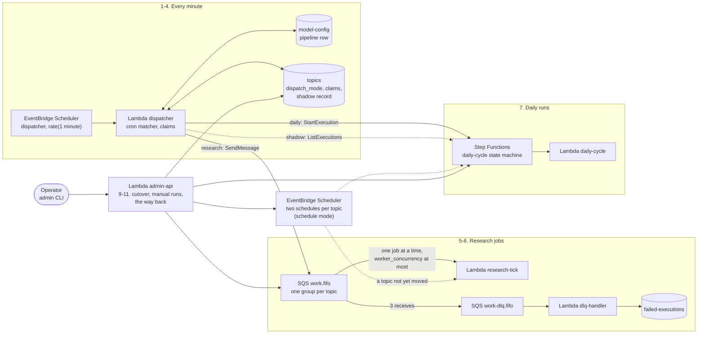

# The queue platform: the dispatcher, the work queue and the cutover

How a topic's research heartbeat and daily article are started once it no longer has schedules of
its own: one dispatcher a minute reads every topic's cadence, claims the work that is due on the
topic's row, sends research jobs to a FIFO work queue and starts the daily runs itself. Then how a
topic is watched in shadow mode before it moves, how it moves (the cutover and its pre-flight),
how it moves back, and what a manual run, a pause and a restore do to a topic on the queue.

It exists because two EventBridge Scheduler schedules per topic, each at a hand-set stagger slot,
stop fitting an hour past about twelve topics, and nothing capped how many research ticks ran at
once. The queue platform makes the number of topics a matter of rows, not schedules: one schedule
for the dispatcher, one queue, and one knob (`worker_concurrency`) for how many research jobs run
at once however many topics there are. The two schedules stay as the permanent undo: a topic is
moved one at a time, after shadow mode has watched it, and can be moved back in one command.

The settings and their defaults are in
[configuration.md](../configuration.md#the-queue-platform-prompts-and-evals); moving topics in
production, and back, is in the
[production runsheet](../production-runsheet.md#moving-topics-to-the-queue-and-back); the alarms
are in [observability.md](../observability.md#the-queue-platforms-and-evals-alarms). The design,
and the reasons behind it, are in
[model-ranch-prompt-assets-evals.md](../enhancements/archive/model-ranch-prompt-assets-evals.md)
(sections 4.7, 4.8 and 5.1), which builds on
[dispatcher-sqs-enhancement.md](../enhancements/archive/dispatcher-sqs-enhancement.md). This page does not
repeat them.

**In the assistant.** `architecture(feature="queue-platform")` walks through the steps below with
this environment's resource names on screen. It tells them in ten: the tick and its record (1 and
12) are one step, and the daily run (7) is told with the step that starts it (4). Ask about a part
by name for more: `architecture(name="dispatcher")` (the function, or with `kind="schedule"` its
schedule), `"work"` and `"work-dlq"` (the queues), `"daily-cycle"` (the state machine) or
`"topic-schedules"` (the two schedules a topic on them keeps), or about the layer that holds it
(`orchestration`). Where evals are on, `evals status` shows the work queue's depth and the age of
its oldest job, and how many topics are in each dispatch mode.

Resource names below use `<prefix>` (your `unique_name_prefix`) and `<env>` (`dev` or
`production`). Both environments build it from one module,
[`infra/modules/work-queue/`](../../infra/modules/work-queue/), always instantiated.

## Contents

- [The steps](#the-steps)
- [The tick](#the-tick)
- [Reading a cadence: the cron matcher](#reading-a-cadence-the-cron-matcher)
- [Claims](#claims)
- [A research job on work.fifo](#a-research-job-on-workfifo)
- [A daily run](#a-daily-run)
- [Shadow mode, as built](#shadow-mode-as-built)
- [The cutover and its pre-flight](#the-cutover-and-its-pre-flight)
- [Cutover day](#cutover-day)
- [The way back](#the-way-back)
- [Manual runs, pausing, and a restore](#manual-runs-pausing-and-a-restore)
- [Flows](#flows)
- [When something fails](#when-something-fails)
- [Where state lives](#where-state-lives)
- [Permissions](#permissions)
- [Where in the code](#where-in-the-code)
- [Design history](#design-history)

## The steps

| # | Step | What happens | Where in the code / infra |
|---|---|---|---|
| 1 | **The tick** | Every minute a schedule invokes the dispatcher. It reads the `pipeline` row and every topic, skips a paused topic, and considers each topic on the queue, and each topic still on its schedules while shadow mode is on ([in detail](#the-tick)). | [`lambdas/dispatcher_handler.py`](../../lambdas/dispatcher_handler.py); `Dispatcher.tick` in [`lambdas/common/dispatch.py`](../../lambdas/common/dispatch.py); `aws_scheduler_schedule.dispatcher` (`<prefix>-<env>-dispatcher`) |
| 2 | **Reading the cadence** | The topic's two expressions, as the stagger writes them for the Scheduler, are parsed by the cron matcher. One it cannot read is logged and the topic is skipped, never guessed at ([in detail](#reading-a-cadence-the-cron-matcher)). | `effective_cadences`, `parse_cadences` in `dispatch.py`; [`lambdas/common/cron_match.py`](../../lambdas/common/cron_match.py); `effective_schedules` in [`common/stagger.py`](../../lambdas/common/stagger.py) |
| 3 | **Research is due** | The research cadence has a turn since the last tick and the topic is due by the research tick's own rule. The topic is claimed on its row, then one job goes to `work.fifo` ([in detail](#claims)). | `research_turn` in `cron_match.py`; `is_due` in [`common/research_schedule.py`](../../lambdas/common/research_schedule.py); `claim_research`, `research_message`, `research_dedup_id` in `dispatch.py` |
| 4 | **The daily run is due** | Today's first daily turn has passed in the topic's zone and the topic has not been dispatched today. The day is claimed, then the daily-cycle state machine is started under a name made from the topic, the date and the claim number, at most `daily_starts_per_tick` a minute ([in detail](#a-daily-run)). | `daily_turn_passed` in `cron_match.py`; `claim_daily`, `execution_name`, `_start_daily` in `dispatch.py` |
| 5 | **The research job** | An event source mapping hands the research tick one job at a time, at most `worker_concurrency` at once. The tick runs at the minute the dispatcher found the topic due, not the minute it left the queue ([in detail](#a-research-job-on-workfifo)). | `aws_lambda_event_source_mapping.research_tick`; `_queue_record`, `_stamp` in [`lambdas/research_tick_handler.py`](../../lambdas/research_tick_handler.py) |
| 6 | **Dead letters** | A job received three times without finishing goes to `work-dlq.fifo`, whose consumer writes a `research_job` row to FailedExecutions ([in detail](#when-something-fails)). | `aws_sqs_queue.work_dlq`, `aws_lambda_event_source_mapping.work_dlq`; [`lambdas/dlq_handler.py`](../../lambdas/dlq_handler.py) |
| 7 | **The daily run** | The state machine runs as it does from a schedule: `NameTheRun` adds the execution's id, the daily cycle uses it as its run id, and Step Functions' retries and the pipeline dead-letter queue are unchanged. | `aws_sfn_state_machine.daily_cycle` in each environment's `main.tf`; `_run_id` in [`lambdas/daily_cycle_handler.py`](../../lambdas/daily_cycle_handler.py) |
| 8 | **Shadow mode** | A topic still on its schedules is never sent or started. The tick records the turns it would have dispatched on the row and counts where the schedules did otherwise ([in detail](#shadow-mode-as-built)). | `_shadow_research`, `_judge_research`, `_shadow_daily`, `_daily_ran` in `dispatch.py` |
| 9 | **The cutover** | `topics update <id> --dispatch-mode queue`: a pre-flight, a confirmation, the two schedules deleted, then the row written with `dispatch_mode: queue` and, after today's turn, today's daily claim ([in detail](#the-cutover-and-its-pre-flight)). | `_move_to_queue`, `_update_topic` in [`lambdas/admin_api_handler.py`](../../lambdas/admin_api_handler.py); `cutover_refusals`, `cutover_day` in `dispatch.py` |
| 10 | **Manual runs** | `topics trigger` on a topic on the queue sends a research job of its own to `work.fifo`, or starts the state machine under a manual name, rather than invoking a Lambda ([in detail](#manual-runs-pausing-and-a-restore)). | `_trigger_on_the_queue` in `admin_api_handler.py`; `manual_research_dedup_id`, `manual_execution_name` in `dispatch.py` |
| 11 | **The way back** | `topics update <id> --dispatch-mode schedule`, or `topics reschedule --dispatch-mode schedule` for every topic on the queue: the row says schedule first, then its two schedules are written ([in detail](#the-way-back)). | `_update_topic`, `_reschedule_topics`, `_apply_topic_schedules` in `admin_api_handler.py` |
| 12 | **The tick's record** | Each tick prints one `dispatcher_tick` evidence line with what it did, and stores its time as `last_tick` for the next tick's window. The heartbeat alarm counts the lines that say `ok`. | `handler` in `dispatcher_handler.py`; `dispatcher_tick` in [`common/evidence.py`](../../lambdas/common/evidence.py); `aws_cloudwatch_metric_alarm.dispatcher_heartbeat` |

## The tick

One Lambda, `<prefix>-<env>-dispatcher` (60 seconds), invoked once a minute by
`<prefix>-<env>-dispatcher` (`rate(1 minute)`). A tick:

1. reads the `pipeline` row of `<prefix>-<env>-model-config` and scans `<prefix>-<env>-topics`;
2. goes through the topics in topic-id order. A paused topic is skipped. A topic whose
   `dispatch_mode` is `queue` is dispatched for real. A topic on its schedules (`dispatch_mode`
   unset or `schedule`) is only ever shadowed, and only while `dispatch_shadow` is on;
3. for each topic considered, works out its research turn and its daily turn (below), and sends,
   starts or records accordingly;
4. writes `last_tick` (this tick's time) on the `pipeline` row;
5. prints `dispatcher_tick` with `considered`, `dispatched` (research jobs sent), `started` (daily
   runs started) and `skipped_unparsable`, its `outcome` (`ok` or `error`) and how long it took.

Two settings on the `pipeline` row, changed with `pipeline-config set` and read every tick:

| Setting | Default | What it does |
|---|---|---|
| `dispatch_shadow` | `true` | Whether topics still on their schedules are shadowed. Off, the tick considers only topics on the queue. |
| `daily_starts_per_tick` | 3 (1 to 10) | How many daily runs one tick may start. Once the count is reached, a later topic whose turn has passed waits for the next minute: its turn stays passed and its day unclaimed. |

A value that is not valid is ignored for its default, with a log line, so a hand edit never stops
the dispatcher.

**It raises,** unlike the pipeline's other handlers. A tick that could not do its job (the Topics
scan, a send to the queue, a throttled `StartExecution`, or the `last_tick` write) is printed and
raised again, so the function's errors alarm fires. So is a tick that finished but had a daily
start refused for a reason that is not the topic's own ([a daily run](#a-daily-run)): it runs every
other topic and writes `last_tick` first. One topic's own trouble (a zone the runtime does not
know, a field missing, an execution name or input Step Functions refuses) is printed as
`dispatcher: topic_id=... skipped: ...` and the tick goes on to the next topic.

## Reading a cadence: the cron matcher

The dispatcher reads exactly what the stagger would write to the Scheduler for the topic
(`stagger.effective_schedules`, from the topic's cadences and slot, the pipeline row's
`stagger_minutes` and how many topics there are), so a topic fires at the minute its schedule
would have. [`cron_match.py`](../../lambdas/common/cron_match.py) accepts only the shapes the
stagger emits or passes through:

| Field | Accepted |
|---|---|
| Minutes | a whole number, `*/N`, or a list (`0,30`) |
| Hours | `*`, a whole number, `*/N`, `a/N`, a list (`9,21`), a range (`9-17`, or `22-2` across midnight), a range with a step |
| Day of month | `*`, `?`, a whole number, or `1/N` |
| Month, year | `*` |
| Day of week | `*`, `?`, a list of names (`MON,WED,FRI`) or a range of names (`MON-FRI`) |
| A rate | `rate(N minutes|hours|days)` |

Anything else (`at(...)`, a month or a year, `#`, `L` or `W`, a weekday range that wraps, both day
fields set) is refused. The tick logs
`dispatcher: cadence unparsable topic_id=... expression=...`, counts it in `skipped_unparsable` and
moves on. The admin API refuses such a cadence for a topic on the queue, and the pre-flight
refuses to move a topic that has one.

**Turns.**

- **Research, a cron.** The minutes the cron names, matched over the window since the last tick,
  `(last_tick, now]`, at most a day back. A tick that failed costs nothing: the next one looks back
  to the last one that finished.
- **Research, a rate.** Every minute is a turn, and the research tick's own due rule (`is_due`:
  the topic's research interval since `last_research_at`, less 5 minutes) decides.
- **Daily.** A daily `rate(...)` is refused. A cron's daily turn has *passed* once today's clock,
  as an `(hour, minute)` pair in the topic's `daily_timezone`, has reached the first turn it names
  for today. Comparing clock pairs is what makes daylight saving behave: on the spring-forward
  morning a 02:30 turn, which does not exist, fires at 03:00; on the fall-back morning 02:30 comes
  round twice, and the day's claim stops the second.
- **A daily cron with several hours** (`9,21`, `*/4`) dispatches **once a day**, at the first
  turn. The Scheduler fired at each; this is a change of behaviour, on purpose.

## Claims

A claim is a conditional write on the topic's row that stops two overlapping ticks queueing the
same work twice. The expressions are constants in `dispatch.py`, and tests hold them word for word
to the design.

| Claim | Update | Only when |
|---|---|---|
| Daily | `SET last_daily_dispatched_on = :today ADD daily_claim_n :one` | `last_daily_dispatched_on` is missing or is not today (the topic's local date) |
| Research | `SET research_claimed_at = :now` | `research_claimed_at` is missing or older than one research interval, less the same 5 minutes `is_due` allows, so a topic due at :05 is also claimable at :05 |

Both also require the row to exist, so a claim never recreates a deleted topic. A send or start
that fails after its claim **releases** it (the field put back as it was, or removed), but only
while the row still holds this tick's value. A daily release gives `daily_claim_n` back in the same
write, so the next try sends the same execution name: the start that failed may have reached Step
Functions all the same, which answers that name with success while the run is running and with
`ExecutionAlreadyExists` once it has closed, so the day's run never starts twice.

## A research job on work.fifo

`<prefix>-<env>-work.fifo` is a FIFO queue with content-based deduplication off:

- **The body:** `{"topic_id": ..., "job": "research", "force": false, "due_checked_at": <the
  tick's time>, "dispatched_at": <the same>}`.
- **The group:** the topic id, so one topic's jobs run one at a time and in order.
- **The deduplication id:** `<topic_id>:research:<yyyy-mm-ddTHH:MM>`, SQS's own guard against the
  same minute sent twice.
- **Visibility:** 720 seconds, six times the research tick's 120-second timeout. Three receives
  without finishing send a job to `<prefix>-<env>-work-dlq.fifo`.

The event source mapping hands the research tick one job per invocation (`batch_size` 1), with
at most `worker_concurrency` jobs running at once (the Terraform variable, default 2, the least
SQS accepts). The research tick reads the record's body as it reads a direct invoke's, ignores
`job`, and runs **at `due_checked_at`**: that time decides its own due check and is the
`last_research_attempt_at` it stamps before the fetch and the `last_research_at` a successful
fetch stamps, never the time it ran. `last_research_at` never moves backwards (the later of the
stored value and `due_checked_at`). Otherwise a topic behind a busy
queue would be stamped late, found not due at its next turn, and researched only every second
heartbeat. A stale job is harmless for the same reason. A record whose `due_checked_at` cannot be
read runs at now, as a direct invoke does.

The research tick never raises, so a job that fails cleanly is answered and deleted like any
other; only a timeout or a crash leaves it to be received again.

## A daily run

There is no message for a daily run. The dispatcher claims the day, then calls `StartExecution` on
the daily-cycle state machine with:

- **the name** `<slug>-<local date>-<n>`: the slug is the topic id lower-cased, every character
  outside `[a-z0-9-]` replaced by `-`, at most 40 characters; the date is today in the topic's zone;
  `n` is the topic's claim count (`daily_claim_n` after the claim);
- **the input** `{"topic_id": ...}`.

The name is what makes a repeat harmless: Step Functions refuses a second execution of the same
name (`ExecutionAlreadyExists`), which the dispatcher counts as consumed, with a log line and no
retry. The same name while the first is still running, with the same input, is answered as a
success. From there the run is the one a schedule starts: `NameTheRun` adds `$$.Execution.Id`, the
daily cycle's `already_written` check and the state machine's retries work unchanged
([article research](article-research.md#runs-that-write-nothing-and-runs-that-fail)).

A start that fails releases the claim, with its number, and what happens next depends on why:

- **Throttled** (`ThrottlingException`, `TooManyRequestsException`, `ExecutionLimitExceeded`): the
  tick raises at once, so it fails and the next tick tries again.
- **The topic's own name or input** (`InvalidName`, `InvalidExecutionInput`,
  `ValidationException`): that topic's trouble alone, printed as `skipped`, and the tick goes on.
- **Any other refusal** (the role, the state machine, the service), which no one topic causes and
  likely every queue topic meets: printed as `dispatcher: topic_id=... start refused: ...`, and the
  tick goes on to the other topics, so their research still goes out and their starts are tried.
  Once it has written `last_tick` it raises `DispatchError`, so the dispatcher's errors alarm fires,
  and the next tick tries again.

## Shadow mode, as built

While `dispatch_shadow` is on, every unpaused topic still on its schedules is shadowed: the tick
decides as it would for a topic on the queue, sends and starts nothing, and keeps a record on the
row that the cutover's pre-flight reads. It never changes what the topic's schedules do.

**Research.** At a research turn, the turn is recorded as `shadow_last_research_dispatch_at` when
the live path would have claimed it (the topic due, and no record younger than the claim's
expiry), or when the schedule's own research tick, firing in the same minute, has already stamped
`last_research_at` within 5 minutes of now. A recorded turn is judged once, **5 minutes after the
turn**, by the tick whose window holds that moment, against the turn the schedule's research tick
took: the later of `last_research_at`, which it stamps only once the source has answered, and
`last_research_attempt_at`, which it stamps once it has found the topic due (or was forced),
before it asks the source. So a tick whose fetch failed still took its turn, as a queue job would
have, failing the same way. The turn matches when that stamp is within 5 minutes of it, and is a
mismatch when there is no stamp or it is earlier than that. A stamp later than that is a run-now
made since the turn, which replaced the turn's evidence, so the turn is left unjudged rather than
counted. Each judged turn dates itself on the row: one on time in
`shadow_research_matched_at`, a mismatch in `shadow_research_mismatch_at` (which also sets
`shadow_clean_days` back to 0, [below](#the-recent-stretch-shadow_clean_days)). A research cadence
that is a `rate(...)` is recorded, once an interval, but **never judged**: the Scheduler's firing
minute for a rate cannot be worked out from the expression.

A heartbeat that drifts more than 5 minutes off its computed minute is counted at the first turn
after the drift began. When the topic's research interval is shorter than its cadence's period,
every later turn finds it due again and is judged a mismatch too; otherwise the topic is not due at
the computed minute, so its later turns are neither recorded nor judged. Either way the pre-flight
waits for a research turn judged on time since the last research mismatch, which a drifted
heartbeat never gives, nor one that drifted before shadow mode began.

**Daily.** Once a day, when the daily turn passes, the turn is recorded as
`shadow_last_daily_dispatch_at`, and the previous recorded day is checked: did an execution of the
daily-cycle state machine with this topic's id in its input start on that local date? The check
reads the executions newest first (`ListExecutions`, then `DescribeExecution` for each one that
started that day), up to 10 pages of 100, and stops at the first execution older than the day.

- It ran: the day counts in `shadow_checked_days`, and in `shadow_clean_days` too unless a
  research mismatch is dated at or after the previous daily record (then `shadow_clean_days` goes
  back to 0). A research mismatch judged in the same tick as the check is handed to it.
- It did not: the day counts in `shadow_checked_days`, adds one to `shadow_mismatches` and sets
  `shadow_clean_days` back to 0.
- The check could not answer (Step Functions refused, or the pages ran out): the day counts in
  `shadow_unchecked`, never as a match, so a missing grant can never pass as zero mismatches, and
  sets `shadow_clean_days` back to 0.

The first shadow day has nothing before it to compare, so it adds to no count.

### The recent stretch: shadow_clean_days

`shadow_mismatches`, `shadow_unchecked` and `shadow_checked_days` are the topic's whole history:
they only ever grow, and are only shown. What the pre-flight judges is the recent stretch.
`shadow_clean_days` counts the daily checks in a row that found the previous day's run with no
research mismatch since the daily record before, so each one stands for a full day, record to
record, with no mismatch of either kind. A mismatch of either kind, or an unchecked day, sets it
back to 0. So one old mismatch, or a record from before a cadence change, holds the cutover only
until a full day after it has been watched clean (a day or two, by where in the day it fell), never
until someone clears the row by hand. A row whose days were checked before the count existed is
read as clean when it never counted a mismatch or an unchecked day.

`topics schedule` shows the record under each topic as
`N mismatches · N unchecked days · N checked days · N clean in a row` (the last part once the
dispatcher has counted clean days for it), with the last turns recorded.

## The cutover and its pre-flight

`topics update <id> --dispatch-mode queue` moves one topic. Moving to the queue is never done in
bulk: each topic has its own pre-flight and its own confirmation.

1. **The pre-flight** (`dispatch.cutover_refusals`). The admin API answers 400 with every reason it
   finds, in plain words, before anything is deleted:
   - the topic is paused (shadow mode does not watch a paused topic);
   - the dispatcher cannot read its research or daily cadence, judged both as the stagger writes
     it now and as stored (the dispatcher falls back to the stored text whenever the topic's
     offset comes to 0, so a daily `rate(...)` is refused whatever the stagger is now), or its
     zone;
   - when its cadences are readable: the schedules written for it (`research_schedule` and
     `daily_schedule` on its row) are not the ones the dispatcher works out now, or were never
     recorded. The move judges today's daily turn by the dispatcher's expression
     ([cutover day](#cutover-day)), but the Scheduler ran today by the written one, and the two
     part whenever a topic is added or deleted (the daily offset counts the topics) or the stagger
     changes, since only `topics reschedule` writes every topic's schedules again. A move between
     the two minutes would start a second run that day, or none. The refusal says to run
     `topics reschedule` first. The row is judged as this update would write it, so a cadence or
     slot changed in the same update is refused the same way: make that change in an update of its
     own, then move;
   - its slug has no letter or digit, or another topic has the same slug (their daily runs would
     take each other's names);
   - its id cannot be the work queue's message group id (letters, digits and punctuation, short
     enough for the longest deduplication id);
   - shadow mode has not yet checked a full day (its first check runs at its second shadow daily
     turn), or has not watched a full day clean since its last mismatch or unchecked day
     (`shadow_clean_days` is 0; the reason gives the whole-history counts), or, for a cron research
     cadence, has seen none of its research turns taken on time since its last research mismatch
     (the reason names that turn), or none at all. A topic whose research cadence is a `rate(...)`
     is judged by its daily record alone.
2. **The confirmation.** Without `confirm: true` the API answers 409 `confirm_required`, naming the
   two schedules it will delete. The CLI asks first, unless `--yes`.
3. **The schedules are deleted,** before the row says queue, so a failure in between leaves the
   topic running nowhere, but never on both paths at once (two articles in a day). A delete that
   fails answers 502 and the row still says schedule; one of the two may be gone already, and the
   same update run again (or `topics reschedule`, which writes both back) puts that right.
4. **The row** is written with `dispatch_mode: queue` and, when today's turn has passed, today's
   daily claim ([cutover day](#cutover-day)). Applying the row then records the expressions the
   dispatcher reads and deletes nothing: the schedules are deleted once, in step 3.

From the next minute the dispatcher runs the topic. A topic on the queue keeps its cadences and
its slot, and its row keeps recording the expressions the dispatcher reads (`research_schedule`,
`daily_schedule`). An update to a topic on the queue is checked against the matcher, with the
same 400 as the pre-flight's cadence reason.

**A 500 from the move.** If recording `research_schedule` and `daily_schedule` fails after the row
is written, the API answers a bare 500 `internal server error`, but the move has already happened:
the row says queue, the schedules are gone, and the dispatcher runs the topic from the next minute.
Nothing deletes the schedules a second time, so no failed delete can answer 500 for a move made.
Run `topics schedule` before anything else. If it
shows the topic on the queue, nothing more is needed; running the same update again is harmless,
since it is no longer a move, so it is neither checked nor confirmed, and it answers 200. A failure
on the row write itself is the same bare 500 with the row still on schedule and its schedules gone:
`topics update <id> --dispatch-mode schedule` writes them back.

The API also takes `dispatch_mode: queue` when a topic is created (the CLI has no flag for it).
The same checks apply, bar the schedules written and the shadow record, which a new topic cannot
have, and the topic is given no schedules.

## Cutover day

The Scheduler may already have run today's daily cycle when a topic moves. Two things stop a
second run:

- **The cutover-day claim.** When today's daily turn has already passed in the topic's zone, the
  write that sets `dispatch_mode` also sets `last_daily_dispatched_on` to today
  (`dispatch.cutover_day`). `daily_claim_n` is left as it is, so tomorrow's run takes the next
  number: a topic moved after its turn starts nothing today and starts `<slug>-<tomorrow>-<n>`
  tomorrow. A topic created on the queue after today's turn is given the same claim.
- **A same-day shadow record counts as dispatched.** A live topic never writes a shadow field, so a
  `shadow_last_daily_dispatch_at` dated today can only mean the Scheduler owned today; the live
  path treats it as today's dispatch.

Both judge today's turn by the expression the dispatcher works out, which is why the pre-flight
first asks that the expressions written to the Scheduler are the same.

## The way back

Schedule mode is the permanent undo, for one topic or all of them:

- **One topic:** `topics update <id> --dispatch-mode schedule`.
- **Every topic on the queue:** `topics reschedule --dispatch-mode schedule`, which answers
  `moved_to_schedule` with the topics it moved (`--dry-run` shows them and writes nothing).

Either way, the row says `schedule` **before** the two schedules are written, so the dispatcher has
let go of the topic first and it never runs on both paths. The same write drops the topic's
`shadow_last_daily_dispatch_at`, which dates from before the cutover: kept, its first shadow daily
check would ask about a day too far back for the pages it reads, and count an unchecked day that
would hold the next cutover for good. A topic whose schedules then fail to be written is off the
queue with nothing running it: the answer says so (502 for one topic, an error on its row for the
bulk undo), and the same command run again writes them.

## Manual runs, pausing, and a restore

**A manual run** (`topics trigger`) on a topic on the queue goes the way the dispatcher's would, so
it waits its turn behind the topic's other work rather than racing it:

- **research_tick:** a research job on `work.fifo` with `force: true` ("check now"), in the
  topic's group, with a deduplication id of its own, `<topic_id>:research:manual:<token>`, so SQS
  never drops it as the dispatcher's job of the same minute or the last manual one;
- **daily_cycle:** the state machine started as `<slug>-<local date>-manual-<HHMMSS>` (the topic's
  zone), with `force` passed on when asked for. Two in the same second share a name: the second is
  refused with a 409.

Neither touches the dispatcher's claims. The topic's own turn still comes, and the daily cycle's
already-written check holds. `network_prefetch` still invokes the research tick directly. With no
work queue in the deployment (`WORK_QUEUE_URL` empty), a manual research job answers 500.

**Pausing.** The dispatcher skips a paused topic, and a paused topic's handlers refuse it whatever
invoked them. A topic on the queue has no schedules to disable. A queue topic resumed after
today's daily turn has passed is given today's date as `last_daily_dispatched_on` in the same write
that unpauses it (`dispatch.cutover_day`, the cutover's rule), so the dispatcher starts its next run
tomorrow, as a schedule enabled again after its turn would, rather than starting today's late.
`daily_claim_n` is left as it is. Resumed before the turn, it runs today at its turn. When the
dispatcher cannot read its cadences or zone, nothing is claimed: it skips such a topic anyway.

**A restore** (`backup restore`) writes each topic's row as the snapshot holds it, with one field
changed for a topic on the queue: its `last_daily_dispatched_on` is the newest of the snapshot's,
the live row's (only when the live row is in the same zone, since another zone's date can be
tomorrow here) and, once today's daily turn has passed in its zone, today's (`dispatch.cutover_day`,
judged with this deployment's pipeline row and every topic it will hold). So a snapshot from before
today's run starts no second run today, and an older claim is never written over a newer one the
live row holds. `daily_claim_n` is left as the snapshot has it: an execution name carries the date.
A claim the dispatcher makes between the restore's read of the live rows and its write is still
written over, since a batch write cannot be conditional. Then, in its schedules phase, the restore
deletes the schedules of every restored row that says queue (it may have gone back to them after
the snapshot was taken).

## Flows

**Research on the queue.** Dispatcher tick → `cron_match` finds a turn in `(last_tick, now]` →
`is_due` → claim `research_claimed_at` → `SendMessage` to `work.fifo` (group the topic id,
deduplicated by the minute) → event source mapping (one job, at most `worker_concurrency` at once)
→ research tick at `due_checked_at` → `no_change` or a Finding, `last_research_at` stamped no
earlier than before. Loss points: a failed send releases the claim and fails the tick (alarm); a
job that times out three times reaches `work-dlq.fifo` → `dlq_handler` → a `research_job` row in
FailedExecutions.

**A daily article on the queue.** Dispatcher tick → the daily turn has passed in the topic's zone →
not dispatched today → under `daily_starts_per_tick` → claim `last_daily_dispatched_on`,
`daily_claim_n` → `StartExecution` named `<slug>-<date>-<n>` → `NameTheRun` adds the execution id →
daily cycle (`_run_id` the execution id; `already_written` check) → the article
([article research](article-research.md)). Loss points: `ExecutionAlreadyExists` (consumed, no
retry); a failed start releases the claim and its number; a throttled one fails the tick at once,
and one refused for a reason not the topic's own fails it once every other topic has run; a run
that fails is retried by the state machine and then reaches the pipeline dead-letter queue, as from
a schedule.

**A shadowed topic.** Dispatcher tick → research turn recorded, judged 5 minutes later against
the later of `last_research_at` and `last_research_attempt_at`, and dated on the row as matched or
mismatched → daily turn recorded, the previous recorded day checked against the state machine's
executions → the counts and `shadow_clean_days` on the row → `topics schedule` → the pre-flight.

**The cutover.** (`topics reschedule` first, whenever a topic was added or deleted or the stagger
changed since the schedules were written) → `topics update <id> --dispatch-mode queue` →
pre-flight (400) → 409 `confirm_required` → the CLI asks → the schedules deleted, once → the row
written with `dispatch_mode: queue` and the cutover-day claim → the next tick runs it.

## When something fails

| What failed | What you see | What to do |
|---|---|---|
| The dispatcher has stopped, or fails every minute | `<prefix>-<env>-dispatcher-heartbeat`: fewer than one `ok` tick in each of three 5-minute periods (missing data counts as breaching); the function's errors alarm for a tick that raised | Read `/aws/lambda/<prefix>-<env>-dispatcher` for the tick's error. A topic on the queue is not run meanwhile, unless the log says `start refused` (the row below): then research and the other topics' starts still go out. To move every topic back: `topics reschedule --dispatch-mode schedule` |
| Jobs wait too long | `<prefix>-<env>-work-queue-age`: the oldest job in `work.fifo` more than 900 seconds old | Look for the research tick's errors or throttles; raise `worker_concurrency` if the queue is simply long |
| A research job could not finish | `<prefix>-<env>-work-dlq-messages` and `-work-dlq-received`; a `research_job` row in `failed-executions list`; the DLQ handler's log line `research job for topic_id=... failed` | Read the research tick's log for the timeout or crash. Nothing replays the job: the topic's next turn sends a new one |
| A daily run could not be started | `dispatcher: topic_id=... start refused: ...` in the dispatcher's log every minute a start is refused, and the function's errors alarm; if the refusal lasts 15 minutes, `<prefix>-<env>-dispatcher-heartbeat` too (a refused tick's `dispatcher_tick` line says `error`), although research still goes out | Step Functions refused the dispatcher's role, the state machine or the service, not the topic: read the refusal and mend that. Each claim was given back with its number, so once mended the next tick starts the day's run under the same name |
| A daily run failed | As from a schedule: the pipeline dead-letter queue, `failed-executions list`, the daily cycle's alarms | [Article research](article-research.md#runs-that-write-nothing-and-runs-that-fail) |
| A cadence the dispatcher cannot read | `dispatcher: cadence unparsable topic_id=...` every minute; `skipped_unparsable` in `dispatcher_tick` | Change the cadence (`topics update`), or move the topic back to its schedules |

The dispatcher's errors and throttles alarms come from the observability module, like every
pipeline Lambda's; the other four are the work-queue module's own. Each emails the alerts topic
([observability.md](../observability.md#the-queue-platforms-and-evals-alarms)).

## Where state lives

| What | Where |
|---|---|
| Whether a topic is on the queue | `dispatch_mode` on its row of `<prefix>-<env>-topics` (unset means its schedules) |
| The claims | `last_daily_dispatched_on`, `daily_claim_n` and `research_claimed_at` on the topic's row |
| The shadow record | `shadow_last_research_dispatch_at`, `shadow_last_daily_dispatch_at`, `shadow_mismatches`, `shadow_unchecked`, `shadow_checked_days`, `shadow_clean_days`, `shadow_research_mismatch_at` and `shadow_research_matched_at` on the topic's row |
| The research tick's own stamps | `last_research_at` (a fetch that answered) and `last_research_attempt_at` (a turn taken, stamped before the fetch, and read only by shadow mode) on the topic's row |
| The expressions the dispatcher reads | `research_schedule` and `daily_schedule` on the topic's row, as the stagger writes them; for a topic on its schedules, what was last written to the Scheduler, which the pre-flight compares with what the dispatcher works out now |
| The settings and the last tick | `dispatch_shadow`, `daily_starts_per_tick` and `last_tick` on the `pipeline` row of `<prefix>-<env>-model-config` |
| Jobs waiting | `<prefix>-<env>-work.fifo`; those that could not finish in `<prefix>-<env>-work-dlq.fifo`, then a row in `<prefix>-<env>-failed-executions` |
| Daily runs | the daily-cycle state machine's executions, named `<slug>-<date>-<n>` or `<slug>-<date>-manual-<HHMMSS>` |
| The schedules of a topic not yet moved | EventBridge Scheduler, group `default`: `<prefix>-<env>-<topic_id>-research-tick` and `-daily-cycle` |
| Logs | `/aws/lambda/<prefix>-<env>-dispatcher`, 90 days |

## Permissions

The dispatcher runs as the shared `lambda_exec` role. The work-queue module adds two inline
policies to that role, so every Lambda on it holds these rights (accepted; the admin API needs the
first two for manual runs):

| Policy | What it allows |
|---|---|
| `<prefix>-<env>-lambda-dispatch` | `sqs:SendMessage` on `work.fifo`; `states:StartExecution` and `states:ListExecutions` on the daily-cycle state machine; `states:DescribeExecution` on its executions (the last two for shadow mode's daily check) |
| `<prefix>-<env>-lambda-consume-work` | `sqs:ReceiveMessage`, `DeleteMessage` and `GetQueueAttributes` on `work.fifo` (the research tick's mapping) and `work-dlq.fifo` (the DLQ handler's) |

The dispatcher's schedule runs as a role of its own, `<prefix>-<env>-dispatcher-scheduler-invoke`,
which may invoke the dispatcher and nothing else.

## Where in the code

| Part | Code | Infra |
|---|---|---|
| The tick and its decisions | `lambdas/dispatcher_handler.py`; `lambdas/common/dispatch.py` (`Dispatcher`, the claims, `SETTINGS`, `validate_setting`, `effective_settings`) | `aws_lambda_function.dispatcher`, `aws_scheduler_schedule.dispatcher` in [`infra/modules/work-queue/main.tf`](../../infra/modules/work-queue/main.tf) |
| The cron matcher | `lambdas/common/cron_match.py` (`parse`, `research_turn`, `daily_turn_passed`) | none |
| The queues and their consumers | `_queue_record`, `_stamp` in `lambdas/research_tick_handler.py`; `lambdas/dlq_handler.py` | `aws_sqs_queue.work`, `aws_sqs_queue.work_dlq`, both event source mappings; `worker_concurrency` in each environment's `variables.tf` |
| The cutover, the way back, manual runs, a resume | `_update_topic`, `_move_to_queue`, `_reschedule_topics`, `_apply_topic_schedules`, `_trigger_on_the_queue`, `_queue_resume_day`, `_schedule_view` in `lambdas/admin_api_handler.py`; `cutover_refusals`, `cutover_day`, `cadence_problem`, `written_schedule_problem`, `shadow_problems`, `slug_problem`, `queue_id_problem` in `dispatch.py` | the admin API's `PUT /topics/{topic_id}`, `POST /topics/reschedule`, `POST /topics/{topic_id}/trigger`, `POST /topics/{topic_id}/resume` |
| A restore's daily claim | `_restored_topics`, `_newest_claim` in [`lambdas/common/backup.py`](../../lambdas/common/backup.py) | none |
| The commands | `scripts/admin_cli.py`: `topics update --dispatch-mode`, `topics reschedule --dispatch-mode schedule`, `topics schedule`, `topics trigger`, `pipeline-config set --dispatch-shadow --daily-starts-per-tick` | none |
| Alarms | none | `work_queue_age`, `work_dlq_messages`, `work_dlq_received`, `dispatcher_heartbeat` (with the `dispatcher_ticks` metric filter) in the module; errors and throttles through `local.pipeline_lambda_function_names` |

## Design history

- [model-ranch-prompt-assets-evals.md](../enhancements/archive/model-ranch-prompt-assets-evals.md): the
  design, built as phase Q (Q0 the matcher and the dispatcher's decisions, Q1 the queue platform in
  shadow mode, Q2 the per-topic cutover), with the decisions the reviews and the bug sweep made in
  its section 7.1.
- [dispatcher-sqs-enhancement.md](../enhancements/archive/dispatcher-sqs-enhancement.md): the proposal it
  builds on. Its step 3, removing per-topic scheduling, is superseded: schedule mode stays as the
  undo.
- [Article research](article-research.md): what the research tick and the daily cycle do once a
  job or a run reaches them.
