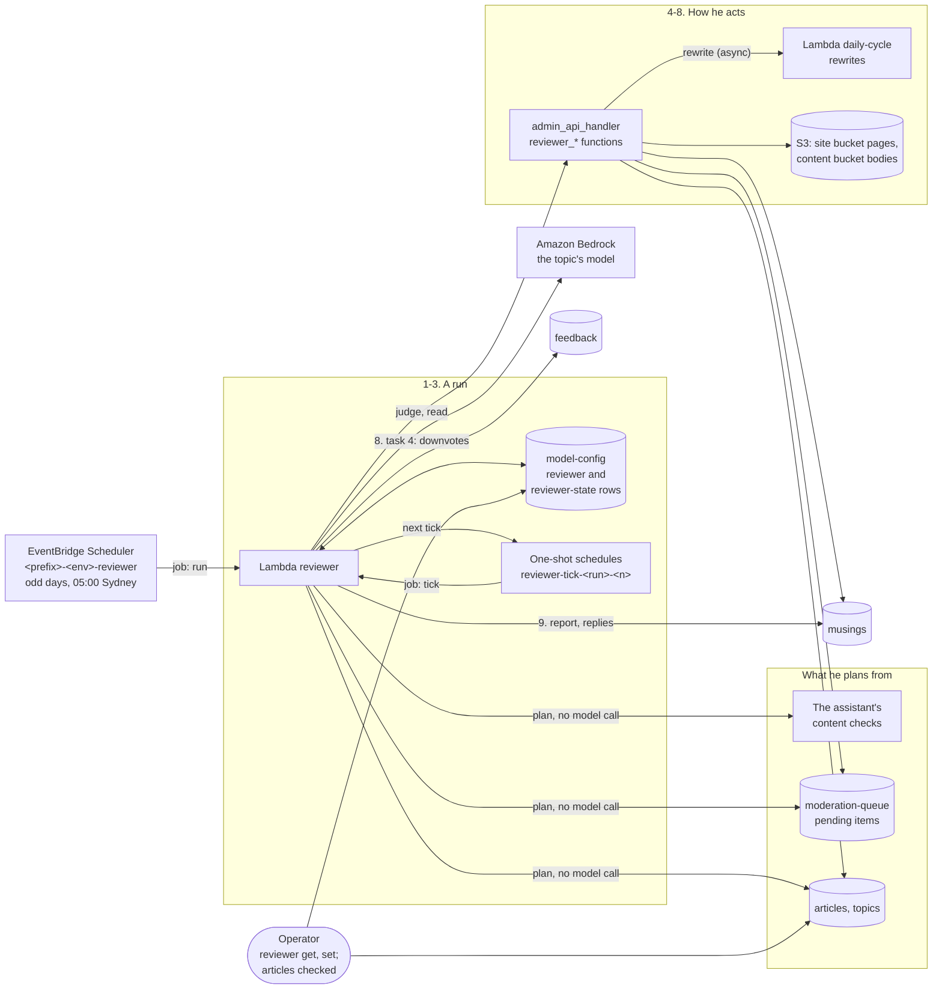

# Professor Grizzlewick: the reviewer bear

How a second bear decides what the admins have left waiting. He is woken every second day. He plans
his run from the tables with no model call, then works through it a couple of tasks at a time, on
one-shot schedules a few minutes apart. His five tasks fix what the assistant's content checks
found, decide held articles, publish long-waiting ones with their flagged sentences cut, read the
newest published articles, and watch the financial articles he approved. He acts through the admin
API's own functions, so each decision takes the path yours would. Then he reports on the Musings
page, where BloggerBear may answer him.

He exists because the review inbox needs a person, and a person falls behind. Every financial
article waits for a decision, and so does any draft a review held. Without him they wait for as long
as you are away. He decides what has waited two days or more, so you decide only what you want to
decide yourself. He keeps the rules a person's review keeps: nothing he approves goes out without a
read by the topic's model (of its first 8,000 characters), a topic you keep for a person is never
his, each financial article he approves is flagged for you to check, and every page says an AI
reviewer approved it, never a person.

Every setting, with its default and range, is in
[configuration.md](../configuration.md#the-reviewer-bear-professor-grizzlewick), and where each is
stored is in [the settings table](../configuration.md#dynamodb-settings-changed-with-no-deploy).
The commands are in [scripts/README.md](../../scripts/README.md#usage). Which model a call uses is
in [models.md](../models.md#which-model-a-call-uses). Deploying him, and what his first run does,
is in the [deployment runsheet](../deployment-runsheet.md#the-reviewer-bear-on-by-default). The
reasons behind the design are in the archived spec,
[reviewer-bear.md](../enhancements/archive/reviewer-bear.md). This page does not repeat them.

**In the assistant.** `architecture(feature="reviewer-bear")` walks through the steps below with
this environment's resource names on screen. Asked what he does, the assistant gives this
walk-through, because no guide describes him. Ask about a part by name for more:
`architecture(name="reviewer")` for his Lambda, what he does and when he runs, or the same call
with `name` set to `"model-config"` (the table that holds his two rows), `"moderation-queue"`,
`"articles"` or `"musings"`. These help too:

- `pipeline_health`, called with no `topic`, lists each financial article he approved and flagged
  that is still published (the `reviewer_financial_check` finding), with `articles get <id>` as the
  command to read it. Asked about one topic, it lists none. Once the flag is cleared or the article
  is taken down, `follow_up` drops the finding.
- `admin_inbox` shows what still waits for a person, the articles he took down included, but it does
  not mark them as his. His hold reason is none of its fixed kinds, so it lists and speaks one as "a
  review flagged it". His words ("held by Professor Grizzlewick: ...") appear only in the item's
  `untrusted.reasons`, which are never spoken, and only until a rewrite replaces the item.
- `content_checks` is the list his first task works from.
- `cli_help(commands=["reviewer set"])` puts his settings' help on screen. `cli_guides(topic="review")`
  and `cli_guides(topic="musings")` walk through the commands around the inbox and the musings,
  though neither describes him.

Resource names below use `<prefix>` (your `unique_name_prefix`) and `<env>` (`dev` or
`production`).

## Contents

- [The steps](#the-steps)
- [When he is woken, and how to stop him](#when-he-is-woken-and-how-to-stop-him)
- [A run: the plan and the ticks](#a-run-the-plan-and-the-ticks)
- [His five tasks](#his-five-tasks)
- [What he never does](#what-he-never-does)
- [How he acts](#how-he-acts)
- [His report and the conversation with BloggerBear](#his-report-and-the-conversation-with-bloggerbear)
- [Where his state lives](#where-his-state-lives)
- [Models, costs and limits](#models-costs-and-limits)
- [What the public pages say about him](#what-the-public-pages-say-about-him)
- [Where it lives](#where-it-lives)
- [Design history](#design-history)

## The steps

| # | Step | What happens | Where in the code / infra |
|---|---|---|---|
| 1 | **Woken** | His schedule invokes his Lambda at 05:00 Sydney time on odd days of the month. With his `enabled` setting off, the run stops there. | `aws_scheduler_schedule.reviewer` (`<prefix>-<env>-reviewer`); `handle` in `lambdas/reviewer_handler.py` |
| 2 | **The plan** | He reads the tables and builds the run's queue of tasks, with no model call, and saves it. A run still under way is left alone. | `start` and `plan` in `lambdas/common/reviewer.py`; the `reviewer-state` row of `<prefix>-<env>-model-config` |
| 3 | **The ticks** | Each tick does the next few tasks, then makes a one-shot schedule for the next tick a few minutes later. The first tick runs straight after the plan. | `tick` in `common/reviewer.py`; `_advance` and `schedule_tick` in `reviewer_handler.py`; `<prefix>-<env>-reviewer-tick-<run id>-<n>` |
| 4 | **Task 1: content findings** | A broken title or body that the assistant's content checks found is sent for a rewrite with a fixed instruction. A blank musing is written again. | `_content` in `common/reviewer.py`; `content_checks` in `lambdas/ops_mcp/content.py` |
| 5 | **Task 2: held articles** | An article held two days or more is judged. A real problem is sent for a rewrite, or rejected once it has had its rewrites; with none, he reads it (its first 8,000 characters) and approves it, if he may. | `_held`, `held_issues`, `judge_majors`, `judge_published`, `may_approve` |
| 6 | **Task 5: the de-fanged publish** | An article held ten days or more is published with the sentences that carry its real problems deleted, approved as it is, or rejected. | `_defang`, `judge_defang`, `cut_sentences`; `reviewer_replace_body` in `admin_api_handler.py` |
| 7 | **Task 3: recently published** | A few of the newest published articles he has not reviewed are read. Fine: tagged. Not: sent for a rewrite. | `_published`, `judge_published` |
| 8 | **Task 4: his flags** | Each financial article he approved is watched. If a reader has downvoted it with a comment since he approved it, he takes it down and puts it back in the inbox. | `_flag`; `reviewer_hold` in `admin_api_handler.py`; `list_reviewer_flagged_articles` in `common/dynamo.py` |
| 9 | **His report** | When the queue is empty, he posts what he did, in counts, on the Musings page. BloggerBear may reply, and he may answer. | `_report` and `_converse` in `reviewer_handler.py`; `report_facts`, `conversation_situation`; `common/musings.py` |

## When he is woken, and how to stop him

His schedule, `aws_scheduler_schedule.reviewer`, is in each environment's `main.tf`:
`cron(0 5 1/2 * ? *)` in the `Australia/Sydney` time zone, with no flexible window. So he runs at
05:00 Sydney time, daylight saving included, on every odd day of the month: the 1st, the 3rd, and
so on. A month with 31 days ends on an odd day, so he runs on the 31st and again on the 1st, two days
running. So do a leap year's 29 February and 1 March. The model catalog's reprice runs at 03:00 on
the same days, two hours before him. To change his time, change Terraform.

The schedule sends `{"job": "run"}`. Each tick sends `{"job": "tick", "run_id": ..., "tick": n}`.

| You want to | Do | Needs a deploy |
|---|---|---|
| Turn him off | Set the `REVIEWER_ENABLED` GitHub variable to `false`, in any letter case, and deploy. Terraform's `reviewer_enabled` is then false: his Lambda, his schedule, the scheduler role's `InvokeReviewer` statement and his alarms are not created. Any other value, or none, deploys him. His admin routes and his log group stay. | Yes |
| Pause his scheduled runs | `reviewer set --enabled off`. A scheduled run then returns `paused` at once. A run already under way still finishes its ticks. | No |
| Let him review but never approve | `reviewer set --may-approve off`, or for one topic `topics update <topic_id> --reviewer-may-approve off`. A topic's own setting wins over his. He still sends real problems in a held article for a rewrite, and rejects it at the limit, while its item has waited less than `defang_after_days` (10). One that has waited that long goes to task 5, which leaves a topic he may not approve for alone, fault or not: it is counted as `left_for_human` on every run until a person decides. `reviewer set --defang-held off` sends those articles to task 2 instead, but turns task 5 off for every topic. Content fixes (task 1) and rewrites of published articles (task 3) carry on as before. | No |
| Stop one of his tasks | `reviewer set` with `--fix-content`, `--review-held`, `--defang-held`, `--review-published` or `--watch-flags` `off` | No |
| Keep one topic from him entirely | Set `force_manual_review` to the Boolean `true` on the topic's item ([configuration.md](../configuration.md#dynamodb-settings-changed-with-no-deploy)). There is no CLI flag for it. It also makes the daily cycle hold every one of the topic's drafts for a person, even one its compliance and fresh-data reviews would publish, so none of its articles publishes until a person approves it. To stop only his approvals there, use `topics update <topic_id> --reviewer-may-approve off` instead ("Let him review but never approve", above). | No |

Where to set `REVIEWER_ENABLED` to turn him off in one environment alone is in the
[deployment runsheet](../deployment-runsheet.md#the-reviewer-bear-on-by-default).

## A run: the plan and the ticks

**The plan.** A scheduled run reads the topics, then plans its tasks in this order, each kind only
while its setting is on:

1. the assistant's content findings on articles published in the last `content_days`;
2. the pending items in the moderation queue that have waited `stale_after_hours` or more, oldest
   first: those that have waited `defang_after_days` or more become task 5, the rest task 2;
3. up to `published_per_run` of the newest published articles he has not reviewed;
4. every article that carries his flag.

No model is called. The queue holds only ids, and is saved in the `reviewer-state` row with a run id
made from the start time and a short random suffix.

**How long it has waited** is counted from the queue item's `created_at`. A rewrite makes a new
item, so the wait starts again when the rewrite finishes. With the defaults (48 hours, and a run
every two days at the same time), a rewrite that finished after a run started is usually not old
enough at the next run, so he comes back to it two runs later.

**The ticks.** Each tick does the next `tasks_per_tick` tasks, then saves the state. With tasks left,
it makes a one-shot schedule, `<prefix>-<env>-reviewer-tick-<run id>-<n>`, for `tick_minutes`
later. It is an `at()` schedule in the `default` group that deletes itself once it has fired. The
first tick runs in the same invocation as the plan. With the defaults (2 tasks, 5 minutes), a run of
10 tasks takes 5 ticks over 20 minutes. When the queue is empty, he posts his report.

**When something goes wrong.**

- A scheduled run that finds a run still under way leaves it alone (`busy`). If that run's next tick
  is more than 30 minutes late, its schedule was lost, so this run carries on from it (`resumed`)
  instead of planning a new one.
- A tick whose `run_id` and `tick` do not match the state row is `stale` and does nothing, so no
  tick runs twice.
- A tick schedule that cannot be made is logged. The run then waits for his next scheduled run,
  which finds it overdue and carries on.
- A task that fails is counted as `error` and logged, and the run goes on.

His settings are read fresh on every invocation, ticks included, but the queue was fixed when the
run was planned. So a change to `may_approve`, `max_rewrites`, `tasks_per_tick`, `tick_minutes`,
`chat_chance_pct` or `reply_chance_pct` applies from his next tick, even in the middle of a run. A
change to a setting the plan uses, such as a task switch (`--review-held off`, say) or
`stale_after_hours`, applies from the next run he plans: the tasks already in the queue still run.

## His five tasks

They are numbered as their settings are (`fix_content` is task 1, `review_held` task 2,
`review_published` task 3, `watch_flags` task 4, `defang_held` task 5). Task 5 is planned in the same
pass as task 2, from the same held articles, so it is described after it.

### Task 1: content findings

He runs the assistant's `content_checks` over the last `content_days` (7). For each finding:

| Finding | What he does |
|---|---|
| `title_markup`, `body_code_fence` or both | Sends the article for a rewrite, with a fixed instruction: a plain-text title, ordinary markdown prose for the body. Takes off his `reviewer_reviewed_at` tag, so it is read again once it is back. |
| `musing_no_text` | Writes the article's blank musings again (`reviewer_regenerate_musings`) |

A rewrite already running is skipped. The assistant's own follow-up then sees each finding fixed and
drops it. He never writes to the assistant's table.

### Task 2: held articles

An article whose queue item has waited `stale_after_hours` (48) or more, and less than
`defang_after_days` (10 days) while task 5 is on. First he sorts what it was held for
(`held_issues`):

| What the item says | What he treats it as |
|---|---|
| A fault the pipeline wrote itself: "draft truncated", "title looks like a refusal", "a rewrite finished but could not be saved" | A fault: never put to the model. A rewrite, or a rejection at the limit (in task 5, always a rejection) |
| A compliance note: a reason that starts "NOTE:" or holds "flagged but not held:" | A minor, ignored. By the compliance review's own rule a note never holds an article. |
| "financial topic", "this topic's articles are always reviewed by a person", "sent back by a person for a rewrite", "held by Professor Grizzlewick" | Neither: a marker, left out |
| Any other reason the reviews held it for | A major |

The fresh-data review's claims are added only when that review counts: it was enforced (a shadow
review is record-only), it finished its review (it was not skipped or unavailable), and it read the
text as it is now, not before a later rewrite. Then each major claim is a major, and each minor
claim is a minor, ignored.

Then he decides, in this order. "At the limit" means the article has had `max_rewrites` (3)
rewrites.

1. **Not his.** The item is gone or no longer pending, the article is one he took down, or its topic
   has `force_manual_review`: skipped. A rewrite that never landed is left for a person: the item
   still says "sent back by a person for a rewrite", or has `last_rewrite_error`. The test does not
   look at who asked for the rewrite. His own rewrite of a held article keeps that article's queue
   item, so if it failed or never finished, he too leaves the article for a person on every later
   run, task 5 included.
2. **A fault.** A rewrite, or a rejection at the limit.
3. **The majors.** The topic's model reads the article and its majors as a skeptic (`judge_majors`):
   is each one really a problem? A date is personal data only when it is tied to an identifiable
   person, so a product's beta window is not. A major the model says nothing about counts as real.
   An answer he cannot read leaves the article for a person. Any real major: a rewrite with his
   notes, or a rejection at the limit. So a rejection needs a real problem still there; a rewrite
   that fixed things is not thrown away.
4. **May he approve?** Not for this topic (`may_approve`, below): left for a person.
5. **A financial topic with majors**, even ones that turned out not to matter: left for a person.
6. **The read.** The topic's model reads the article, up to its first 8,000 characters
   (`judge_published`): broken text, a private person's details, investment advice, a defamatory or
   plainly wrong claim. A read that cannot say leaves it for a person. A read that finds a problem:
   a rewrite, or a rejection at the limit. A read that passes: he approves it. A financial one is approved only with no majors at all, and is
   flagged for you.

**Whether he may approve** (`may_approve` in `common/reviewer.py`): never for a topic with
`force_manual_review`; otherwise the topic's own `reviewer_may_approve` when it is set; otherwise
his `may_approve` setting, on by default.

### Task 5: the de-fanged publish

An article whose queue item has waited `defang_after_days` (10) or more. It has been left for a
person who never came: a financial article whose majors did not matter, or one he could not read.

1. **Not his.** As in task 2, and also a topic he may not approve for: left.
2. **A fault in the draft:** rejected.
3. **The final review.** With majors, the topic's model judges each one again (`judge_defang`). For
   each real one it quotes the exact sentences that carry it, and says whether the article still
   stands without them: nothing left refers to what goes, and the problem does not run through the
   whole of it. The model sees only the first 8,000 characters, so only sentences there can be
   quoted for the cut. An answer he cannot read leaves it for the next run.
4. **Nothing real to cut** (or no majors at all): he reads it, as in task 2, and approves it
   (a financial one flagged) or rejects it. A read that cannot say leaves it for the next run.
5. **A cut that is not plausible**, or real majors with nothing quoted: rejected.
6. **The cut**, made in code (`cut_sentences`): each quoted sentence is deleted, verbatim, once. List
   items and lines left empty go, and blank lines are closed up. Nothing is added, reworded or
   moved. A sentence that is not in the article as written is the model's slip, not the article's,
   so it is left for the next run. A cut that leaves less than half the article is rejected.
7. **The read of the cut.** The cut text is read, as far as its first 8,000 characters. A problem:
   rejected. Cannot say: left. It passes: the original body is kept as
   `articles/<id>.before-defang.md` in the content bucket, the cut body is written in its place, `reviewer_defanged` (`at`, `removed`, `flags`) goes on the
   article, and he approves it. A financial one is flagged.

His rejection here, as in task 2, posts his "pub test" musing.

### Task 3: recently published articles

He looks through the newest `published_lookback` (25) published articles, by when they were
published, and picks up to `published_per_run` (5). He skips one he has tagged
(`reviewer_reviewed_at`), one already in this run's queue, one he flagged, one he took down, and any
of a topic with `force_manual_review`. So a run passes over the ones he has read, up to
`published_lookback` back.

The topic's model reads each one, up to its first 8,000 characters (`judge_published`):

- **Fine:** tagged `reviewer_reviewed_at`.
- **Not:** sent for a rewrite with his notes, and the tag taken off. The article stays up until the
  rewrite is ready, then waits in the inbox like any rewrite.
- **No usable answer:** left untagged, for a later run.

An article he approves in task 2 or 5 is tagged then, so this task never reads it again.

### Task 4: his flags

Each financial article he approves carries `reviewer_flag` (`financial_approved`) and
`reviewer_flagged_at`. Each run he checks every article that carries it:

- **No longer published** (you took it down, or a rewrite did): he clears the flag.
- **A downvote with a comment** stored since `reviewer_flagged_at`: he takes it down and puts it back
  in the inbox (`reviewer_hold`), clears the flag, and posts a shocked musing.
- **Otherwise** it keeps waiting.

He only checks that a downvote carried a comment. A stored comment has already passed the comment
screen. Its text is never read, and never sent to a model, for this.

The hold writes the inbox item first, with the reason "held by Professor Grizzlewick: readers
downvoted it with comments after he approved it". Then it marks the article `reviewer_held_at` and
sets it to `pending_moderation`. So a held article always has an item to show it. If either step
fails, the item is voided and the article stays published, though not quite as it was: a
`reviewer_held_at` already written is not taken off, so tasks 1 and 3 pass the article over from
then on. His flag stays too, so his next run tries the hold again. Once the article is held, the
page is removed, with the musings about the article and its cached page, as `articles unpublish`
does. From then on the article is never his to decide again: `reviewer_held_at` stays on the
article for good, whatever a later rewrite does to the item.

You clear a flag with `articles checked <article_id>` once you have read the article
(`POST /articles/{article_id}/checked`, `_mark_article_checked`). That stops him watching it, and the
assistant's finding is fixed. If it is not fine, `articles unpublish <article_id>` takes it down, and
his next run clears the flag.

## What he never does

- **A topic with `force_manual_review` is never his.** No task of any kind is planned for its
  articles, published or held. The admin API sets it on every vision topic.
- **Nothing is approved without a read.** Every approval follows a read of the article (or of the
  cut) by the topic's model, as far as its first 8,000 characters (`BODY_MAX_CHARS`, in
  [the limits](#models-costs-and-limits)): the end of a longer article is not read. A read that
  fails or cannot say approves nothing.
- **A non-answer never approves.** A major the model skips counts as real, and an answer he cannot
  read leaves the article for a person or his next run.
- **An article he took down is never his again** (`reviewer_held_at`), and a rewrite that never
  landed, whether a person's or his own, is left for a person.
- **He never adds or rewords text himself.** His cut only deletes sentences. His rewrites go through
  the same Re-Write as yours, with its reviews, and come back to the inbox.
- **He never reads a reader's comment**, only whether a downvote carried one.
- **He never touches the assistant's table** (`<prefix>-<env>-operator-suggestions`). It is the
  assistant's alone. Every flag lives on the article, and the assistant reads it from there.

## How he acts

Through the admin API's own functions, in `admin_api_handler.py`, which his Lambda imports. Each
calls the route a person's command calls, so the pages, musings, Stats snapshot and queue states
change exactly as they would for you.

| His act | Function | The same path as |
|---|---|---|
| Approve | `reviewer_approve` | `moderation approve` (and `approve`): `_resolve_moderation_item`, with `published_by` `reviewer`. It renders the page and posts BloggerBear's article musing, in the thoughtful mood of any approval. |
| Reject | `reviewer_reject` | `moderation reject`: `_reject_moderation_item`, which posts BloggerBear's shocked rejection musing |
| Rewrite | `reviewer_rewrite` | `articles rewrite`: `_rewrite_article`, with the topic's model. The rewrite runs in the daily-cycle Lambda and comes back to the inbox. |
| Write blank musings again | `reviewer_regenerate_musings` | `musings regenerate --article`: `_regenerate_article_musings` |
| Take down and hold | `reviewer_hold` | `articles unpublish`'s clean-up, but the article goes back to `pending_moderation`, not `rejected` |
| Put in a cut body | `reviewer_replace_body` | No command: his alone, for task 5. It keeps the original beside it. |

**Who decided, said honestly.**

- His approvals are `published_by` `reviewer`. The page's lineage line says "approved by AI
  reviewer" (`_PUBLISHED_BY_LABELS` in `common/static_pages.py`, and the same label in
  `frontend/app.js`).
- For an article an enforced fresh-data review held, the fact-check line says "Checked against
  current data: reviewed by our AI reviewer before publishing" (`CHECKED_BY_REVIEWER` in
  `common/fact_check.py`), never "by a person".
- His tag and, for a financial article, his flag are written before the approve, and taken off
  again if it fails. So a published financial approval of his never lacks the flag that asks you to
  check it.
- Each approval, rejection, rewrite and hold is logged as a `moderation_decision` line with
  `by: reviewer`. His Lambda prints them, so they are in `/aws/lambda/<prefix>-<env>-reviewer`, not
  in the admin API's log group. The readers that count what a person decided, the assistant's
  `vision_evidence` and `scripts/evidence_export.py`, read the admin API's group, so his decisions
  are never counted as a person's.

## His report and the conversation with BloggerBear

His musings carry `character: "grizzlewick"`. The Musings page shows his one picture,
`frontend/bears/grizzlewick.svg`, whatever his mood, and "Professor Grizzlewick was feeling ..."
under the post (`CHARACTERS` in `frontend/moods.js`).

| Kind | When | Mood |
|---|---|---|
| `reviewer_report` | The end of a run: what he did, in counts, naming the topics he sent back for a rewrite. The page links each article he published, by its topic. It opens with "I've been woken up from slumber, the admins are falling behind on their reviews!" when any held article had waited `stale_after_hours`. A run with nothing worth saying posts nothing. | roused |
| `reviewer_rejection` | He rejected a draft: it "did not make the pub test", and a bear joke. It is timestamped a second before the reject, so BloggerBear's own shocked rejection musing reads as the reply. | stern |
| `reviewer_hold` | He took down an article he approved, after downvotes | shocked |
| `reviewer_answer` | His answer to BloggerBear's reply | follows BloggerBear's tone |

**What the counts mean.** Each task comes to one outcome, counted in the `reviewer-state` row. The
report uses fixed words for each, so nothing a model or a reader wrote reaches its prompt.

| Outcome | In the report |
|---|---|
| `approved`, `approved_flagged` | Held articles he approved; financial ones, flagged for a person |
| `rewrite`, `content_rewrite` | Articles sent back for a rewrite; ones with a broken title or body |
| `rejected` | Drafts still not right after their last rewrite |
| `left_for_human` | Articles left for a person |
| `reviewed_ok` | Newly published articles read and found fine |
| `musing_fixed` | Blank musings written again |
| `held_downvoted` | Articles taken down after downvotes |
| `defanged`, `defang_rejected` | Long-waiting articles published with parts cut; or rejected |
| `flag_resolved` | Checks closed on articles no longer up |
| `skipped`, `flag_waiting`, `error` | Not reported |

**The conversation.** After his report, BloggerBear replies with a chance of `chat_chance_pct` (25%).
If he does, the Professor answers with a chance of `reply_chance_pct` (10%). So a conversation is at
most three musings, each a second after the one it answers. A reply carries `reply_to` (the musing it
answers) and `replying_to`, and the page shows "↩ to Professor Grizzlewick" or "↩ to BloggerBear".

How the report went sets BloggerBear's tone (`conversation_situation`). The stern outcomes are a
rejection, a hold, and a rewrite of either kind; the kind ones are an approval, a clean read and a
de-fanged publish.

| The report | When | BloggerBear (his mood) | The Professor's answer (his mood) |
|---|---|---|---|
| scolded | Any rejection or hold, or more stern outcomes than kind ones | contrite (thoughtful) or sulky (reflective), at random | contrite: a dry "you youngsters never learn" with one pointer (amused); sulky: tough because he wants him to do well (warm) |
| praised | Kind outcomes and no stern ones | proud (proud) | proud of his work, but they must stay vigilant (proud) |
| grateful | Anything else, such as a mixed report | grateful (pleased) | "that's what I'm here for", grumbling about being woken (warm) |

BloggerBear replies as a cheeky but respectful student to a strict professor, never with flattery or
anything suggestive (`_STUDENT_REPLY_RULES` in `common/musings.py`).

**How they are kept safe.** Every one of these is 280 characters at most. A musing must pass the
comment screen's code rules (`rule_drop_reason`). The rejection and the hold must also name the
topic, and a report that opens with being woken must say "slumber". Otherwise a plain line is used.
No article's title or text reaches their prompts, only counts and topic names. Musings in general
are on
[the site, the bear and reader feedback](site-and-feedback.md#musings).

## Where his state lives

| Where | What | Written by |
|---|---|---|
| The `reviewer` row (`config_id` = `reviewer`) of `<prefix>-<env>-model-config` | His settings. One unset or invalid takes its default. | `reviewer set` (`PUT /reviewer-config`). `reviewer get` shows it as stored, the values in force, and his last or current run. |
| The `reviewer-state` row of the same table | The run: `run_id`, `started_at`, `queue`, `planned`, `woken`, `counts`, `mentions`, `tick`, `next_tick_at`, `finished_at`. No row until his first run. | His Lambda only |
| The article's item in `<prefix>-<env>-articles` | `reviewer_reviewed_at`; `reviewer_flag` and `reviewer_flagged_at`; `reviewer_held_at`; `reviewer_defanged`; and `published_by` `reviewer` | His Lambda; `articles checked` clears the flag |
| The topic's item in `<prefix>-<env>-topics` | `reviewer_may_approve` | `topics update --reviewer-may-approve on\|off` (`""` clears it) |
| `<prefix>-<env>-moderation-queue` | The item his hold makes | `reviewer_hold` |
| The content bucket | `articles/<id>.before-defang.md`: a body before his cut | `reviewer_replace_body` |
| `<prefix>-<env>-musings` | His musings and BloggerBear's replies | `common/musings.py` |
| EventBridge Scheduler, group `default` | A run's tick schedules, each gone once it has fired | `schedule_tick` |
| `/aws/lambda/<prefix>-<env>-reviewer` | His log, with his `moderation_decision` lines. Kept 90 days, and kept while he is turned off. | His Lambda |

`articles get` shows an article's `published_by` and its text, not the reviewer fields. Read those
on the article's item in the console.

## Models, costs and limits

**Which model.** His reads and judgements use the topic's model (`resolve_model` in
`common/model_routing.py`: a model from its rotation, else its own, else the project's default).
Each call resolves it again. So does each rewrite he asks for: he names no model, so
`_rewrite_article` picks the topic's model afresh. On a topic with a rotation list, his judgement,
his read and the rewrite of one article may therefore each use a different model from it. His
musings, and BloggerBear's replies to him, use the project's
default model (`resolve_model` with no topic). None of his own calls falls back to another model: on
an error the task is left for a person or his next run, and a musing uses its plain line
([models.md](../models.md#what-follows-the-routing-and-what-does-not)).

**What it costs.** His reads and judgements are counted on the Stats page as "Reviewer bear" (the
`reviewer` category of `tracked_claude` in `common/stats_tracking.py`). His musings and BloggerBear's
replies are counted under "Musings". See [Stats and costs](stats-and-costs.md).

**Limits in code.** These are not settings. Changing one is a code change.

| Limit | Value | Where |
|---|---|---|
| How much of an article a judgement or read sees | the first 8,000 characters; the rest of a longer article is not read, and a flag on text past that point is judged without that text | `BODY_MAX_CHARS` |
| The longest answer he asks for | 700 tokens | `ANSWER_MAX_TOKENS` |
| His rewrite instructions | 1,500 characters at most | `INSTRUCTIONS_MAX_CHARS` |
| How much a cut must leave | half the article | `DEFANG_MIN_KEPT` |
| When a run's next tick counts as lost | 30 minutes late | `OVERDUE_AFTER` |
| A musing | 280 characters | `_MAX_MUSING_CHARS` in `common/musings.py` |
| His Lambda | 600 seconds, 512 MB | `aws_lambda_function.reviewer` |

All but the last two are in `common/reviewer.py`.

## What the public pages say about him

- **The Terms, section 2** ([AI-generated content](../../frontend/terms.html#ai-generated-content)):
  a held draft is reviewed by a person or, if no person has decided within about two days, by the
  AI reviewer, who may approve it, send it back or reject it. A draft that has waited about ten days
  may be published with the passages he judged problematic removed. The article page says whether a
  person or the AI reviewer approved it.
- **The Terms, section 3** ([Not financial advice](../../frontend/terms.html#not-financial-advice)):
  a financial article waits for a person or, after about two days, the AI reviewer. One he approves
  is flagged for a person to check, and taken down again if readers downvote it with comments.
- **The Privacy Policy, section 4**
  ([Feedback](../../frontend/privacy.html#feedback-votes-and-comments)): votes are also used by the
  automated reviewer, who checks only that a downvote carried a comment, never its text.
- **The About page** ([about.html](../../frontend/about.html)): he decides when the admins fall
  behind, and "An old bear minds the inbox" describes his rounds.
- **Each article page**: "approved by AI reviewer" in the lineage line, and the fact-check line
  above.

The Terms say "about two days" and "about ten days". If you move `stale_after_hours` or
`defang_after_days` far from 48 hours and 10 days, change the Terms too.

## Where it lives

| Part | Code | Infra |
|---|---|---|
| His Lambda | `lambdas/reviewer_handler.py` (`handler`, `handle`, `_advance`, `schedule_tick`, `build_hands`, `_report`, `_converse`) | `aws_lambda_function.reviewer` (`<prefix>-<env>-reviewer`, on the shared `lambda_exec` role), while `reviewer_enabled` |
| What he decides | `lambdas/common/reviewer.py` (`SETTINGS`, `plan`, `start`, `tick`, `do_task`, `held_issues`, `judge_majors`, `judge_published`, `judge_defang`, `cut_sentences`, `may_approve`, `summary`) | the `reviewer` and `reviewer-state` rows of `<prefix>-<env>-model-config` |
| How he acts | `lambdas/admin_api_handler.py` (`reviewer_approve`, `reviewer_reject`, `reviewer_rewrite`, `reviewer_regenerate_musings`, `reviewer_hold`, `reviewer_replace_body`, `_mark_article_checked`, `_get_reviewer_config_route`, `_put_reviewer_config_route`) | the admin API's `GET` and `PUT /reviewer-config` and `POST /articles/{article_id}/checked` |
| His voice | `lambdas/common/musings.py` (`REVIEWER_KINDS`, `generate_and_store_reviewer_report`, `generate_and_store_reviewer_rejection`, `generate_and_store_reviewer_hold`, `generate_and_store_bloggerbear_reply`, `generate_and_store_reviewer_answer`) | `<prefix>-<env>-musings` |
| His portrait and the feed | `frontend/bears/grizzlewick.svg`; `CHARACTERS` in `frontend/moods.js`; the musings view in `frontend/app.js` | the site bucket |
| His schedules | `tick_schedule_name` and `schedule_tick` in `reviewer_handler.py` | `aws_scheduler_schedule.reviewer`; the `InvokeReviewer` statement in `data.aws_iam_policy_document.scheduler_invoke`; his ticks under `aws_iam_role_policy.scheduler_manage` (`<prefix>-<env>-*` names) |
| The switch | `TF_VAR_reviewer_enabled` in `.github/workflows/terraform.yml` and `terraform-production-release.yml`; `REVIEWER_ENABLED` in `scripts/setup_repo.py` | `variable "reviewer_enabled"` in `infra/environments/*/variables.tf` |
| His flags in the assistant | `reviewer_flag_findings` in `lambdas/ops_mcp/tools.py`; `reviewer_financial_check` in `lambdas/ops_mcp/suggestions.py` | none |
| Alarms | none | errors and throttles alarms from `infra/modules/observability`, through `local.pipeline_lambda_function_names` ([observability.md](../observability.md#alarms)) |
| The commands | `scripts/admin_cli.py`: `reviewer get`, `reviewer set`, `articles get`, `articles checked`, `articles unpublish`, `topics update --reviewer-may-approve` ([scripts/README.md](../../scripts/README.md#usage)) | none |

## Design history

- [reviewer-bear.md](../enhancements/archive/reviewer-bear.md): the archived spec, with the reasons
  behind each rule above, his first run, and the infrastructure he was given.
- [The site, the bear and reader feedback](site-and-feedback.md#professor-grizzlewick): where he sits
  among the other musings.
- [What is waiting for you](../../scripts/README.md#what-is-waiting-for-you-inbox-and-approve): how his
  decisions fit with yours in the review inbox.
