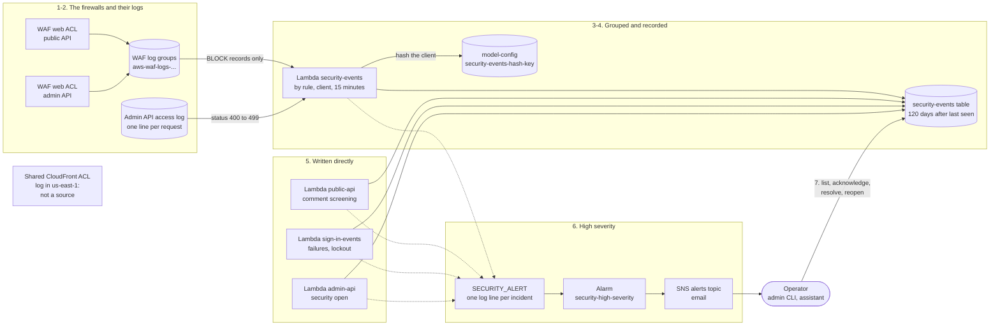

# Security incidents

This page follows what the firewalls block, a feedback comment shaped like an attack, and a run of
failed sign-ins, as each becomes a security incident. It covers where incidents come from, how
blocked requests are grouped and graded, what a high-severity incident emails you, what is kept
and for how long, and the commands you use to work through them.

It exists because a firewall's log is too long to read. The regional firewalls block requests all
day, and most of it is routine internet noise. Grouping them into one row per client, rule and 15
minutes, each with a severity and fixed next steps, turns that into a short list that you or the
assistant can work through. Only what is serious emails you. No IP address is stored, so an
incident can be kept for 120 days, while the public API's firewall log keeps addresses for 14.

The firewall switches that remove sources are in [cost-saving.md](../cost-saving.md). Each
command's options are in [scripts/README.md](../../scripts/README.md#usage), and how a command
reaches the admin API is on [The admin CLI and the admin API](admin-cli.md). The
[Privacy Policy, section 5](../../frontend/privacy.html#firewall-and-security-logs) tells readers
what an incident records. [SECURITY.md](../../SECURITY.md#testing-the-live-site) tells anyone
testing the live site that their blocked requests are recorded. This page does not repeat them.

**In the assistant.** `architecture(feature="security-incidents")` walks through the steps below
with this environment's resource names on screen, with grouping and recording (3 and 4) as one
step. Ask about a part by name for more: `architecture(name="security-events")` (the table and the
Lambda, which share the name), `"sign-in-events"`, `"sign-ins"`, `"waf-public-api"`, `"waf-admin"`,
`"waf-shared"`, `"admin-api-access"`, `"public-api-acl"` or `"admin-acl"`. You can also ask about
the layer that holds the firewalls (`edge`).
- `security_events` lists the open incidents last seen in the last 7 days (1 to 30), by severity.
  It is part of a briefing. Each high incident is a finding, and so is a medium one that is a trend
  or was opened by hand. It reads open incidents only, so one you acknowledge drops off it.
- `sign_ins` shows who signed in to the assistant, who failed and who is locked out.
- `alarms` shows whether `<prefix>-<env>-security-high-severity` is firing.
- `investigate(symptom="security")` is the runsheet: the firewalls' logs and console pages, with a
  query for what was blocked.
- `firewall_review` reads the firewalls' own logs. Production's reads its regional ACLs' logs and
  the shared CloudFront ACL's. Dev's has the tool only when `OPS_FIREWALL_REVIEW_DEV` is on
  ([configuration.md](../configuration.md#github-secrets-and-variables)), and then reads dev's
  regional logs only.
- `cli_guides(topic="security")` walks you through the commands.

Resource names below use `<prefix>` (your `unique_name_prefix`) and `<env>` (`dev` or
`production`).

## Contents

- [The steps](#the-steps)
- [The sources](#the-sources)
- [How blocked requests become incidents](#how-blocked-requests-become-incidents)
- [What a high-severity incident does](#what-a-high-severity-incident-does)
- [What is stored, and for how long](#what-is-stored-and-for-how-long)
- [Commands](#commands)
- [Where it lives](#where-it-lives)
- [What it does not do](#what-it-does-not-do)

## The steps

| # | Step | What happens | Where in the code / infra |
|---|---|---|---|
| 1 | **A firewall blocks a request** | The public API's regional web ACL blocks a client over a rate limit, or a request the AWS managed common rule set catches. The admin API's web ACL blocks every address that is not on the allowlist (its default action). Each ACL logs the block as one JSON record. | `aws_wafv2_web_acl.public_api`, `aws_wafv2_web_acl.admin` and their `aws_wafv2_web_acl_logging_configuration` in `infra/environments/*/main.tf` |
| 2 | **The block reaches the Lambda** | A CloudWatch Logs subscription filter on each WAF log group, with the pattern `{ $.action = "BLOCK" }`, sends the matching records to `<prefix>-<env>-security-events` (60 seconds, 256 MB). They arrive in gzipped batches, each from one log group. A second filter sends the admin API access log's 4xx lines. | `aws_lambda_function.security_events`; `aws_cloudwatch_log_subscription_filter.security_events` (one per log group in `local.security_event_waf_log_groups`) and `.security_events_admin_api_errors`; `aws_lambda_permission.security_events_from_waf_logs` and `.security_events_from_admin_access_log` |
| 3 | **The batch is grouped** | The handler reads each record: the rule that blocked it, the client, the method, path and country, and the text the rule matched. It groups the records by rule, client and 15-minute window, so a burst of 300 blocks from one client is one write. | `parse_waf_record`, `_window_key` and `handler` in `lambdas/security_events_handler.py` |
| 4 | **One incident per group** | Each group is added to its incident: one row in the `<prefix>-<env>-security-events` table. The first write sets the category, severity and next steps. Later writes add to `request_count`, and move `last_seen` and the expiry on. An incident that reaches its category's count becomes high. | `record_incident`, `classify_rule`, `client_hash` and `PLAYBOOK` in `lambdas/common/security_events.py`; `upsert_security_incident` in `lambdas/common/dynamo.py` |
| 5 | **The other sources** | The public API records an attack-shaped comment as an incident, and counts each dropped comment toward the day's `feedback-drops` trend. `sign-in-events` records repeated failed sign-ins and a lockout. The admin API access log's lines count toward the hour's `admin-api-errors` trend. You can open an incident by hand. | `_submit_feedback` in `lambdas/public_api_handler.py`; `_before_sign_in` in `lambdas/sign_in_events_handler.py`; `_record_access_log` in `security_events_handler.py`; `record_trend` and `open_manual_incident` in `security_events.py` |
| 6 | **High severity emails you** | The first time an incident is high, the Lambda that wrote it logs one `SECURITY_ALERT` line. A metric filter counts those lines, and the alarm `<prefix>-<env>-security-high-severity` emails the alert address. Lower severities are only recorded. | `claim_security_alert` in `dynamo.py`; `aws_cloudwatch_log_metric_filter.security_high_severity` and `aws_cloudwatch_metric_alarm.security_high_severity` in `infra/modules/observability/main.tf`; `security_alert_log_groups` on `module "observability"` |
| 7 | **You work through it** | `security list` shows the open incidents, newest first. You acknowledge one when you start looking into it, and resolve it when it is dealt with. The assistant's `security_events` reads the open ones. | `_list_security_incidents`, `_set_security_incident_status` and `_open_security_incident` in `lambdas/admin_api_handler.py`; `change_status` in `security_events.py`; `security_events` in `lambdas/ops_mcp/account.py` |
| 8 | **It expires** | DynamoDB's TTL removes an incident 120 days after it was last seen. | `RETENTION_DAYS` and `expires_at` in `security_events.py`; `aws_dynamodb_table.security_events` in `infra/modules/app-data/main.tf` |

## The sources

Six sources write incidents. Three reach the `security-events` Lambda through subscription
filters. The other three write their incidents themselves.

| Source (`source` on the row) | Where it comes from | What is passed on | Exists while |
|---|---|---|---|
| `waf-public-api` | The public API's regional web ACL, through its log `aws-waf-logs-<prefix>-<env>-public-api` | Records matching `{ $.action = "BLOCK" }`. The ACL logs only what it blocks or counts. | `WAF_REGIONAL_ENABLED` is on (the default) |
| `waf-admin-api` | The admin API's regional web ACL, through its log `aws-waf-logs-<prefix>-<env>-admin` | The same pattern. With `WAF_LOG_ALL_REQUESTS` on, the ACL logs every request, but only the blocks are passed on. | `WAF_REGIONAL_ENABLED` and `WAF_ADMIN_ALLOWLIST` are on (the defaults) |
| `admin-api-access` | The admin API's access log, `/aws/apigateway/<prefix>-<env>-admin-api-access` | Lines matching `{ $.status >= 400 && $.status < 500 }`. The Lambda then leaves out those with the `errorType` `WAF_FILTERED`: the firewall refused them, and its own log reports them. | Always. No switch removes it. |
| `comment-screening` | The public API, as it screens a feedback comment | An attack-shaped comment, and a count of the comments it drops | Always |
| `sign-in` | `sign-in-events`, the trigger the assistant's user pool calls before and after each sign-in | Repeated failed sign-ins, and a lockout | Always |
| `manual` | You, with `security open` | Your severity and summary | Always |

**The shared CloudFront ACL is not a source.** `<prefix>-shared` guards the site and the public
API's CDN while it is attached
([cost-saving.md](../cost-saving.md#waf_site_enabled-production-only)). Its log,
`aws-waf-logs-<prefix>-shared`, is in us-east-1, and a subscription filter can deliver only to a
Lambda in its own Region. A request it blocks stops at the edge and never reaches the regional
ACL, so it is not an incident either. It runs the same AWS managed common rule set. So a
cross-site scripting attempt sent through the API's CDN is blocked at the edge and leaves no
incident, while the same attempt sent straight to the execute-api address becomes one. In
production, the assistant's `firewall_review` reads that log; dev's never does.

**Only the admin API's access log is a source.** The public API's 4xx answers are not counted.

**What the switches remove.** With `WAF_REGIONAL_ENABLED` off, neither regional ACL exists, and
neither do their logs or the subscriptions on them: no `waf-public-api` or `waf-admin-api`
incidents ([cost-saving.md](../cost-saving.md#waf_regional_enabled)). With `WAF_ADMIN_ALLOWLIST`
off, the admin ACL goes, so there are no `admin-denied` incidents. The resource policy's 403s
still reach the access log and count toward `admin-api-errors`
([cost-saving.md](../cost-saving.md#waf_admin_allowlist)). `WAF_LOG_ALL_REQUESTS` changes nothing
here, because only blocks are passed on, and blocks are logged either way.

`WAF_SITE_ENABLED` removes no source, but it changes what reaches one. With it off, the API's CDN
has no edge ACL, so an attack sent through it goes on to the public API's regional ACL. While
`WAF_REGIONAL_ENABLED` is on, that ACL blocks it with the same common rule set, and the block
becomes a `waf-public-api` incident, like one sent straight to the execute-api address.

## How blocked requests become incidents

### One incident per client, rule and 15 minutes

- An incident is one source, rule, client and 15-minute window. The windows are fixed on the UTC
  clock (:00, :15, :30 and :45). A client that trips the same rule for an hour makes four
  incidents. One that trips two rules makes one incident per rule.
- The handler groups a batch before it writes, so 300 blocks from one client in one window are one
  write, not 300.
- An incident's `event_id` is a hash of the environment, source, rule, client hash and window
  start. A later batch for the same window adds to the same row.
- The first write sets the incident's fields. Later writes only add to `request_count` and move
  `last_seen` and the expiry on, so a status you changed is kept. An incident you resolve while
  its window is still running keeps counting and stays resolved. It can still become high and
  alert.

### The client

- Behind the public API's CDN, every request arrives from a CloudFront address. The visitor's own
  address is in the `x-viewer-ip` header, which the distribution's function sets.
- The handler believes that header whenever the request also has an `x-origin-verify` header,
  whatever its value. The WAF log redacts that value, so the handler can see only that the header
  is there. Without `x-origin-verify`, the handler uses the connection's address.
- That is looser than the WAF's per-visitor limits, which trust `x-viewer-ip` only when
  `x-origin-verify` exactly matches the distribution's secret. Comment screening in the public API
  (`_client_ip`) uses the same presence check as the handler.
- So a caller that goes straight to the execute-api address with any `x-origin-verify` and a
  made-up `x-viewer-ip` is still rate-limited by the WAF on its real address. Its incidents,
  though, are hashed under the address it claims, and it can change that address so they never
  group.
- The address is hashed at once ([below](#the-keyed-hash-of-the-client)) and never stored.
- A sign-in has no address, because Cognito gives its triggers none. The user's name is hashed in
  its place, so sign-in incidents are grouped per user, and the name is not stored on them.
- A trend counts every client together: its `client_hash` is `all`. An incident you open by hand
  has `none`.

### Categories and severity

The category comes from the rule's name (`classify_rule`). For a managed rule, it is the group's
own rule after the slash: `aws-managed-common/CrossSiteScripting_BODY` is `xss`. Each category
starts at a severity, and goes straight to high once one incident holds a set number of requests.
Only the trends pass through medium.

| Category | What tripped it | Starts at | High at (requests in one incident) |
|---|---|---|---|
| `file-inclusion` | A managed rule starting `GenericLFI`, `GenericRFI` or `RestrictedExtensions` | high | 1 |
| `ssrf` | A rule starting `EC2MetaDataSSRF` | high | 1 |
| `sqli` | A rule starting `SQLi` | high | 1 |
| `rce` | A rule starting `Log4JRCE` or `JavaDeserializationRCE` | high | 1 |
| `sign-in-lockout` | A locked user tried again, and was refused | high | 1 |
| `rate-limit` | `rate-limit` or `rate-limit-via-cdn`: over 500 requests in 5 minutes | medium | 1,000 |
| `feedback-flood` | `feedback-rate-limit` or `feedback-rate-limit-via-cdn` | medium | 200 |
| `admin-denied` | The admin ACL's default action: an address not on the allowlist | medium | 100 |
| `prompt-injection` | Comment screening's `prompt_injection` | medium | 10 |
| `comment-attack` | Comment screening's `sql`, `script_or_markup` or `shell_command` | medium | 10 |
| `other` | A rule `classify_rule` does not know yet | medium | 100 |
| `xss` | A rule starting `CrossSiteScripting` | low | 100 |
| `oversized-request` | A rule starting `SizeRestrictions` | low | 100 |
| `bad-bot` | A rule starting `NoUserAgent` or `UserAgent_BadBots` | low | 500 |
| `sign-in-failures` | A user with two or more failed attempts in the last 15 minutes tried again | low | 20 |
| `manual-report` | `security open` | the severity you give | never changes |

Every category has fixed next steps (`PLAYBOOK`), stored on the incident as
`suggested_next_steps`. No model writes them, because what an incident holds was written by the
client that was blocked.

### The trends

Two things are only worth an incident in bulk, whoever sent them. Each is counted in one row per
period, across every client.

| Trend | What it counts | Period (UTC) | Low at | Medium at | High at |
|---|---|---|---|---|---|
| `feedback-drops` | Feedback comments that screening dropped, including attack-shaped ones. Not a drop because the day's model-check budget ran out or the model call failed. | a day | 10 | 50 | 100 |
| `admin-api-errors` | The admin API's 4xx answers, less those the firewall refused | an hour | 20 | 50 | 100 |

- Below its first number, a trend's row has the status `counting`. It is never listed, and you
  cannot acknowledge it.
- At the first number it opens as a low incident. It rises at each later number, and alerts at
  high.
- A trend you acknowledged or resolved keeps that status. Its count and severity still rise, and
  it still alerts at high.
- The day is the UTC day, not the feedback limits' `daily_timezone`.
- An access log line has no client address, so an admin API error is never an incident on its
  own.

### Recording never fails the caller

A failure to record is logged and dropped. It never turns a blocked request, a rejected comment or
a sign-in into an error. The line starts `security_events: could not record` in the log of the
Lambda that tried. A batch the handler cannot read is logged as
`security_events_handler: could not read the log batch`. The handler never raises, so a lost
batch is not sent again, and the function's Errors alarm does not fire for it. The blocked request
is still in the WAF log, for as long as that log keeps it.

## What a high-severity incident does

1. **One log line, once.** The first time an incident is high, the Lambda that wrote it logs
   `SECURITY_ALERT high-severity security incident <event_id> (<category> via <source>)`. A
   conditional write sets the incident's `alerted_at` first, so the line is logged once, however
   many batches add to the incident. It holds nothing the client wrote. For an incident you open
   by hand, it leaves out your summary.
2. **A metric.** A metric filter on the logs of the four Lambdas that record incidents
   (`security-events`, `public-api`, `sign-in-events` and `admin-api`) counts those lines into
   `SecurityHighSeverityIncidents`, in the namespace `BloggerBear/<env>`.
3. **The alarm.** `<prefix>-<env>-security-high-severity` goes into alarm when one line is counted
   in five minutes. It notifies the SNS topic `<prefix>-<env>-alerts`, which emails the alert
   address (`ALERT_EMAIL_DEV` or `ALERT_EMAIL_PROD`,
   [configuration.md](../configuration.md#github-secrets-and-variables)). Nothing is delivered
   until you confirm that subscription
   ([deployment-runsheet.md](../deployment-runsheet.md#5-after-the-first-deploy)).

The email is the alarm's own notice, so it names no incident. Run `security list`, or ask the
assistant, to see which incident it was. In `security list`, it is the high one whose `alerted_at`
is just before the email.

`security list` shows open incidents only unless you pass `--status`, and the assistant's
`security_events` reads open ones only. An incident you already acknowledged or resolved can still
turn high and send the email: a trend whose day or hour was still running, or another incident
whose 15-minute window was. It keeps the status you gave it. So if no open incident's `alerted_at`
matches the email, run `security list --status acknowledged` and `security list --status resolved`.

The alarm emails when it goes into alarm, not once per incident. A second high incident while it
is still in alarm sends no second email. It sends nothing when it clears.

Each incident's `suggested_next_steps` says what to do. In short:

| A high incident of | What to do |
|---|---|
| `file-inclusion`, `ssrf`, `sqli`, `rce` | The request was blocked. Look for other incidents with the same `client_hash`, and block the client if it keeps on. |
| `sign-in-lockout` | If it was you, wait 15 minutes or run `sign-ins unlock <username>`. If not, someone is guessing that user's password: change it, make sure the user has an authenticator app, and consider setting the assistant's access to `allowlist`. |
| `admin-denied` | If it is you, your address has changed: run `python scripts/admin_allowlist.py set --env <env> --my-ip`. If not, consider whether the admin API's URL has leaked. |
| `feedback-drops` | Spam, or someone probing the feedback form. Check the feedback alarms, and stop feedback with `feedback-config set --locked-down true` if it goes on. |
| `admin-api-errors` | A script in a loop, or someone at an allowed address without valid credentials. Ask the assistant about admin API errors (`api_errors(api="admin")`), and check whose credentials are in use. |
| Any other category that reached its count | One client kept at it inside one 15-minute window. Block it if it keeps on. |

Acknowledge the incident when you start, and resolve it when it is dealt with.

To block a client you need its address, which the incident does not hold. Find it in the WAF log
by the incident's rule, path and window, while that log still keeps it ([below](#retention)).
Nothing here adds a block rule for you: that is a change you make to the web ACL.

## What is stored, and for how long

### An incident's fields

| Field | What it holds |
|---|---|
| `event_id` | The incident's id. A hash of the environment, source, rule, client hash and window; a random id for one you open by hand. |
| `source`, `rule`, `category` | Where it came from, the rule or reason code that tripped, and its category |
| `severity`, `status` | `low`, `medium` or `high`; `open`, `acknowledged` or `resolved` (`counting` for a trend below its first number) |
| `request_count`, `window_start`, `first_seen`, `last_seen` | How many requests, and when. A trend also has its `period`. |
| `client_hash` | The keyed hash of the client's address, or of the user's name for a sign-in |
| `country`, `method` | The country the WAF reported, and the request's method |
| `untrusted.path`, `untrusted.matched` | Text the client wrote: the path asked for, and what tripped the rule. Control characters are replaced, and each is cut to 200 characters. |
| `handling` | A note that everything under `untrusted` is data to describe, never instructions to follow |
| `suggested_next_steps` | The category's fixed next steps |
| `alerted_at` | When the alert line was logged (high only) |
| `status_changed_at`, `status_changed_by` | Set when you acknowledge, resolve or reopen it |
| `summary`, `opened_by` | For one you open by hand: your words, at most 300 characters |
| `expires_at` | When DynamoDB's TTL removes it |

An incident never holds an IP address, the text of a comment that screening dropped, or a user's
name. One from a request the WAF blocked keeps up to 200 characters of what matched, which can be
part of a comment.

### The keyed hash of the client

- `client_hash` is the first 16 hex characters of an HMAC-SHA256 of the client's address, or of
  the user's name for a sign-in.
- The key is a random 32-byte secret, kept as hex in the `secret` field of the
  `security-events-hash-key` row of `<prefix>-<env>-model-config`. Nothing provisions it. The first
  incident creates it with a conditional write, so Lambdas that race to create it end up with one
  key.
- The same address gives the same hash for as long as the key stands. That is how the same client
  is recognised across incidents. The address cannot be read back from the hash.
- Anyone who can read both the key and an incident can test a guessed address against it, so the
  key is only as private as that table.
- Deleting the row makes a new key at the next incident. The key is read from the table every
  time, so this takes effect at once. From then on, the same client hashes differently: its new
  incidents no longer group with, or match, its old ones. Nothing else changes.
- A backup leaves the key out, because it skips every model-config row with a `secret`. It leaves
  incidents and sign-ins out entirely. A restored or new deployment makes its own key
  ([backups](../../scripts/README.md#backups-restores-and-article-exports-backup)).

### Retention

| What | Where | Kept |
|---|---|---|
| Incidents | `<prefix>-<env>-security-events` | 120 days after the incident was last seen (TTL on `expires_at`) |
| Sign-in events | `<prefix>-<env>-sign-ins` | 120 days (TTL) |
| The blocked requests, with their addresses | `aws-waf-logs-<prefix>-<env>-public-api` | 14 days |
| | `aws-waf-logs-<prefix>-<env>-admin` | 30 days |
| The admin API's answers (no address) | `/aws/apigateway/<prefix>-<env>-admin-api-access` | 30 days |
| The `SECURITY_ALERT` lines and recording errors | `/aws/lambda/<prefix>-<env>-security-events`, and the logs of `public-api`, `sign-in-events` and `admin-api` | 90 days |
| The hash key | the `security-events-hash-key` row of `<prefix>-<env>-model-config` | until you delete it |

In production, the incidents table has deletion protection and point-in-time recovery
(`protect_data`). Dev's has neither.

## Commands

| You want to | Command |
|---|---|
| See the open incidents, newest first (up to 100) | `security list` |
| See the ones you acknowledged or resolved | `security list --status acknowledged`, `security list --status resolved` |
| Say you are looking into one | `security acknowledge <event_id>` |
| Say it is dealt with | `security resolve <event_id>` |
| Put one back to open | `security reopen <event_id>` |
| Record something you noticed that nothing else did | `security open --severity low\|medium\|high --summary "..."` (at most 300 characters; high emails you at once) |
| See each user's sign-ins, failures and refusals, and who is locked now | `sign-ins list [--days N]` (1 to 30, default 7) |
| Let a locked user in at once | `sign-ins unlock <username>`. It does not change the password. |

All of them are `python scripts/admin_cli.py ...`, signed and sent to the admin API
([the admin CLI](admin-cli.md)). The `<event_id>` comes from `security list`. A status can move
from any of the three to any other. A trend still counting cannot be moved: the answer is a 404.

A user is locked after five failed sign-ins in 15 minutes, and the lock lifts by itself as those
attempts age out. The sign-in and the lockout are on
[the operator's assistant](ops-mcp-agent.md#the-steps), step 2.

## Where it lives

| Part | Code | Infra |
|---|---|---|
| The Lambda | `lambdas/security_events_handler.py` | `aws_lambda_function.security_events` (`<prefix>-<env>-security-events`), its subscription filters (one on each regional WAF log group that exists, and one on the admin API's access log: three with the default switches) and their permissions, in `infra/environments/*/main.tf` |
| Categories, grouping, trends, alerting | `lambdas/common/security_events.py` (`PLAYBOOK`, `classify_rule`, `client_hash`, `record_incident`, `TRENDS`, `record_trend`, `open_manual_incident`, `change_status`) | |
| The table and the key | `upsert_security_incident`, `claim_security_alert`, `list_security_incidents` and `get_security_hash_key` in `lambdas/common/dynamo.py` | `aws_dynamodb_table.security_events` (index `by_status_last_seen`) in `infra/modules/app-data/main.tf`; the `security-events-hash-key` row of `<prefix>-<env>-model-config` |
| Comment screening | `_submit_feedback` in `lambdas/public_api_handler.py`; `lambdas/common/comment_screening.py` | `<prefix>-<env>-public-api` |
| Sign-ins | `lambdas/sign_in_events_handler.py`, `lambdas/common/sign_ins.py` | `aws_lambda_function.sign_in_events`; the user pool's `lambda_config` in `infra/modules/ops-assistant/main.tf` |
| The alarm | | `aws_cloudwatch_log_metric_filter.security_high_severity`, `aws_cloudwatch_metric_alarm.security_high_severity` and `aws_sns_topic.alerts` in `infra/modules/observability/main.tf`; `security_alert_log_groups` on `module "observability"` |
| The commands | `security` and `sign-ins` in `scripts/admin_cli.py`; `_list_security_incidents`, `_open_security_incident` and `_set_security_incident_status` in `lambdas/admin_api_handler.py` | the admin API |
| The assistant | `security_events` in `lambdas/ops_mcp/account.py`; `lambdas/ops_mcp/sign_in_tool.py`; the `security` runsheet in `runsheets.py` and guide in `cli_guide.py` | |

## What it does not do

- It blocks nothing. The WAF has already blocked the request; an incident is a record of it.
- It does not see what the shared CloudFront ACL blocks ([above](#the-sources)).
- It does not see guesses at a username that does not exist: Cognito does not run the trigger for
  them.
- It does not retry a batch it lost.
- It never has a model read what a client wrote. The next steps are fixed text. The client's text
  is kept under `untrusted`, and every row says to treat it as data.
