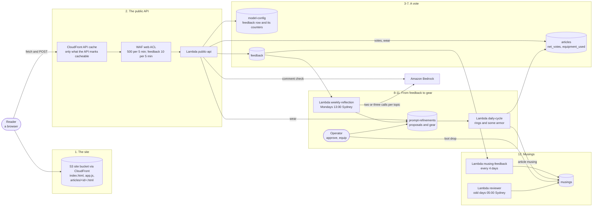

# The site, the bear and reader feedback

This page follows a reader's visit and vote through the system. It covers the public site and its
API, and the path a vote takes: the decoy field, the limits, the token and the comment screen.
Then it shows how a week of feedback becomes a proposal, and how an approved proposal becomes a
piece of gear the bear wears into later drafts. Votes wear that gear down or repair it. Last come
the musings that BloggerBear and Professor Grizzlewick post about all of it.

It exists because the site is public and anonymous. There are no accounts and no cookies, and
nothing about a visitor is stored with their feedback. Feedback is the only thing a reader writes,
and the only way a reader can reach a model and so run up the bill. So every submission passes the
cheap checks first. A comment is kept exactly as written or dropped, and never redacted. The counts
that bound the cost are site-wide. Readers steer the writing only through you: a proposal changes
nothing until you approve it. The bear's gear, moods and musings put that loop on the site where
readers can see it.

What it costs, and the Stats page that shows it, are on [Stats and costs](stats-and-costs.md).
Every setting you can change with no deploy is listed in
[configuration.md](../configuration.md#dynamodb-settings-changed-with-no-deploy). Each command's
options are in [scripts/README.md](../../scripts/README.md). The reviewer bear's full design is in
[reviewer-bear.md](../enhancements/reviewer-bear.md). This page does not repeat them.

**In the assistant.** This page has no `feature` entry yet. Ask about its parts by name instead:
`architecture(name="public-api")`, `"feedback"`, `"prompt-refinements"`, `"musings"`,
`"weekly-reflection"`, `"musing-feedback"`, `"reviewer"`, `"public-api-acl"` or `"site"`. You can
also ask about the layer that holds the pages (`presentation`). The assistant cannot read the
feedback table, because reader comments are the public's words.
- `investigate(symptom="feedback")` is the runsheet for rejected feedback or a used-up screening
  budget.
- `security_events` shows the trend of dropped comments.
- `content_checks` finds a musing that went out with no text.
- `cli_guides(topic="gear")`, `"musings"` and `"review"` walk you through the commands.

Resource names below use `<prefix>` (your `unique_name_prefix`) and `<env>` (`dev` or
`production`).

## Contents

- [The steps](#the-steps)
- [The public site](#the-public-site)
- [When the site takes feedback: limits and settings](#when-the-site-takes-feedback-limits-and-settings)
- [From feedback to gear](#from-feedback-to-gear)
- [Musings](#musings)
- [Professor Grizzlewick](#professor-grizzlewick)
- [Scratch the bear's tummy](#scratch-the-bears-tummy)
- [Commands](#commands)
- [Where it lives](#where-it-lives)
- [What none of it stops](#what-none-of-it-stops)



## The steps

| # | Step | What happens | Where in the code / infra |
|---|---|---|---|
| 1 | **The site** | A static single-page app with hash routes (`#/`, `#/topic/<id>`, `#/article/<id>`, `#/musings`, `#/stats`), served from the site bucket. Every published article also gets a static page, `articles/<id>.html`, rendered when it is published. That page has its own small script for its view count and its votes. The About, Terms and Privacy pages are plain HTML. The pages find the API through `config.js`, which Terraform writes. | `frontend/index.html`, `app.js`, `article-widgets.js`; `render_and_publish_article_page` in `lambdas/common/static_pages.py` |
| 2 | **The public API** | One anonymous REST API with eleven routes, all handled by one Lambda. A CloudFront distribution in front of it caches only the responses the Lambda marks cacheable. The regional WAF limits each visitor. API Gateway throttles the whole stage, and the feedback route more tightly. | `_ROUTES` and `_response` in `lambdas/public_api_handler.py`; `infra/modules/api-cdn/`; `module "public_api"` and `aws_wafv2_web_acl.public_api` in `infra/environments/*/main.tf` |
| 3 | **Is feedback open?** | Before it shows the form, the page calls `GET /articles/<id>/feedback-status`. This only reads: it counts nothing. If feedback is closed, the answer says why, and the page shows a "Hold your Paws!" panel in place of the form. If it is open, the answer carries a one-use token. The token says how long the browser must wait before using it, and whether it needs proof of work. | `_feedback_status`; `status_for` in `lambdas/common/feedback_limits.py`; `issue` in `lambdas/common/feedback_verification.py` |
| 4 | **The browser waits and works** | The token becomes valid at a random moment 0.5 to 2 seconds after it was issued. When the site is busy (at 70% of any of its limits), the browser must also find a number such that SHA-256(token + ":" + number) starts with 16 zero bits. The reader is asked to do nothing. If the server answers "too early", the page waits and sends again. If the token was used or expired, it fetches a fresh one. | `frontend/verify.js` (`submit`) |
| 5 | **The decoy and the token** | `POST /articles/<id>/feedback` first checks a hidden decoy field, `referral_code`. A script that fills it in is told the submission worked, and nothing is stored or counted. Next it checks whether feedback is open; if not, it answers 423, 429 or 503 with the reason. Then it checks the token. Each token is signed with HMAC, made for one article, used once and good for two hours. A bad token is a 403. If the key cannot be read, the answer is 503. | `_submit_feedback` in `public_api_handler.py` (`HONEYPOT_FIELD`, `_CLOSED_STATUS`); `verify` in `feedback_verification.py`; the signing key is the `verification-secret` row of `model-config`, made on first use (`get_verification_secret` in `lambdas/common/dynamo.py`) |
| 6 | **The comment screen** | A comment is optional. Code checks it first: length (1,000 characters at most), control characters, attack shapes (prompt injection, SQL, script or markup, shell), links and personal details. If it passes, the comment goes to one model call that must answer exactly `KEEP`. That call happens only while today's model-check budget lasts. If any check drops the comment, the whole submission is refused with a bare 422. The vote is not recorded, nothing is counted, and the reader is not told why. An attack shape also opens a security incident. Any other drop counts toward the day's "feedback-drops" trend: 10 opens an incident, 50 makes it medium and 100 makes it high. Running out of budget, and a failed model call, do not count toward that trend. | `screen_comment` and `rule_drop_reason` in `lambdas/common/comment_screening.py`; `take_screening_slot` in `feedback_limits.py`; `record_incident` and `record_trend` in `lambdas/common/security_events.py` |
| 7 | **Counted and stored** | Only now is the submission counted against the article, the day and the rate window, each with a conditional update. A later refusal gives back the counts already taken. The vote and the comment (as written, or none) are stored with no identifier of any kind. The article's `net_votes` moves by one. The week's `feedback_given` count goes up. The gear the article was written with takes the vote (step 11). | `acquire` in `feedback_limits.py`; `put_feedback`, `update_article_net_votes` in `dynamo.py`; `record_feedback_given` in `lambdas/common/stats_tracking.py`; `apply_feedback` in `lambdas/common/wear.py` |
| 8 | **The weekly reflection** | Every Monday at 13:00 Sydney time, it reads the last 7 days of feedback and groups it by topic. For each topic with feedback, one model call reads the tally and the comments, passed as data and never as instructions. It answers with a rationale and a suggested change. Each suggestion is written as a pending proposal. It is already named as gear: a theme the model wrote and a check passed, a rarity rolled by code and a durability. | `lambdas/weekly_reflection_handler.py`; `generate_identity` in `lambdas/common/gear.py`; `aws_scheduler_schedule.weekly_reflection` |
| 9 | **You decide** | `approve` (with the rest of the inbox) or `refinements approve` / `reject`. Approving with no choice made wears it as a ring for its topic. If all five rings are worn, it is parked in the backpack instead. You can also put it in an armor slot, or straight into the backpack. The first time a piece is worn, BloggerBear posts a loot drop on the Musings page. A rejected proposal is deleted 7 days later. | `_resolve_prompt_refinement` and `_announce_drop` in `lambdas/admin_api_handler.py`; `plan_equip` in `lambdas/common/equipment.py`; `CLEANUP_TTL_DAYS` in `dynamo.py` |
| 10 | **Drafting with gear** | Each article uses all of its topic's rings, and a random part of the worn armor: anywhere from none of it to all of it. The draw is never the same combination twice running, while a different one is possible. The guidance is capped at 4,000 characters. What was used is recorded on the article as `equipment_used`. Separately, the topic's best-voted article (net votes above zero) gives the draft an example excerpt. | `guidance_for` and `pick_armor` in `equipment.py`; `_get_approved_guidance` and `get_top_voted_articles` in `lambdas/daily_cycle_handler.py` |
| 11 | **Wear** | A stored downvote costs each worn piece the article used 1 durability. An upvote gives 1 back, never above the piece's maximum. A piece that reaches 0 is taken off (`worn_out`). A parked spare of the same kind takes its place: the one with the most durability left. Wear never fails the feedback it came with. | `apply_feedback` in `wear.py`; `pick_replacement` in `equipment.py` |
| 12 | **Musings** | Short posts in the bear's voice, 280 characters at most. They are written when an article is published or rejected, when a topic is paused or resumed, when gear drops, every 4 days about feedback, and by Professor Grizzlewick. The feed shows them newest first, 15 a page. | `lambdas/common/musings.py`; `lambdas/musing_feedback_handler.py`; `_list_musings` in `public_api_handler.py`; `frontend/moods.js` |

## The public site

| Page | What it shows | What it calls |
|---|---|---|
| `#/` | The topics | `GET /topics` |
| `#/topic/<id>` | A topic's published articles, 10 a page, and up to 3 of its articles waiting for review | `GET /articles?topic_id=&page=`, `GET /topics/<id>/activity` |
| `#/article/<id>` | The article, its lineage and cost, the gear it was written with (as that gear is now), its sources, and the feedback form with an optional comment | `GET /articles/<id>`, `POST .../view`, `GET .../feedback-status`, `POST .../feedback` |
| `/articles/<id>.html` | The same article as a static page. Its "Equipment used" record is frozen when the page is rendered. Its form has the two vote buttons only, with no comment box. | `POST .../view`, `GET .../feedback-status`, `POST .../feedback` |
| `#/musings` | The musings, newest first, 15 a page | `GET /musings?page=` |
| `#/stats` | The costs ([Stats and costs](stats-and-costs.md)), then "What BloggerBear is wearing": each armor slot, the rings, and how many pieces are in the backpack | `GET /stats`, `GET /equipment` |
| `/rss.xml` | The 50 newest published articles | `GET /rss.xml` |

A pending or rejected article answers exactly like one that does not exist. No article's votes and
no comment are ever shown on the site; the Stats page shows only counts of feedback. A piece of
gear's public description is its guidance in one line, held back if it fails the comment rules
(`public_view` in `gear.py`).

The API's CDN caches a response only when the Lambda sends a `max-age`. The listings, an article,
the musings and the gear are cached for 60 seconds; the Stats and the RSS feed for 300. The view
counter, the feedback status (it hands out a fresh token), the feedback itself and every error are
sent `no-store`.

## When the site takes feedback: limits and settings

An accepted submission (a vote, with or without a comment) counts against four checks, in this
order. The first one that is closed is the reason the reader sees.

| Check | What closes it | Answer | Reopens |
|---|---|---|---|
| The article | `feedback_locked` on its row, or `feedback_count` at `article_limit`. Reaching the limit sets the lock. | 423 | When you unlock it (and reset its count, if it was full) |
| A site-wide lockdown | `locked_down` | 423, with your `lockdown_reason` if set | When you lift it |
| The daily limit | `daily_limit` accepted today | 429 | At the start of the next day in `daily_timezone` |
| The rate limit | `rate_limit_count` in the current `rate_limit_window_minutes` | 429 | When the window ends. The windows are fixed, so a burst across two can briefly reach twice the limit. |

If the limiter cannot be read or written, feedback is refused (503, "unavailable"), never allowed.

The settings are the `feedback` row of `<prefix>-<env>-model-config` (`config_id` = `feedback`).
The counters are short-lived rows in the same table (`feedback-day#...`, `feedback-window#...`,
`feedback-screen#...`), and its TTL clears them. A missing or invalid value takes its default.
Nothing here needs a deploy.

| Setting | Default | Allowed | What it does | `feedback-config set` flag |
|---|---|---|---|---|
| `locked_down` | false | true or false | Stops feedback site-wide; the page says so | `--locked-down` |
| `lockdown_reason` | none | up to 100 characters | What the page says while locked down | `--lockdown-reason` |
| `rate_limit_count` | 20 | 1 to 1,000,000 | Accepted submissions per window | `--rate-limit` |
| `rate_limit_window_minutes` | 5 | 1 to 1,440 | The window's length | `--rate-window-minutes` |
| `daily_limit` | 100 | 1 to 1,000,000 | Accepted submissions a day | `--daily-limit` |
| `article_limit` | 50 | 1 to 1,000,000 | Accepted submissions on one article, then it locks | `--article-limit` |
| `screening_limit` | 300 | 1 to 1,000,000 | Comments a day sent to the model check. After that, every comment is dropped. Rejected feedback counts against none of the limits above, so this is what bounds its cost. | `--screening-limit` |
| `verification_required` | true | true or false | Whether a submission must carry the token. Turn it off only in an emergency. | `--verification-required` |
| `token_delay_min_ms`, `token_delay_max_ms` | 500, 2000 | 0 to 30,000 | A token is valid from a random moment between the two | `--token-delay-min-ms`, `--token-delay-max-ms` |
| `pow_threshold_percent` | 70 | 1 to 100 | Once the site is this full of its daily limit, rate limit or model-check budget, tokens ask for proof of work | `--pow-threshold-percent` |
| `pow_difficulty_bits` | 16 | 0 to 24 | How much work: the leading zero bits. 0 never asks for it. | `--pow-difficulty-bits` |
| `daily_timezone` | `Australia/Sydney` | an IANA zone name | Where a day starts | `--daily-timezone` |

```bash
python scripts/admin_cli.py feedback-config get        # stored, in force, and today's usage
python scripts/admin_cli.py feedback-config set --locked-down true --lockdown-reason "Back soon"
python scripts/admin_cli.py feedback-config set --daily-limit 200 --screening-limit ""   # "" clears one
python scripts/admin_cli.py articles feedback-lock <article_id>
python scripts/admin_cli.py articles feedback-unlock <article_id> --reset-count   # an article at its limit
```

Deleting the `verification-secret` row of `model-config` rotates the signing key, but only in
public API containers that load the key after the delete. A warm `<prefix>-<env>-public-api`
container keeps the key it already loaded (`_secret_cache` in `common/feedback_verification.py`)
for as long as it lives. It keeps signing and accepting tokens with the old key, and it refuses
tokens from containers that have the new one. To finish a rotation, delete the row, then force new
containers by changing the function's configuration, for example
`aws lambda update-function-configuration --function-name <prefix>-<env>-public-api --description "rotate verification key"`.
A Terraform apply that changes nothing recycles nothing. After that, tokens already handed out stop
working.

**At the edge**, set in Terraform and not by `feedback-config`:

| Limit | Value | Where |
|---|---|---|
| WAF, the whole API | 500 requests per 5 minutes from one visitor | `rate-limit` and `rate-limit-via-cdn` on `aws_wafv2_web_acl.public_api` |
| WAF, the feedback POST | 10 per 5 minutes from one visitor | `feedback-rate-limit` and `feedback-rate-limit-via-cdn` |
| API Gateway, the stage | 25 requests a second, bursts of 50 | `throttling_rate_limit`, `throttling_burst_limit` on `module "public_api"` |
| API Gateway, the feedback POST | 2 a second, bursts of 5 | `method_throttling` |

The WAF counts the visitor's address. It logs only the requests it blocks or counts, never the ones
it lets through. That log keeps the address for 14 days, with the part of the request that tripped
the rule, which for a blocked comment can be a fragment of its text. The headers that fingerprint a
browser are redacted, but the address is not (`aws_wafv2_web_acl_logging_configuration.public_api`;
the [Privacy Policy, section 5](../../frontend/privacy.html#firewall-and-security-logs) says the
same). Behind the CDN, the address comes from the `x-viewer-ip` header that the CDN sets, and the
WAF trusts it only with the origin-verify header.
The regional WAF exists while `WAF_REGIONAL_ENABLED` is on, which is the default
([cost-saving.md](../cost-saving.md#waf_regional_enabled)). Without it, calls straight to the
execute-api address keep only API Gateway's throttling and the settings above. Calls through the
CDN, which is how the site calls the API, also pass the shared CloudFront web ACL
(`<prefix>-shared`, `aws_wafv2_web_acl.this`), with or without the regional WAF. That ACL is
attached while `WAF_SITE_ENABLED` is on in production (the default), or once `web_acl_arn` is set
in dev ([cost-saving.md](../cost-saving.md#waf_site_enabled-production-only)). It also guards the
site, and it sits in front of the cache. It blocks an address past 2,000 requests per 5 minutes on
every route (`rate-limit`) and applies the AWS managed common rule set. It has no separate limit
for the feedback POST, and it logs what it blocks the same way, in us-east-1.

Two alarms watch feedback: `<prefix>-<env>-feedback-rejections-spike` and
`<prefix>-<env>-feedback-screening-budget-used-up`. The lambda-runs dashboard counts accepted and
rejected submissions from the public API's log lines. Those lines hold a reason code only, never the
comment.

## From feedback to gear

An approved proposal is a piece of **gear**. Only worn gear goes into the prompts.

- **Armor** (helmet, chest, gloves, boots, sword, shield) is guidance for every topic, one piece per
  slot. Putting a piece in a taken slot sends the old one to the backpack.
- **Rings** are guidance for one topic, five at most in all.
- **The backpack** holds approved gear that is not worn. Nothing in it is used, and the public sees
  only how many pieces it holds.

The model never chooses a piece's rarity. Code rolls it, weighted towards common: common 50,
uncommon 28, rare 14, epic 6, legendary 2. The maximum durability is rolled inside the rarity's
range. A piece's name is `<slot noun> of <theme>`, so it renames itself when it moves slot. If the
model's theme fails its checks (the comment rules, a character allow-list, and a model asked
`SAFE`), a plain theme built from the topic is used. A proposal is never lost to a bad name.

What you can do with gear: put it on, take it off, make your own, raise its rarity, repair it,
delete it, and announce it again. All of it is in
[scripts/README.md, What the bear wears](../../scripts/README.md#what-the-bear-wears-equipment).

Three things matter for how the loop behaves:

- **Wearing is not using.** The topic's rings go into every article, but the armor is a fresh
  random draw each time, and it can be none.
- **`equipment_used` is read and shown.** Wear is tied to it (step 11). The article view shows the
  gear as it is now. The static page shows the gear as it was when the page was rendered
  (`equipment_snapshot` in `static_pages.py`). An empty list means no gear. A missing field means
  the article was written before gear existed.
- **Only a parked spare is put on by itself.** Anything you benched, took off, displaced or shelved
  stays where you left it. A worn-out piece stays worn out until you repair it, and an upvote on an
  old article does not revive it.

## Musings

| Kind | Written by | When | Mood |
|---|---|---|---|
| `article` | daily-cycle; the admin API's approve and force-publish | An article is published, from any path | proud if it passed review first time; thoughtful if a person or the reviewer bear approved it, or it was force-published |
| `rejection` | the admin API (a reject, yours or the reviewer's) | A held draft is turned away. It names the topic only, never the title. | shocked |
| `pause`, `resume` | the admin API | You pause or resume a topic. It never says why. | reflective, excited |
| `loot` | the admin API | A piece of gear is worn for the first time. It carries a card with the gear and a link to the Stats page. Each piece is announced once, unless you run `equipment announce` again. | excited |
| `feedback` | musing-feedback, **every 4 days** (`rate(4 days)`, not a time of day) | The last 4 days' votes, by count | pleased (net up), reflective (net down or tied), curious (none at all) |
| `reviewer_report`, `reviewer_rejection`, `reviewer_hold`, `reviewer_answer` | the reviewer | His runs ([below](#professor-grizzlewick)) | roused, stern, shocked; his answer's mood follows its tone |
| `reply` | the reviewer's Lambda, in BloggerBear's voice | BloggerBear answering his report, now and then | follows the tone the report allows |

**How they are kept safe.** The loot, rejection, pause and resume posts and both bears' exchanges
are checked before they are stored. Each must pass the same code rules a comment does. A post about
one topic or one piece of gear must also name it. If a post fails, a plain, accurate line is used
instead. If the model answers an article or feedback musing with nothing, a plain line is used too.

**The pictures.** Each mood has a bear, `frontend/bears/<mood>.svg`, and a grey line under the post:
"BloggerBear was feeling proud". Professor Grizzlewick has one picture whatever his mood,
`bears/grizzlewick.svg`. Each mood exists in two places, `MOODS` in `musings.py` and in `moods.js`,
and a test fails if they drift apart. A mood with no picture shows `bears/default.svg`.

**Fixing one.** `musings list` (with `--blank` for the empty ones), `musings edit <id> --text ...`
for any kind, and `musings regenerate` for musings about published articles. The reviewer bear also
writes a blank article musing again himself, as part of his first task. `articles unpublish` removes the
musings about that article. Details:
[scripts/README.md, Fixing a musing](../../scripts/README.md#fixing-a-musing-musings).

## Professor Grizzlewick

The reviewer bear is a second character with a Lambda of his own, `<prefix>-<env>-reviewer`. He
runs on odd days of the month at 05:00 Sydney time (`cron(0 5 1/2 * ? *)`), so on the 31st and the
1st he runs two days running. He works through a run a couple of tasks at a time, on one-shot
schedules a few minutes apart. Each run:

- He fixes what the assistant's content checks found. A blank musing is written again; a broken
  title or body is sent for a rewrite.
- He decides held articles that have waited `stale_after_hours` (48) or more. He may approve one,
  financial ones included, when `may_approve` is on (the default) and his read of it passes. Each
  financial article he approves is flagged for you to check.
- He reads the newest published articles.
- He watches his financial approvals, and takes one down if readers downvote it with a comment.
- An article held 10 days or more he publishes with its flagged sentences cut, or rejects.

He acts through the admin API's own functions, so the pages, musings and Stats move as if you had
done it. A topic with `force_manual_review` is never his. His report, and any back-and-forth with
BloggerBear, go to the Musings page. `reviewer get|set` changes his settings with no deploy.
Everything else is in [reviewer-bear.md](../enhancements/reviewer-bear.md) and
[configuration.md](../configuration.md#the-reviewer-bear-professor-grizzlewick).

## Scratch the bear's tummy

A small toy, decoration only. It appears under "Thanks for your feedback!" about one time in three,
and always on the "Hold your Paws!" panel, except when feedback is unavailable. It has no say in
whether feedback is accepted. Nothing about how it is played is sent or stored (`frontend/tummy.js`;
the pictures are `bears/tummy.svg` and `tummy-happy.svg`).

## Commands

| You want to | Command |
|---|---|
| See what feedback is allowed, and today's usage | `feedback-config get` |
| Stop feedback everywhere, or change a limit | `feedback-config set ...` |
| Stop or restart feedback on one article | `articles feedback-lock <id>`, `articles feedback-unlock <id> [--reset-count]` |
| Decide the week's proposals | `approve` (with the inbox), or `refinements list\|approve\|reject` |
| See and arrange the gear | `equipment list\|equip\|unequip\|create\|delete\|bump\|repair\|announce` |
| Fix a musing | `musings list\|edit\|regenerate` |
| Change the reviewer bear's settings | `reviewer get\|set`; per topic, `topics update --reviewer-may-approve` |
| Clear his flag on a financial article you checked | `articles checked <id>` |

All of them are `python scripts/admin_cli.py ...`, signed and sent to the admin API
([the admin CLI](admin-cli.md)).

## Where it lives

| Part | Code | Infra |
|---|---|---|
| The pages | `frontend/` (`app.js`, `article-widgets.js`, `verify.js`, `gear.js`, `moods.js`, `tummy.js`, `notice.js`); `common/static_pages.py` | the site bucket and its CloudFront distribution (`infra/modules/static-site/`) |
| The public API | `lambdas/public_api_handler.py` | `<prefix>-<env>-public-api`; `infra/modules/rest-api/`, `infra/modules/api-cdn/`; `aws_wafv2_web_acl.public_api` |
| Limits, token, screen | `common/feedback_limits.py`, `common/feedback_verification.py`, `common/comment_screening.py` | the `feedback` and `verification-secret` rows of `<prefix>-<env>-model-config` |
| Feedback | `put_feedback` in `common/dynamo.py` | `<prefix>-<env>-feedback` |
| Proposals and gear | `lambdas/weekly_reflection_handler.py`, `common/gear.py`, `common/equipment.py`, `common/wear.py`; the gear routes in `admin_api_handler.py`; `scripts/gear_create.py` | `<prefix>-<env>-weekly-reflection` and its schedule; `<prefix>-<env>-prompt-refinements` |
| Musings | `common/musings.py`, `lambdas/musing_feedback_handler.py` | `<prefix>-<env>-musing-feedback` and its schedule; `<prefix>-<env>-musings` |
| The reviewer bear | `lambdas/reviewer_handler.py`, `common/reviewer.py` | `<prefix>-<env>-reviewer` and its schedule, while `reviewer_enabled` |

The fixed schedules (`aws_scheduler_schedule.weekly_reflection`, `.musing_feedback` and
`.reviewer`) are in each environment's `main.tf`, not in settings. To change their times, change
Terraform.

## What none of it stops

Anyone can read the API, fetch a token, wait a second and post. One person with many addresses can
still use up the day's limit of accepted votes (100 by default). The checks above make each
automated submission cost a request, a wait and, when the site is busy, some CPU, and they shut out
the cheap attacks. The limits protect the bill, not the feature. Stopping the rest would need a per-visitor identifier, and the
[Privacy Policy](../../frontend/privacy.html) promises none is kept. A comment model can be fooled
too, which is why nothing downstream treats a stored comment as instructions. The weekly reflection
passes comments to its model as delimited data.
