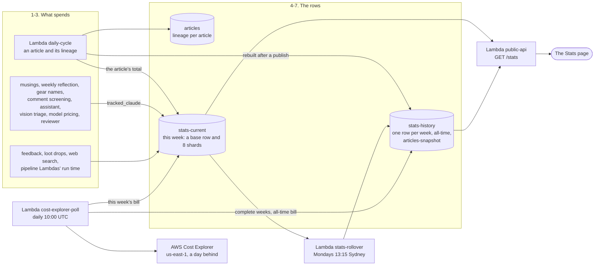

# Stats and costs

This page follows a cost from where it is spent to the public Stats page. Every model call, every
pipeline Lambda's run time, every web search and every reader action becomes a figure there. Each
article's own cost is recorded on the article (its lineage). Everything else is added onto one
weekly row. Each Monday a rollover moves that row into history and onto an all-time total. Each day
a poll reads the AWS bill from Cost Explorer. The page shows each of those sources in its own
section.

It exists because one of the project's rules is that every cost is on show. An article's cost was
always on the article. But much of the spend belongs to no article: musings, the weekly reflection,
naming gear, screening comments, the operator's assistant, vision triage, pricing models, and the
reviewer bear. And the AWS bill is more than tokens. So both are tracked. Each figure on the page
covers exactly one period, and a token estimate is never added to the bill, because they are the
same dollars counted two ways.

How a model call is priced (the registry, the archived prices, the built-in list, the AUD rate) is
in [Models: how a cost is worked out](../models.md#how-a-cost-is-worked-out). The gear section at
the bottom of the Stats page is explained in
[The site, the bear and reader feedback](site-and-feedback.md). This page does not repeat them.

**In the assistant.** This page has no `feature` entry yet.
- `spend` (`period` `"week"` or `"month"`) gives the AI spend against a typical week. Where the
  deployment sets `account_wide_data` (production does, dev does not), it gives the whole AWS bill
  too.
- Ask about the parts by name: `architecture(name="stats-current")`, `"stats-history"`,
  `"stats-rollover"` or `"cost-explorer-poll"`.
- `table_sample(name="stats-history")` shows the newest row.
- `investigate(symptom="costs")` is the runsheet for spend that looks too high, or a cost poll that
  stopped.
- `alarms` shows whether a scheduled run was dropped.
- `cli_guides(topic="costs")` is about spending less: how often topics run, and which model writes.

Resource names below use `<prefix>` (your `unique_name_prefix`) and `<env>` (`dev` or
`production`).

## Contents

- [The steps](#the-steps)
- [What is counted](#what-is-counted)
- [The rows](#the-rows)
- [The weekly rollover](#the-weekly-rollover)
- [The daily cost poll](#the-daily-cost-poll)
- [The Stats page, section by section](#the-stats-page-section-by-section)
- [When a week goes missing](#when-a-week-goes-missing)
- [Where it lives](#where-it-lives)

## The steps

| # | Step | What happens | Where in the code / infra |
|---|---|---|---|
| 1 | **An article's own cost** | Every model call that goes into an article is recorded with its model and tokens. The article's `lineage` holds those calls, their cost in AUD, and the research calls of the Findings it was written from. One call that nothing can price leaves the whole article unpriced, never part-summed. | `invoke_model_tracked` in `lambdas/common/bedrock.py`; `build_lineage` and `build_research_lineage` in `lambdas/common/costing.py`; the `articles` table |
| 2 | **Spend on no article** | Each model call outside an article goes through `tracked_claude`, with a category. The call's tokens and cost are added onto this week's row under that category. Work that makes several calls at once (an assistant run, a vision triage decision) is added in one go. A call with no price is counted as an unpriced call, never as free. Recording never loses the model's answer: a failed write is logged and dropped. | `tracked_claude`, `record_model_usage` and `record_assistant_run` in `lambdas/common/stats_tracking.py` (`BEDROCK_CATEGORIES`) |
| 3 | **Activity and run time** | Plain counters go onto the same row. They are feedback kept and feedback rejected for its comment, loot drops, AgentCore web searches (each priced at a fixed US$0.007), and GDELT searches that fell back to AgentCore. The pipeline's Lambdas (the scheduled jobs, and the security and sign-in event handlers) time themselves and add their milliseconds. The public and admin APIs do not, so a request pays no extra write, and neither do the assistant or the vision worker. When an article is drafted, its whole cost is also added, under `articles`. | `record_*` in `stats_tracking.py`; `track_lambda_duration` in `lambdas/common/lambda_timing.py`; `record_article_lineage`, called by `lambdas/daily_cycle_handler.py` |
| 4 | **This week's row** | Every increment is an `ADD` onto one of 8 shard rows (`current#0` to `current#7`), picked at random, so no single item is hot. The base row, `current`, holds the poll's readings, which are set rather than added. Reading the week sums the base row and every shard, strongly consistent, so the rollover copies every write already made. | `increment_current_stats`, `get_current_stats` in `lambdas/common/dynamo.py`; `<prefix>-<env>-stats-current` |
| 5 | **The weekly rollover** | Mondays at 13:15 Sydney time, 15 minutes after the weekly reflection, so the reflection's own cost lands in the week it reflects on. It copies the week's row into history, keyed by the week's Monday, and adds its counters onto the all-time row. Then it deletes this week's rows. | `lambdas/stats_rollover_handler.py`; `split_for_rollover` in `stats_tracking.py`; `aws_scheduler_schedule.stats_rollover` |
| 6 | **The daily cost poll** | Every day at 10:00 UTC, it reads the AWS bill by service from Cost Explorer. The bill reaches as far as yesterday, never today. It writes this week's bill so far onto this week's row, and each complete week's bill onto that week's history row. Then it adds up the all-time bill again. | `lambdas/cost_explorer_poll_handler.py`; `fetch_costs` in `lambdas/common/cost_explorer.py`; `record_aws_bill` in `stats_tracking.py`; `aws_scheduler_schedule.cost_explorer_poll` |
| 7 | **The Articles snapshot** | The Articles section is built from every article: totals, by model, by topic, and spend per day. It is priced at the registry's prices when it is built, and stored as one row. It is rebuilt when an article is drafted, and when an article is published, approved, rejected, unpublished, held by the reviewer or re-priced. | `build_stats` in `lambdas/common/stats.py`; `refresh_articles_snapshot` in `stats_tracking.py`; the `articles-snapshot` row of `<prefix>-<env>-stats-history` |
| 8 | **`GET /stats`** | Three single-row reads: the Articles snapshot (its 30-day table shifted to today's window), this week's row as `weekly`, and the all-time row as `historic`. Each is shaped from its own row alone. The CDN and browsers may keep the answer for 300 seconds. | `_stats` and `_articles_stats` in `lambdas/public_api_handler.py`; `public_view` in `stats_tracking.py`; `rewindow_daily` in `stats.py` |
| 9 | **The page** | `#/stats` draws Total Stats, Weekly Stats, Articles, then the bear's gear. It adds no money up itself: every sum comes from the API. | `renderStats` and `renderStatsSection` in `frontend/app.js` |

## What is counted

| On this week's row | What it is | Written by |
|---|---|---|
| `articles_*` | Each drafted article's whole cost (authoring and research), as one entry per article. An article with any unpriced call counts as one unpriced article. | `record_article_lineage` |
| `musings_*`, `weekly_reflection_*`, `gear_identity_*`, `comment_screening_*`, `assistant_*`, `vision_triage_*`, `model_pricing_*`, `reviewer_*` | Calls, tokens in and out, cost in AUD and unpriced calls, per category | `tracked_claude`, `record_model_usage`, `record_assistant_run` |
| `feedback_given`, `feedback_rejected_comment`, `loot_drops` | Feedback stored; whole submissions refused because their comment failed the screen (a closed site, a bad token or the decoy field is not counted); gear announced as a loot drop | the public API; `common/musings.py` |
| `web_search_agentcore_queries`, `web_search_agentcore_cost_aud`, `web_search_gdelt_fallbacks` | AgentCore queries and their estimated cost; GDELT searches that fell back | `lambdas/common/web_search.py` |
| `lambda_ms_<function>` | Milliseconds each timed Lambda ran this week. It is a lower bound, since a cold start's setup is not timed. | `track_lambda_duration` |
| `aws_bill_week_usd` | This week's AWS bill so far, by service, in USD before tax | the cost poll |
| `api_gateway_cost_*`, `agentcore_cost_*`, `waf_cost_*` | The poll's other readings, each with its `as_of`: API Gateway and AgentCore over 30 days; WAF over 30 days, this week, this month and last month. Kept for you, never shown on the page, because they cover other periods. | the cost poll |

Costs are converted to AUD at the fixed rate in `costing.py` (`USD_TO_AUD_RATE`, 1.50).

## The rows

| Row | Table | Holds |
|---|---|---|
| `current` and `current#0` to `current#7` | `<prefix>-<env>-stats-current` | This week, summed when read. `week_start` is the Monday (by the UTC date) of the first write after a rollover. |
| One per week, keyed by its Monday | `<prefix>-<env>-stats-history` | A completed week, written once by the rollover and never overwritten. Later, the poll adds that week's complete AWS bill (`aws_bill_week_complete`). |
| `all-time` | same | Every completed week's counters added up, plus the poll's other readings as the last rollover carried them. Also the all-time AWS bill (`aws_bill_total_usd`) and the first week it counts from (`aws_bill_total_since`). |
| `articles-snapshot` | same | The Articles section as last built |
| `articles-backfill` | same | A marker: the one-time `stats backfill-articles` has run |

A week on the page runs from one Monday's rollover to the next, and is named by its Monday.

## The weekly rollover

`<prefix>-<env>-stats-rollover`, `cron(15 13 ? * MON *)` in `Australia/Sydney`, the same in both
environments.

- If nothing was recorded this week, it does nothing.
- The history row is a conditional write, so a week already rolled over is never replaced. On a
  repeat run, the week is also not added to the all-time row a second time. This week's rows are
  still cleared.
- The counters are added onto the all-time row. The poll's readings are set, not summed: the latest
  one wins. The whole-bill fields stay on the week's own row, because the poll works out the
  all-time bill itself.
- Clearing deletes the base row and every shard. The next write after that starts the new week.

## The daily cost poll

`<prefix>-<env>-cost-explorer-poll`, `cron(0 10 * * ? *)` with no time zone, so 10:00 UTC, in both
environments.

- **One query.** It makes a single `GetCostAndUsage` call: daily, grouped by service, over every
  service on the bill. A long answer takes more pages. Each call is billed, which is why the poll is
  daily. Tax is left out of every figure.
- **Always yesterday.** Cost Explorer runs about a day behind, so every window ends yesterday. A
  week's Sunday is known only on the Tuesday.
- **Six weeks back.** Every poll re-reads the last 6 complete Monday-to-Sunday weeks
  (`COMPLETE_WEEKS`). That fills each week's history row with its whole bill and picks up AWS's late
  corrections. It fills only weeks the rollover wrote a row for.
- **The all-time bill** is recomputed each time, as the sum of every complete week, so a corrected
  week is never counted twice.
- **Account-wide.** Cost Explorer bills the account. Dev and production share one account, so both
  Stats pages show the same bill, and the page labels it as the account's.
- **us-east-1 only.** Cost Explorer has no other endpoint, so the client is pinned there. The Lambda
  role's `CostExplorerRead` statement allows `ce:GetCostAndUsage` on `*`, which AWS requires.

**Turn Cost Explorer on once, by hand**, in the AWS Billing console. It cannot be turned on from
Terraform or the CLI. Until it is, the poll has nothing to read, and the Stats page's AWS bill tiles
say "No data" ([friction 1.10](../friction.md)).

## The Stats page, section by section

| Section | Source | What it shows |
|---|---|---|
| **Total Stats** | the `all-time` row only | Every completed week added up. The current week is left out and shown under Weekly Stats, and the page says so. |
| **Weekly Stats** | this week's row only | This week so far |
| **Articles** | the `articles-snapshot` row | Every article ever drafted, held and rejected ones included (they cost tokens too): totals, published counted apart, spend per day over the last 30 days (a chart with a table twin), by model and by topic, with the research share |
| **What BloggerBear is wearing** | `GET /equipment` | The armor, the rings and the backpack count ([the gear](site-and-feedback.md#from-feedback-to-gear)) |

Total Stats and Weekly Stats have the same three parts:

1. **AWS bill.** What was charged, in three groups that add up to the total. AI is any service with
   "Bedrock" in its name. Security is WAF, Shield, GuardDuty, Security Hub, Inspector, KMS and
   Secrets Manager. Infrastructure is everything else. A new service on the bill needs no code
   change. In Total Stats this is every complete week since the first one counted. In Weekly Stats
   it is this week to yesterday.
2. **AI spend by token estimate.** One row per category, with a total. These estimates are already
   inside the bill's AI group, so they are never added to it. A figure that includes unpriced calls
   says how many ("+2 unpriced"), because it is a lower bound.
3. **Activity.** Feedback kept and rejected, loot drops, pipeline run time in hours (all the timed
   Lambdas together; the per-function figures stay on the row), and web search: AgentCore
   queries and cost, and GDELT fallbacks.

The categories are labelled on the page in `OBSERVABILITY_CATEGORY_LABELS` in `app.js` (for
example, `reviewer` is "Reviewer bear").

## When a week goes missing

If the scheduler drops a run, the function is never invoked, so it logs nothing and reports no
error. The `<prefix>-<env>-schedule-invocations-dropped` alarm is what tells you. It covers every
schedule in the `default` group, and the Scheduler console's metrics say which one it was.

If the rollover misses a Monday, the next rollover files two weeks of counters under the first
week's date. The second week then has no row, so the poll can never record its bill.
`scripts/repair_stats_week.py` mends that. It makes a placeholder row for the missing week, which
the next poll fills with that week's bill. It also notes on the week before that its counters cover
both weeks. It cannot split the counters, because nothing recorded them by day. Run it within six
weeks of the missing one. It talks to DynamoDB directly, with your AWS credentials, and writes
nothing without `--apply`
([scripts/README.md](../../scripts/README.md#a-week-the-stats-rollover-missed-repair_stats_weekpy)).

Two other repairs go through the admin API:

| Command | What it does |
|---|---|
| `stats backfill-articles [--apply]` | Once only: adds every article's recorded cost onto the all-time row. It was the catch-up for articles drafted before the weekly `articles` category existed. It sums every article now in the table, so a run today would also count articles already counted. A dry run without `--apply`. It refuses to run a second time. |
| `lineage audit`, `lineage backfill [--apply]` | `audit` lists articles with no lineage or no cost, and models with no price. `backfill` works out each article's cost again from its recorded tokens at today's prices. With `--apply` it saves what changed and rebuilds the Articles snapshot; without it, it only reports. |

## Where it lives

| Part | Code | Infra |
|---|---|---|
| Per-article cost | `lambdas/common/costing.py`, `lambdas/common/bedrock.py` | the `articles` table |
| The weekly row | `lambdas/common/stats_tracking.py`, `lambdas/common/lambda_timing.py`; the stats functions in `lambdas/common/dynamo.py` | `<prefix>-<env>-stats-current` |
| The rollover | `lambdas/stats_rollover_handler.py` | `<prefix>-<env>-stats-rollover` and `aws_scheduler_schedule.stats_rollover` |
| The cost poll | `lambdas/cost_explorer_poll_handler.py`, `lambdas/common/cost_explorer.py` | `<prefix>-<env>-cost-explorer-poll` and `aws_scheduler_schedule.cost_explorer_poll`; the `CostExplorerRead` IAM statement |
| History and the all-time row | `lambdas/common/dynamo.py` (`put_stats_history_row`, `increment_stats_totals`, `set_stats_totals_fields`, `set_stats_history_week_fields`) | `<prefix>-<env>-stats-history` |
| The Articles section | `lambdas/common/stats.py` | the `articles-snapshot` row |
| The API and the page | `_stats` in `lambdas/public_api_handler.py`; `frontend/app.js` | `GET /stats` on `<prefix>-<env>-public-api`, cached by `infra/modules/api-cdn/` |
| The missed-run alarm | | `aws_cloudwatch_metric_alarm` for `schedule-invocations-dropped` in `infra/modules/observability/main.tf` |
| Repairs | `scripts/repair_stats_week.py`; `stats` and `lineage` in `scripts/admin_cli.py` | |

The two schedules are fixed in each environment's `main.tf`, not in settings. To change their
times, change Terraform. The rollover should stay after the weekly reflection's Monday 13:00 run.
