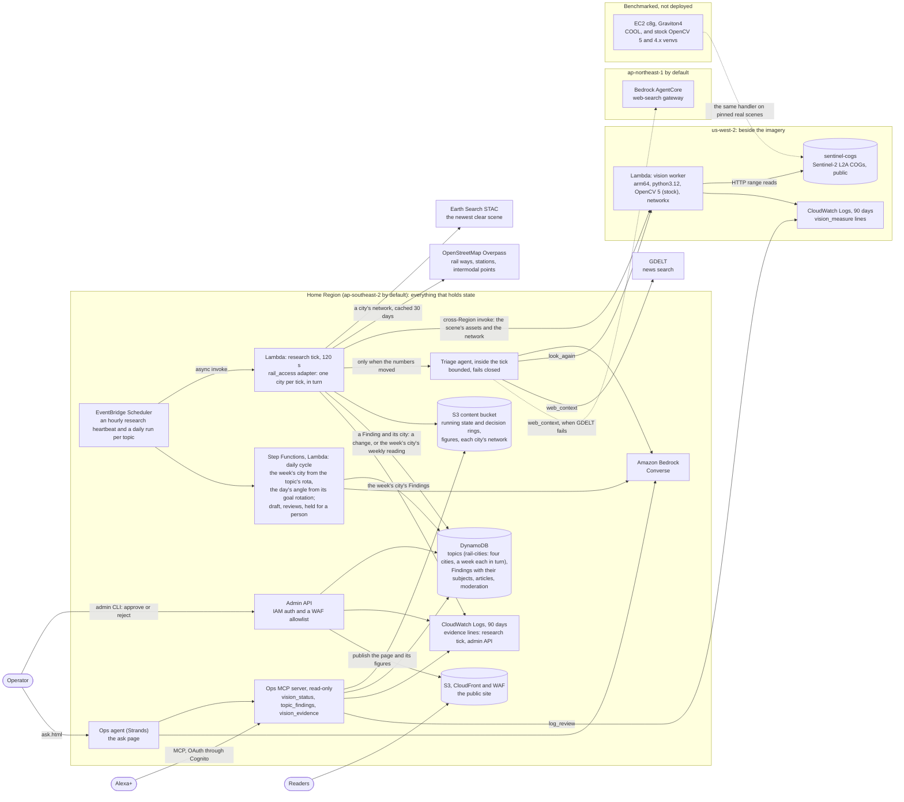
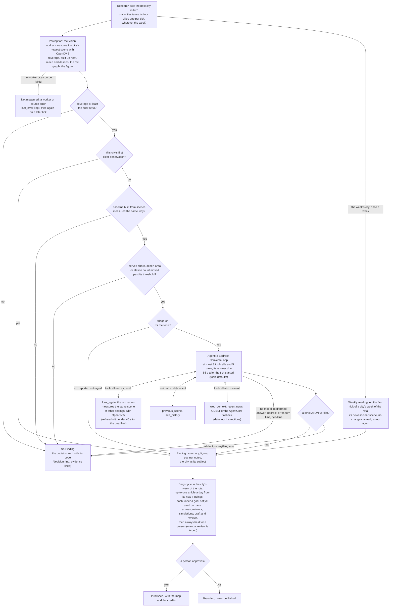

# Rail Access Monitor: technical report

**OpenCV AI Competition 2026** · **Entry:** BloggerBear's Rail Access Monitor · **Awards entered:**
Best Use of COOL ([Appendix A](#appendix-a-best-use-of-cool)) and Agentic Vision
([Appendix B](#appendix-b-agentic-vision)) · **Deadline:** 26 October 2026, 11:45 pm PDT

> An autonomous publisher that measures, from free Sentinel-2 imagery and OpenStreetMap, how much
> of a city's built-up area lies within walking reach of a rail station, with OpenCV 5 in a worker
> beside the imagery. It writes about one city a week: a reading of its newest clear scene, written
> up from a different angle each day, and again when the numbers moved and a bounded agent has
> checked the change is real. A person approves every article.

**Team.** [R2: the team: each member's name and role, as the owner gives them]

**Links.**

| What | Where |
|---|---|
| The code | [the repository](https://github.com/AllainWoodsford/BloggerBear) (public, Apache-2.0) at the tag `opencv-2026-submission` [R2: the tag, once made] |
| The video (at most 5:00, unlisted) | [R2: the video's link] |
| The working endpoint | [R2: the approved rail article's URL on dev's CloudFront domain] |
| The Devpost page | [R2: the Devpost submission's URL] |
| How to build and test it | [REPRODUCE.md](REPRODUCE.md) |
| The evidence | [evidence/README.md](evidence/README.md): every number below cites a file there or a code anchor, or is marked indicative and cites the design doc that recorded it |

**What is written here.** Every section describes the code on `dev` at 4a3d1b8 (16 October),
except the rotation as it runs: a city a week (#338), the angles of the goal rotation (#335) and
the runsheet that set the live topic up ([RailVisionSeeding.md](../RailVisionSeeding.md), #334)
are described as at a952db1 (17 October), the `dev` commit that brought them in. Code anchors are
`file:line` at 4a3d1b8, and all of them are checked again at the tag. A sentence that needs a
number not yet measured holds a marked placeholder, `[R2: ...]`, naming the run or file the number
will come from; `scripts/submission_check.py` fails while any is left. A few numbers were measured
before the run files existed (PR D's smoke run, the build container's timings, a workstation's
Overpass query): each is marked indicative and cites the design doc that recorded it,
[vision.md §7](../enhancements/archive/vision.md#7-measured) or [friction.md](../friction.md). No number
here is typed from memory.

**The status of the evidence.** Each result below says which of four kinds it is.

| Kind | What it means here | State on 17 October |
|---|---|---|
| **Live** | measured and decided by the deployed system on dev, read back from its logs and state | Dev was deployed with the vision worker on 15 October, and again on 16 October with the rotating topic (#331). The first rail topic's first ticks found three defects, now fixed (§6, "Failures observed in the deployment"). The rotating topic, `rail-cities`, has been seeded and switched to a city a week (#338) with three goals in turn (#335); no live triage has run yet. [R2: the live run's dates and counts, from the evidence export] |
| **Replayed** | the real adapter and worker code driven over pinned real scenes, tick by tick, with the real model or its recorded answers | Built (`vision_eval.py replay`, #336), not yet run on real data. [R2: the replay's run files] |
| **Benchmarked** | a script's run on pinned inputs, written to a run file with its code, machine, build and inputs | One run file: the coverage of all 46 pinned Sydney scenes (§6). The Graviton session, stock against COOL, is the owner's (Appendix A). |
| **Constructed** | inputs built to exercise one path: a failure case, a labelled agent case | The unit tests (§6, "Tests"); the agent's 13 labelled cases are built (`scripts/vision_eval_cases/`, #337), not yet run against the model. [R2: the case set's run file] |

---

## 1. The problem

Where a city builds and where its trains reach drift apart slowly and quietly. The numbers that
would show it (where the roofs are, how far each neighbourhood is from a station, which stations
the network depends on) are in open data that nobody looks at every week: Sentinel-2 passes over
every city every few days, and OpenStreetMap carries every line and station. Looking takes a
pipeline that measures the same thing the same way every time, says when something moved, says
what it could not see, and never publishes a number without a person reading it.

BloggerBear is already that pipeline for text feeds: topics, a diff-first research tick, a daily
authoring cycle, reviews, a moderation queue and a static site. The Rail Access Monitor gives it
eyes. One topic watches four cities (Sydney, Melbourne, Singapore and Boston) and writes about one
a week, each in turn: on the Monday a reading of the city's newest clear scene, then an article a
day from it, each from a different angle (access, the network's flags, the simulated links).

**The yardstick.** The measure resembles UN Sustainable Development Goal indicator 11.2.1, the
proportion of the population that has convenient access to public transport. [R2: the indicator's
definition and its distances to low- and high-capacity transport, quoted from its current metadata
in the UN Statistics Division's SDG metadata repository, with the metadata's date; not from memory]
The adapter's default reach is 1,000 m (`reach_m`, `lambdas/common/adapters/rail_access.py:150`),
in a straight line from each station. Two differences are stated wherever the number appears:

- **Built-up area, not population.** The measure is the share of the built-up *area* within reach,
  from reflectance; the indicator counts *people*.
- **A straight line, not the walking network.** A river, a motorway or a rail yard between a home
  and a station is not seen.

**Why a measured, diff-first, human-approved pipeline.** A model asked "is Sydney well served?"
would answer from what it read; this answers from what was measured, says when, and says what was
not measured. The diff comes first, so no model is called unless a number moved (the repository's
rule 2); the one exception is the week's city's weekly reading, once a week, which claims no change
and goes to no agent. An agent checks whether a change is real or an artefact of the imagery or the
map, and a person approves every article, because the numbers are proxies.

## 2. Users

- **The operator-publisher.** One person runs BloggerBear.
  - They create the rail topic with one command (`scripts/rail_topics.example.json`, the runsheet's
    [`rail_access` topics](../deployment-runsheet.md#rail_access-topics)), switch it to a city a
    week with three editorial goals ([RailVisionSeeding.md §7](../RailVisionSeeding.md#7-a-city-a-week-written-up-from-three-sides)),
    and approve or reject each held article from the review inbox (`python scripts/admin_cli.py
    inbox`, `approve`).
  - They ask the operator's assistant, on its page or by voice through Alexa+, what the pipeline
    saw and why: `vision_status` (which cities were measured, and why the others were not),
    `topic_findings` (the new Findings the next article on the week's city reads; on a day with
    none, the run writes the week's earlier Findings up again under the next goal, which the tool
    does not show) and `vision_evidence` (each decision, what the agent did, what a person did),
    read-only ([the evidence trail](../enhancements/archive/vision-evidence.md#asking-the-assistant)).
  - They need three things: little effort, never a wrong number published, and the evidence on
    demand.
- **Readers.** People following their city's growth and its trains: commuters, local-news
  readers, urbanism readers, students. They get a short article with a map, its credits, and what
  was not measured.
- **Hypothesis users.** Planners, advocates and journalists, who may take a flag as a lead to
  check, not as a finding. The SDG 11.2.1 yardstick says what the measure resembles and how it
  differs; §8's proxies say why a flag is a lead.
- **Not for:** emergency response, security assessment, ridership or revenue forecasting, or
  investment.

## 3. Architecture

**The system.** Everything that holds state is in one home Region (ap-southeast-2 by default).
The vision worker runs in us-west-2, beside the Sentinel-2 imagery, keeps nothing and writes
nothing but its log line. COOL is benchmarked on Graviton4, not deployed. The source is
[diagrams/architecture.mmd](diagrams/architecture.mmd); its SVG is
[diagrams/architecture.svg](diagrams/architecture.svg).



**The components.**

| Piece | What it does | Where |
|---|---|---|
| The topic | `rail-cities`: four city polygons, `reach_m` 1,000, a 192-hour findings window, and a `rotation` read on Sydney's calendar. The template gives each city weekdays; the live topic was switched to a city a week (`rotation_period` `"week"`, in the order Melbourne, Singapore, Boston, Sydney, which gives Sydney the week of 19 October and Melbourne that of 26 October) with three editorial goals taken in turn (`editorial_goal_rotation`: `access`, `network`, `simulations`) | `scripts/rail_topics.example.json`; [RailVisionSeeding.md §7](../RailVisionSeeding.md#7-a-city-a-week-written-up-from-three-sides); [dailysubject_hook.md](../enhancements/archive/dailysubject_hook.md) |
| The research tick | Hourly, diff-first, 120 s. The rail adapter takes one city per tick in turn, whatever the week: the newest clear scene from Earth Search, the city's OpenStreetMap network from its own S3 object (a first fetch gets the tick's measuring time), the worker, then the diff against the city's baseline. On the first tick of a city's week it also reports that city's newest clear scene as its **weekly reading**, no change claimed, once a week (`reported_period`) | `lambdas/research_tick_handler.py`; `lambdas/common/adapters/rail_access.py`; `lambdas/common/vision_sites.py` |
| The worker | Validates the request against the contract, range-reads only the tiles under the city, measures with OpenCV 5, draws the figure, replies with the metrics, the figure, the build record and per-stage timings, and logs one `vision_measure` line | `lambdas/vision_worker_handler.py`; `lambdas/vision/`; `lambdas/common/vision_contract.py` |
| The agent | Asked only when a number moved past a threshold; a bounded Bedrock Converse loop with four tools; fails closed | `lambdas/common/vision_triage.py` |
| The day subject and the angle | The daily cycle asks the rail adapter's `day_subject` hook whose week it is, and drafts only that city's Findings since its last article on that city (`last_article_by_subject`). The goal rotation picks the angle: new Findings get the next goal; with nothing new, the run revisits the same Findings under a goal not yet used on them, so one weekly reading becomes three articles (access on Monday, the network's flags on Tuesday, the simulated links on Wednesday) and then nothing until something new. Every article is held for a person | `lambdas/common/day_subject.py`; `lambdas/common/goal_rotation.py`; `lambdas/common/findings_window.py`; `lambdas/daily_cycle_handler.py` |
| The person | Every vision article is held; approving it publishes the page with its map and credits | `lambdas/admin_api_handler.py`; `scripts/review_inbox.py` |
| The assistant | Read-only tools over the state, the Findings and the evidence lines, for the ask page and Alexa+ | `lambdas/ops_mcp/` ([ops-assistant-vision.md](../enhancements/archive/ops-assistant-vision.md)) |

**The agent's workflow** (perception, decision, action and the person; every failed gate and every
agent failure ends at "No Finding", and a worker or source failure at "Not measured", which keeps
no decision; the week's city's weekly reading claims no change, so it reaches a Finding with no
agent). The source is [diagrams/agent-workflow.mmd](diagrams/agent-workflow.mmd); its SVG
is [diagrams/agent-workflow.svg](diagrams/agent-workflow.svg).



Each node and the evidence it leaves (P1's evidence lines, [the evidence
trail](../enhancements/archive/vision-evidence.md)):

| Node | Evidence | Where it is kept |
|---|---|---|
| The tick, and each city's turn | `research_tick` (its outcome, whether the state was stored, the Finding's time); `vision_site` (measured, deferred, not reached, with the error's code) | the research tick's log group, 90 days |
| Perception | `vision_measure` (build, CPU, timings, bytes read, coverage, graph size, peak memory), keyed by the worker's request id; Lambda's `REPORT` line for every run, a timed-out one included | the worker's log group in us-west-2, 90 days |
| The gates (coverage, first observation, baseline, thresholds) | `vision_decision` (the code: `below_floor`, `first_observation`, `baseline_building`, `within_range`, `reported`, `artefact`; which measures moved; whether the network copy changed) | the research tick's log group; the city's decision ring (the last 12) in the running state |
| The agent and its tools | `vision_triage` (each step's code-derived result, how the loop stopped, tokens, cost, the reason's SHA-256 prefix only) | the research tick's log group; the ring entry, which alone keeps the reason |
| The Finding | `research_tick.finding` equal to the decision's time, with `stored: true`; a weekly reading has no decision of its own: its tick's `research_tick.finding`, and the city's `reported_period` (its week's Monday) | the Findings table (14 days); the running state |
| The daily cycle and the hold | the article's `status`, `created_at`, `subject` (the week's city), `editorial_goal` (the angle), `revisit` and its lineage's `captured_at`s | the Articles table; the topic's `goal_rotation_state` |
| The person | `moderation_decision` (approved, rejected, unpublished, sent back; with the time, never who) | the admin API's log group; the Articles table (`published_by`) |

**The chain of ids.** `(topic_id, at)` joins a decision to its Finding and to the article's
lineage (`at` is the tick's fetch time, the Finding's `captured_at`); `worker_request_id` joins a
decision to the worker's `vision_measure` and `REPORT` lines; `tick` and `run` name the research
tick's invocation and attempt; `article_id` and `queue_id` join the person's decision. So a
decision can be followed from the scene to the person from the logs alone. A decision is *kept*
only when its tick stored the state; *reported* when the adapter put it in the summary; and *a
Finding was written* only when the tick's line names its time. Readers parse every line through
`evidence.parse` and filter by field equality, never trusting a line because it looks right.

**Where state lives, and how long.** The running state (each city's history, its decision ring
and what it knows of its network) is `snapshots/<topic>/running-state.json`, rewritten every
tick; dev's `snapshots/` expire 21 days after the last write (`infra/environments/dev/main.tf:188-189`).
Each city's network is its own object, `vision/<topic>/<site>/network.json`, outside
`snapshots/`. Figures are `vision/<topic>/<site>/<scene>.png`. Findings expire after 14 days
(`FINDING_TTL_DAYS`, `lambdas/research_tick_handler.py:68`). The logs are kept 90 days in both
Regions. [R2: the evidence export's directory, which makes the code-derived part permanent in git]

## 4. The OpenCV 5 implementation

The worker uses 37 distinct `cv2` functions (every `cv2.<name>(` call in `lambdas/vision/` and
`lambdas/vision_worker_handler.py` at 4a3d1b8). By stage:

| Stage | What OpenCV does, and why | Where |
|---|---|---|
| Reading the scene | No GDAL (rasterio for arm64 did not fit Lambda's 250 MB): a small reader for the TIFF subset Sentinel-2's COGs use range-reads only the tiles under the city. The rail task works on SWIR16's 20 m grid so a 60 km city fits the window; the 10 m red and NIR come from their 20 m COG overviews, or are reduced with `cv2.resize(INTER_AREA)` when a file has none; the scene classification is aligned with nearest-neighbour `cv2.warpAffine`, never averaged | `lambdas/vision/cog.py`; `lambdas/vision/scene.py` |
| Masks | The site polygon with `cv2.fillPoly`; cloud, shadow and no data from the scene classification | `lambdas/vision/masks.py` |
| Built-up density, the "heat" | NDBI above a threshold and NDVI below a cap, not water, cloud, shadow or no data, then a 3×3 `cv2.morphologyEx(MORPH_OPEN)`; the mask blurred with `cv2.GaussianBlur` of a walking-distance sigma (500 m), so each pixel holds the share of built-up ground around it, never rescaled | `lambdas/vision/urban.py` (`built_up_mask`, `heat_map`) |
| Reach and transit deserts | One `cv2.distanceTransformWithLabels` (`DIST_L2`, mask 5) from the station raster gives every pixel its distance to the nearest station and which one: the served share, the deserts and each station's catchment from one pass; deserts are `cv2.connectedComponentsWithStats` clusters of built-up ground beyond reach | `lambdas/vision/access.py:43-53` and below |
| The network as a graph | OpenStreetMap ways drawn one pixel wide with `cv2.polylines`; thinned to a skeleton with sequential hit-or-miss (`cv2.morphologyEx(MORPH_HITMISS)`), because the headless wheel has no `ximgproc`; junctions and ends counted with `cv2.filter2D`; runs and node clusters with `cv2.connectedComponents(WithStats)`; stations snapped with a labelled distance transform (`DIST_LABEL_PIXEL`); run lengths with `cv2.findContours` and `cv2.arcLength`; corridor visibility with `cv2.blur`. networkx then measures degree, betweenness, hubs, distance to a hub, flags and simulated links | `lambdas/vision/network.py`; `lambdas/vision/rail_analyse.py` |
| The figure | `cv2.applyColorMap(COLORMAP_INFERNO)` over the red band, `cv2.addWeighted` for the slate tint of what was not seen, desert outlines with `cv2.findContours` and `cv2.drawContours`, edges with `cv2.polylines` and `cv2.line`, stations with `cv2.circle`, hubs with `cv2.drawMarker`, the caption and legend in a strip under the map with `cv2.putText`; encoded with `cv2.imencode` at PNG level 9 within a 2 MiB budget | `lambdas/vision/rail_annotate.py`; `lambdas/vision/annotate.py` |
| The build record | `cv2.__version__` and the SHA-256 of `cv2.getBuildInformation()` (the build fingerprint), with the KleidiCV line reported beside it; a `cool` worker whose fingerprint differs from the pinned `COOL_BUILD_SHA256` refuses every request (`not_cool`) | `lambdas/vision/build.py:30-33`, `:52-55` |

**The worker contract.** Every request is checked before any byte is read: the version, the
task, an asset URL allowlist (the `sentinel-cogs` bucket by default), parameter bounds, a polygon
of 3 to 64 points, and for rail the network's shape and caps (60,000 way points, 5,000 ways, 2,000
stations). Every failure is a code (`bad_request`, `backend_mismatch`, `not_cool`,
`site_outside_scene`, `window_too_large`, `unreadable_scene`, `internal`). The worker follows no
redirect and reads no further than the byte range it asked for. Every reply echoes the parameters
it was measured with, so a result can be reproduced. (`lambdas/common/vision_contract.py`;
[vision.md §4](../enhancements/archive/vision.md#the-worker-contract).)

**The limits, and why.** The rail window is capped at 3,584 px a side, 71.7 km at 20 m
(`RAIL_MAX_WINDOW_PX`, `lambdas/vision_worker_handler.py:90`): on one core of the build
container's Xeon, the worst contract-valid network built for the test took up to 25.5 s and
1.32 GB there, against 37.5 s at 4,096 px. With an assumed 1.3 times slower arm64 core that is
about 33 s, and 41 to 56 s with the read (10 to 30 s for a 4,096 px window, scaled to this one's
77 % of the pixels), under the client's 58 s; a full 30 s read on top of the worst case would not
fit (the comment on `RAIL_MAX_WINDOW_PX`; [vision.md §7](../enhancements/archive/vision.md#7-measured);
indicative: a shared x86 container). No graph is built past 10,000 node clusters
(`MAX_GRAPH_NODES`), and betweenness is exact within a work budget of 600,000 and sampled from 20
to 200 seeded sources above it, said by the `betweenness_sampled` flag (`BETWEENNESS_WORK`,
`lambdas/vision/rail_analyse.py:55`, `:74`). Sydney needs 3,327 × 3,306 px.

**Stock against COOL.** The same handler runs on two backends: stock `opencv-python-headless`
5.0.0.93 (the deployed worker, `lambdas/requirements-vision.txt`) and OpenCV's COOL build for
Graviton. `VISION_BACKEND` says which a deployment is, a request for the other is refused, and the
fingerprint guard above means a result can never claim a build it did not run on
([Appendix A](#appendix-a-best-use-of-cool)).

**Why OpenCV 5, honestly.** None of the 37 functions above is specific to OpenCV 5: each is in
4.x too. The evidence README records that `opencv-python-headless==4.14.0.94` imports and runs the
benchmark's kernels, `analyse_rail_access` among them (x86, 16 October; it shows the code runs on
4.x, not a timing). What OpenCV 5 changes for this workload is measured, not assumed: the
Graviton session times stock 4.14 against stock 5.0 on the same instance, scenes and network.
[R2: the 4.x-against-5.0 speed-up on the compute stages with its interval, and the parity result,
from the `bench-compare` run file `...-scenes-opencv-4x-1t-vs-opencv-1t.json`; or, if that run was
cut, the sentence that no 5.x-specific call is used and the comparison was not measured]

## 5. AWS deployment

**The services, each with its configuration.**

| Service | Configuration | Code |
|---|---|---|
| The vision worker | Lambda, arm64, python3.12, 2,048 MB, 60 s, in us-west-2; `opencv-python-headless` 5.0.0.93, numpy 2.4.4, networkx 3.4.2, requests 2.34.2; `VISION_BACKEND=opencv`; its log group kept 90 days, and its role may write only that log group | `infra/modules/vision-worker/main.tf:211-260`; `infra/modules/vision-worker/variables.tf:26-36`; `lambdas/requirements-vision.txt` |
| The research tick | Lambda, python3.11, 512 MB, 120 s; started asynchronously by an EventBridge Scheduler heartbeat per topic, hourly by default (`rate(1 hour)`) | `infra/environments/dev/main.tf:691-711`; `_DEFAULT_RESEARCH_CADENCE`, `lambdas/admin_api_handler.py:172` |
| The daily cycle | Step Functions around a Lambda (300 s), on the topic's own schedule at its stagger slot's minute: `rail-cities` every day at 09:50 Sydney time on dev (the template's 09:05, moved by the stagger), writing about the week's city under the day's goal | `infra/environments/dev/main.tf`; `lambdas/common/stagger.py`; [RailVisionSeeding.md §1](../RailVisionSeeding.md#1-what-gets-seeded) |
| The agent | Bedrock Converse, at most 700 output tokens a turn (`MAX_TOKENS`, `lambdas/common/vision_triage.py:66`); news from GDELT, with the AgentCore web-search gateway (ap-northeast-1 by default) as its fallback | `lambdas/common/web_search.py:13-20`; `infra/modules/web-search/variables.tf` |
| State | S3 (`snapshots/` expire after 21 days on dev; figures and networks are kept); DynamoDB (Findings have a 14-day TTL) | `infra/environments/dev/main.tf:188-189`; `lambdas/research_tick_handler.py:68` |
| The site | S3, CloudFront and WAF; dev's CloudFront domain is public | `infra/modules/static-site/`; `infra/environments/dev/main.tf:475` |
| The admin API | API Gateway with IAM authentication and a WAF IP allowlist that fails closed | `infra/modules/rest-api/` |
| The operator's assistant | API Gateway, Cognito, the MCP server's Lambda and the agent's Lambda (Strands); Alexa+ through the same MCP server with OAuth | `infra/modules/ops-assistant/`; [alexa/README.md](../../alexa/README.md) |
| Infrastructure and CI | Terraform 1.16.2, with the aws provider 6.64.0 from the lock file; GitHub Actions with OIDC (dev applies on a merge, production on a reviewed release); every action pinned by SHA | `.github/workflows/terraform.yml:149`; `infra/environments/dev/.terraform.lock.hcl`; [dependencies.md](dependencies.md) |
| The COOL bench | EC2 `c8g.xlarge` (or `c8g.2xlarge`) in us-west-2, from the Marketplace product's AMI (COOL 3.1); by hand, not in Terraform | the [COOL benchmark runsheet](../cool-benchmark-runsheet.md); [the reconnaissance](evidence/cool/recon.md) |

**Why two Regions.** The Sentinel-2 COGs are in `sentinel-cogs`, us-west-2. The worker reads beside
them with HTTP range requests (about 54 MB for the whole Sydney box at 20 m, in PR D's smoke run;
indicative, [vision.md §7](../enhancements/archive/vision.md#7-measured)) and sends back a few KB of metrics and one
PNG. Everything with state stays in the home Region, so the vision Region holds nothing to migrate
and can be torn down at any time. The tick calls the worker with one cross-Region
`lambda:InvokeFunction`.

**Least privilege.**

- The worker's role may write its own log group and nothing else
  (`infra/modules/vision-worker/main.tf:211-220`); it reads only public data over HTTPS.
- The pipeline's execution role gets one extra statement: invoke that one function.
- The assistant's role is read-only. Where vision is on, one more policy lets it query the worker's
  log group in us-west-2 (with the project's tag conditions) and read
  `snapshots/*/running-state.json`, nothing else in the bucket
  (`infra/modules/ops-assistant/vision.tf`). `vision_evidence` needed no new grant.
- The deploy roles trust only the `dev` branch and the `production` environment.

**What it costs.** [R2: the cost per decision and per tick, in AUD at the project's fixed rate
(`costing.USD_TO_AUD_RATE`, 1.50, `lambdas/common/costing.py:35`) with USD beside it, from the
evidence export's `summary.json`]

**The deployed worker, as AWS reports it.** [R2: `aws lambda get-function-configuration` of the
worker, redacted (architecture, runtime, memory, timeout, `CodeSha256` and `VISION_BACKEND`; never
the account id or the role ARN), from the export's `provenance.json`]

**Deployment is opt-in.** Nothing of vision is created until the `VISION_ENABLED` repository
variable is `true`; the bootstrap is re-applied by hand with `vision_region` first
([runsheet](../deployment-runsheet.md#vision-optional)).

## 6. Evaluation

**Method and inputs.** Every number here is read from a run file under
[evidence/runs/](evidence/runs/), written by the script that measured it with its code's commit,
machine, OpenCV build and inputs ([the schema](evidence/README.md#the-run-file)).

- **Pinned scenes.** `scripts/vision_eval_manifest.json` pins 46 Sydney scenes (clear, season,
  cloud, no-data, smoke, the 2019 baseline and the 2024 year set) by every asset's ETag and size; a
  run refuses a scene whose ETag changed ("input changed"), so two run files that cite the same
  ETags read the same bytes. `python scripts/vision_eval.py pin` checks the manifest against the
  bucket.
- **A pinned network.** The Sydney network fixture, `scripts/vision_benchmark_networks/sydney.json`,
  is the network the deployed worker was sent, copied from its S3 object after the rotating topic
  fetched it (committed on 17 October, #349). [R2: the fixture's extract date and sha256, from
  `scripts/vision_benchmark_networks/NOTICE.md`]
- **A cache.** `--cache DIR` answers every range read from a local directory, filled on the first
  read, so repeats and both backends read byte-identical inputs.

**Baselines and references.**

| What is compared | Baseline or reference | Against | Result |
|---|---|---|---|
| The built-up mask | ESA WorldCover 2021, class 50 "Built-up" | the NDBI and NDVI mask | E8 (below) |
| Walking access | a straight-line buffer (the simple form of SDG 11.2.1's reach); the precise distance transform | the production distance transform | E5 |
| Measurement noise | the topic's thresholds | a year of clear scenes of an unchanged network, through the production rule | E3 |
| The platform | stock OpenCV 5 on Graviton4; stock OpenCV 4.14 on the same instance; stock OpenCV 5 on x86 (indicative only) | COOL on Graviton4 | E9, E10, [Appendix A](#appendix-a-best-use-of-cool) |
| The decision | numeric-only (every candidate reported) and always-artefact | the agent, by balanced accuracy | the agent, below |
| Cause, not sequence | the same case with only OpenCV's output changed | the original | the counterfactuals, below |

**E1 and E2: coverage and scene selection** (benchmarked; run file
[`2026-10-16-eval-coverage-intel-xeon-processor-2-80ghz-none.json`](evidence/runs/2026-10-16-eval-coverage-intel-xeon-processor-2-80ghz-none.json),
`vision_eval.py coverage`, 16 October, commit 8071a4f, on the build container: x86, outside
us-west-2; coverage does not depend on the CPU).

- **E1, why a scene is unusable.** For each of the 46 pinned scenes, the scene classification's
  class shares inside the Sydney polygon, the coverage as the worker defines it, and the mean
  aerosol optical thickness. The cloudy scene of 5 January 2024 has a coverage of 0.1467, so it is
  flagged `low_coverage` and can never be material or a first observation; 7 scenes under the floor
  are explained by one unusable class. The smoke scene of 26 December 2019 has a coverage of 0.9949
  (the classification flags nothing) and a mean aerosol optical thickness of 0.4358, against 0.203
  on the clear 21 December 2019: smoke passes the coverage gate, which is why the agent's cases
  include it.
- **E2, how the search spends worker calls.** Of the 149 items of Sydney's tile (56HLH) in 2024,
  65 pass the topic's cloud filter (STAC cloud cover at most 40), 38 of those pass the footprint
  rule (the scene holds the whole city), and 5 of those 38 still fall under the 0.6 floor: worker
  calls that could only report "too cloudy". The year set (clear scenes, site coverage at least
  0.95, one per datatake) holds 17 scenes.

**E3: measurement noise on an unchanged network** (replayed). [R2: from the `stability` run file:
the decisions over the 2024 year set through the production rule with the default thresholds and
one network fixture, the false-material count and rate with its Wilson 95 % interval, by month; the
spread of served share, desert area and built-up area; the built-up mask's IoU between consecutive
scenes; the Jaccard of hubs and flags]

**E5: the access method against the yardstick** (benchmarked). [R2: from the `access-baseline`
run file on one clear scene: the production distance transform against `DIST_MASK_PRECISE` and
against a straight-line buffer of discs, the difference in served share, the IoU of the served
mask, and the times]

**E8: the built-up proxy against a reference** (benchmarked). [R2: from the `builtup-check` run
file: IoU, precision and recall against ESA WorldCover 2021 class 50 on one clear Sydney scene, and
the served share with each mask; or, if the check was cut, the sentence that the built-up proxy
has not been validated against a reference]

**E6 and E7: the graph** (benchmarked, if run). [R2: exact against sampled betweenness on the real
Sydney graph, and raster snapping against the vector map; or "not run"]

**The failure catalogue** (constructed, each case held by a test or a real run).

| Case | Input | Expected |
|---|---|---|
| Cloud | the 5 January 2024 scene | `low_coverage`, coverage about 0.147; no model call; never a first observation |
| Swath no-data | a scene whose footprint misses the city's south | not chosen by the search; measured directly, `low_coverage` |
| Smoke | the 26 December 2019 scene | coverage passes the gate; whether the numbers move is measured (the agent's case C10) |
| A site outside the scene, a window too large | the polygon moved off the tile, or widened past 71.7 km | `site_outside_scene`, `window_too_large`, after the header read and before any tile; not sent again for 6 hours |
| A graph too large, betweenness sampled | a dense synthetic mesh; a graph over the work budget | `graph_too_large`; `betweenness_sampled`, and the planner notes say "about" |
| An unreadable scene, a URL off the allowlist | a missing key, a redirect, another host | `unreadable_scene`; `bad_request` before any read |
| The wrong build | a `cool` request to a stock worker; COOL without a pin | `backend_mismatch`; `not_cool` |
| Overpass fails | a 429, a 504, a timeout, an oversize reply | the stored network serves; a refresh retried after 6 hours; a first fetch that fails is the `osm` error and no measurement |
| Out of time | a budget under the reserves | deferred, keeping its place |
| The agent fails | malformed answer, Bedrock error, deadline, turn and tool budget, `look_again` refused for time, no model | `artefact`, with the stop code |
| Injected news | a headline that instructs | `artefact`: tool results are data, not instructions |

[R2: each row's test node ids and real-run results, from the `failures` run file]

**Failures observed in the deployment** (live). Before the evidence lines existed, the first rail
topic on dev (`trains-sydney`, created on 16 October) measured nothing on its first day, and its
log showed three defects in turn, each hidden behind the one before: every tick failed reading a
missing running state, because S3 answers 403 rather than `NoSuchKey` to a role without
`s3:ListBucket` (fixed by #305); every Overpass request was refused with a 406 for want of a
User-Agent (#310); and Sydney's network query, timed from a workstation, took 54 s (5,925
elements, 5.5 MB; indicative) against a 30 s first fetch (#312: the first fetch now gets the tick's
measuring time)
([friction.md](../friction.md), entry 12.25; [vision.md §8](../enhancements/archive/vision.md#8-what-went-wrong-and-what-it-taught)
lesson 16). [R2: from the export's `summary.json`, zero rows included: `vision_site` outcomes by
code, worker refusals, worker runs that ended without a reply, tick attempts not kept, OpenStreetMap
failures, and triage stops other than `answered`]

**E9 and E10: timing, memory, and COOL against stock** (benchmarked). See
[Appendix A](#appendix-a-best-use-of-cool). The only timings so far are indicative x86 rows from a
shared build container, where two runs differed by up to 40 %
([vision.md §7](../enhancements/archive/vision.md#7-measured)); none is a COOL ratio.

**The agent** (constructed cases, the live model). [R2: from the `agent` run file: the case set
(four `real` cases, three to five `artefact` cases, each labelled by how it was built and which
input moved), five repeats each; per-class recall, balanced accuracy and the confusion matrix (with
failed-closed runs as their own column) for the agent, numeric-only and always-artefact; stability
across repeats; tool use; latency p50 and p95; tokens and cost in AUD and USD; at least one of the
agent's mistakes, quoted as "the agent's note"]

**The counterfactuals** (A2's cause, not only its sequence). [R2: from the `counterfactual` run
file: (a) the agent level, live, five repeats per arm with only `look_again`'s returned numbers
changed (arm (ii) a constructed tool output, said so): how many repeats called `look_again`, and
"the verdict changed in k of n repeats"; (b) the gate level, the same scene with its coverage just
above (0.62) and just below (0.58) the floor: the agent called or not, a Finding or none]

**Human control and observability** (live). [R2: from the export's `summary.json`, the demo topic
apart: the share of vision articles published by a person (expected 100 %); the person's
decisions with the time from Finding to decision; the operator's agreement with the agent on every
triaged live decision, k of n with a Wilson interval; the completeness of the evidence (every kept
decision with its ring entry, every worker request with its `vision_measure` or `REPORT` line), and
the lines left unmatched]

**The live run.** [R2: from the export: the rotating topic's ticks and decisions per city since its
creation; for Sydney's measured scene, the coverage, built-up, served and desert km², the served
share, the stations (snapped), nodes, edges and components, the hubs and the flags raised, the
quality flags, the network's size, and the worker's read, analyse, graph and annotate times beside
the bucket (its `vision_measure` line); the research tick's wall time with and without the agent
(E11); the endpoint's article (one of Sydney's week, 19 to 25 October, written from its weekly
reading or its first observation: measured but not triaged, as §7 says) and its `editorial_goal`]

**The trace: OpenCV's output changing a later decision.** [R2: the headline trace, rendered by
`vision_decisions.trace` from the replay of the `sydney-demo` sequence
(`evidence/replay/sydney-demo.md`), and the live demo topic's trace if its two-tick triage ran
(the export's `trace`), each labelled live or replayed; see
[Appendix B](#appendix-b-agentic-vision)]

**Tests.** The suite never touches the network: moto for S3 and DynamoDB, scripted fakes for the
worker, the model and every source, and synthetic scenes built in the tests. At 4a3d1b8 the 20
vision test files (`lambdas/tests/test_vision_*.py`, `test_rail_*.py`, `test_osm.py`,
`test_satellite_vision_adapter.py`, `test_figures.py`, `test_frontend_figures.py`,
`test_evidence.py`, `test_ops_mcp_vision_*.py`, and `scripts/tests/test_vision_*.py`) collect
1,432 tests. [R2: the same count and the full suite's count at the tag, from tier 1a of
REPRODUCE.md]

## 7. Limitations

- **Proxies.** Built-up density is from reflectance (NDBI, NDVI and the scene classification), not
  population or jobs: a warehouse district is as built up as a block of flats. A station's
  catchment activity is the mean of that proxy.
- **Not SDG 11.2.1.** Built-up *area*, not people; a *straight line*, not the walking network.
- **No ridership, no service.** Nothing here knows patronage, frequency, journey time or fares. A
  hub is central and busy in the proxy's terms; a ghost line runs through little built-up ground,
  not through few passengers.
- **Grade-separated crossings read as junctions.** Two lines crossing on a bridge cross in pixels;
  degree and betweenness inherit it.
- **One water mask.** Water is the scene classification's water class alone; a flooded field or a
  misclassified shadow moves the built-up mask at its edges.
- **One Sentinel-2 tile per city.** The search keeps only scenes whose footprint holds the whole
  city, so a city must fit one 100 km tile, and the worker's 71.7 km window.
- **Cloud and haze.** A scene under the coverage floor is kept but never material; a station under
  cloud is unmeasured, not quiet; in a cloudy season a baseline builds slowly. Smoke is not flagged
  by the scene classification (E1).
- **The map is the topology.** Where OpenStreetMap is wrong or stale, the graph is; the corridor
  visibility score and the news tool are checks, not corrections. A station that does not snap
  within 300 m has no place in the graph.
- **A suggestion is a simulation.** An orbital link is an edge added to a graph, 1.2 times the
  straight line, with no cost, land or engineering behind it.
- **The agent is bounded, not omniscient.** Three tool calls, a deadline and a strict answer: when
  unsure it says "artefact", so a real change waits for the next clear scene.
  [R2: the agent's measured mistakes, quoted from the `agent` run file]
- **What the evaluation found.** [R2: E3's false-alarm rate against the thresholds; E8's
  agreement, or "the built-up proxy has not been validated against a reference"; E6's sampling and
  E7's snap misses, if run]
- **Every `real` agent case is network-driven.** A true, imagery-driven growth of a city's
  built-up area within the evaluation's window could not be built honestly.
- **A small live sample.** A weekly reading claims no change and a city's first observation has no
  baseline, so neither is triaged: the endpoint's article is measured but not triaged, and few live
  decisions reach the agent before the deadline. [R2: the live n, and the weather's effect on the
  live run]
- **A city a week.** Each city is written about one week in four. A change found in another city's
  week is triaged and kept as a Finding, but it is written up only if its city's week comes while
  it is still inside the 192-hour findings window. A city whose newest scene is under the coverage
  floor when its week starts gets its weekly reading, and its articles, only once a clear scene is
  measured, so the angles start later in its week.
- **The demo topic.** Its thresholds of 0 make the agent run on a known day; it is disclosed in §8.
- **COOL is benchmarked, not deployed.** The deployed worker runs stock OpenCV 5 on Lambda arm64;
  whether COOL runs on Lambda's CPUs is open ([vision.md §10](../enhancements/archive/vision.md#10-still-open)).
- **The x86 timings are indicative.** A shared container, runs differing by up to 40 %; the arm64
  factor of 1.3 behind the window cap is an assumption until the Graviton rows replace it.
- **Overpass.** Two public endpoints, rate-limited and sometimes slow: a stored network serves for
  30 days and a failed refresh is retried after 6 hours, but a city whose first fetch keeps failing
  stays unmeasured.
- **A Finding written while the daily cycle starts can be missed.** The tick dates a Finding at
  its start and writes it at its end; older than this work, and listed as a follow-up
  ([vision.md §10](../enhancements/archive/vision.md#10-still-open)).

## 8. Responsible use

**A person approves every vision article.**

- `force_manual_review` is forced on for every `rail_access` and `satellite_vision` topic, at
  create and at update (`MANUAL_REVIEW_ADAPTERS`, `lambdas/admin_api_handler.py:376-377` and
  `:549-550`), and cannot be unset.
- The daily cycle adds the manual-review reason to every such draft's hold reasons
  (`lambdas/daily_cycle_handler.py:429-430`), whatever the compliance review says.
- The daily cross-topic digest, the one other path that publishes with no person, leaves these
  topics out (`lambdas/trending_digest_handler.py:239-241`).
- Every publish of a held article is `published_by="humans"`: approving one, or force-publishing
  it, is an operator's act (`lambdas/admin_api_handler.py:1131`, `:1218`, `:1736`).
- The evidence trail records *that* a person decided, and when (approved, rejected, unpublished,
  sent back), never *who*; a topic change that switches the agent or the news off is logged by key,
  never by content (`moderation_decision`, `topic_changed`).
- [R2: the operator's labels on every triaged live decision, and the agreement rate in §6]

**AI disclosure.** Articles are written by a model from measurements and approved by a person. Each
article's page shows its lineage: the models, their cost, and `published_by`. The agent's reason
reaches a summary only quoted, as "the vision agent's note (not a measurement)"
(`quoted_note`, `lambdas/common/vision_triage.py:327-331`).

**Proxies, not people.**

- Built-up density comes from reflectance, not population, income or need, unlike SDG 11.2.1,
  which counts people.
- "Beyond reach" means a straight-line distance to a station, not the walking network, and not
  access.
- The summary prompt forbids saying any area is well or badly served in absolute terms, and any
  cause, forecast, or political, planning or investment view (`build_summary_prompt`,
  `lambdas/common/adapters/rail_access.py:1039-1054`).
- A transit desert is not an equity finding, and nothing here says it is.

**Critical infrastructure.** The "single point of failure" planner note names the station on the
most shortest paths of the *public map's* graph (`_single_point_of_failure`,
`lambdas/common/rail_notes.py:75-92`). It uses no operational data, and it usually names a
well-known interchange. As built, the sentence may end an article ("the pipeline flags it as a
single point of failure, where a disruption would cut more routes than anywhere else on the map").
[R2: the owner's decision, with its reason: keep the wording; or keep the flag on the Finding
(`planner_notes`) and soften the published sentence to "the most central station on the mapped
network"; or leave it out of the published article]

**Privacy.**

- Pixels are 10 to 20 m: no person, vehicle or vessel can be identified. The ship task's prompt
  forbids identifying any vessel or owner, and the rail prompt any person or company
  (`SYSTEM_PROMPT` and `RAIL_SYSTEM_PROMPT`, `lambdas/common/vision_triage.py:118-143`).
- No personal data is stored. The evidence lines hold codes, ids, times and numbers only, by
  schema: never a site or station name, an error's message, a news title or host, or the agent's
  reason (its SHA-256 prefix only) ([the evidence trail](../enhancements/archive/vision-evidence.md#what-is-never-recorded-and-why-readers-parse-lines)).

**Untrusted text.**

- News results are cut (a title to 200 characters, a snippet to 300, a source to 100), made one
  plain line each, a link kept only when it is http(s) and short, and the rail system prompt says
  that what the tools return is data from outside sources, not instructions
  (`WEB_CONTEXT_FIELD_CHARS`, `_web_context`, `_web_row`, `lambdas/common/vision_triage.py:115`,
  `:666-707`; `RAIL_SYSTEM_PROMPT`).
- The assistant scrubs untrusted text and shows it only in "(unverified)" columns on the page,
  never to a voice caller; `vision_evidence` carries no untrusted text at all, and every evidence
  reader parses each line rather than trusting it.
- [R2: the injected-news case's result (C5), from the `agent` run file]

**Licences and credits.**

- Sentinel-2 imagery: Copernicus Sentinel data, free, full and open; "Contains modified Copernicus
  Sentinel data" under each vision article and on the About page, and with the data's year in the
  figure's strip and its page caption.
- The AWS copy: "Sentinel-2 Cloud-Optimized GeoTIFFs accessed from the Registry of Open Data on
  AWS".
- OpenStreetMap: "Map data © OpenStreetMap contributors", under the Open Database Licence, in the
  figure's strip and caption, under each rail article and on the About page. The committed network
  fixture carries its own notice (`scripts/vision_benchmark_networks/NOTICE.md`), and this
  repository's licence does not cover it.
- GDELT: cited and linked, as its terms ask.
- ESA WorldCover 2021, CC BY 4.0, if E8 ran. [R2: keep or drop this line with E8]
- This repository: Apache License 2.0 ([LICENSE](../../LICENSE)).

**Fail closed, and bounded.** An unsure agent never makes a Finding: a malformed answer, an
unknown verdict, a Bedrock error, no model, the turn limit or the deadline all mean "artefact"
(`STOPS`, `lambdas/common/vision_triage.py:71`). Cost and time are bounded in code: at most three
tool calls and five turns by default, the answer due 85 s after the tick started, no model turn
with under 10 s left, `look_again` refused when a worker run could not finish, at most 700 output
tokens a turn, and no agent call at all unless a number moved.

**The demo topic is disclosed.** `rail-sydney-demo` ("Rail access: Sydney (demo)", site id
`demo-sydney`) has thresholds of 0, which exist only to make the agent run for the demonstration:
its second clear scene goes to the agent whatever the numbers did. Its first tick is steered to an
older clear scene with a temporary `max_cloud_cover`, so that its second tick triages on a known
day ([runsheet: the demo topic's two-tick procedure](../deployment-runsheet.md#evidence-what-the-pipeline-measured-and-decided)).
Its articles are rejected in the inbox, never published, and it is counted apart from the cities
everywhere. [R2: whether the procedure ran, its dates, and that its articles were rejected]

---

## Appendix A. Best use of COOL

**Version, delivery and configuration (C1).** [R2: from `evidence/cool/recon.md` and the run files'
`environment.cool` and `environment.host`: the Marketplace product and version, its delivery type
(AMI or container) and image digest or AMI id, the instance type (`c8g.xlarge`), the Region, the
Python version, the COOL fingerprint (`build_sha256`), threads, and the price]

**Method, inputs and baselines (C2).** One Graviton4 instance, one session, the backends
interleaved so a slow minute does not land on one side:

- three interpreters on the instance: COOL's own activated Python 3.12 environment (its `cv2`
  is 5.1.0-dev, built against numpy 2.5.1: [the reconnaissance](evidence/cool/recon.md)), and
  venvs with stock `opencv-python-headless` 5.0.0.93 and 4.14.0.94
  ([the COOL benchmark runsheet](../cool-benchmark-runsheet.md),
  steps 4, 6 and 7);
- `vision_benchmark.py kernels` (each OpenCV operation on synthetic images) and `scenes` (the
  worker's handler on the pinned real Sydney scenes with the Sydney network fixture, from the
  cache, each scene in a fresh interpreter), pinned to one core, the deployed worker's shape, and
  on four;
- `compare`: the speed-up of one run over another on the compute stages (`analyse` and `annotate`;
  the read apart), with a seeded bootstrap interval, and the parity of the rail metrics; it refuses
  two runs from different machines or inputs;
- `controls`: the COOL guard's three negative controls.

**Results.** [R2: from the `bench-compare` run files: the headline speed-up of COOL over stock on
the pinned one-core scenes pair, on the compute stages, with its 95 % interval and `parity: pass`;
per stage; the four-thread pair; and the kernel pair]

**The proof that COOL executed the claimed core workload (C3).** The core workload is
`lambda_handler` on a real city: the range reads, `analyse_rail_access` and `annotate_rail`. The
evidence, each a committed file:

1. the `scenes --backend cool` run files, every scene `ok`, with `environment.opencv.build_sha256`
   equal to the SHA-256 of `cool-buildinfo.txt` from the product's own `cv2`;
2. the OpenCV and KleidiCV shared objects mapped into the process during those runs, by path, size,
   SHA-256 and owning package (`environment.libraries`), and the vendor build lines;
3. optionally, `perf`'s share of samples inside those libraries (`perf-dso.txt`);
4. the CPU is Neoverse V2 (`lscpu.txt`, and every run's `environment.cpu`);
5. the instance's Marketplace product codes name the COOL product (`environment.host`);
6. the controls: `not_cool` under stock with the same pin, `not_cool` with no pin, and
   `backend_mismatch` for an `opencv` request;
7. parity with stock on the same scene and network;
8. the speed-up on the compute stages, per stage, with intervals;
9. optionally, the agent's replay run with COOL executing `look_again` inside the loop.

[R2: each item ticked with its file, or said not shown and why]

**The claim's scope**, exactly: the same worker handler, run on Graviton4 with COOL, on real Sydney
scenes and its real OpenStreetMap network, and [R2: keep "and inside the agent's loop" only if the
agent session ran]; the deployed worker runs stock OpenCV 5 on Lambda arm64 (its CPU named in its
logs). Not "COOL is deployed": a deployed COOL worker is out of scope until after the deadline.

## Appendix B. Agentic Vision

**The workflow (A1)** is the agent diagram in §3: perception (the worker), decision (the gates,
then the bounded agent with `look_again`, `previous_scene`, `site_history` and `web_context`),
action (a Finding, or a kept decision with no Finding), and the person. Once a week the week's
city's weekly reading is a Finding with no change claimed and no agent; the daily cycle then
writes the week's city up from a different angle each day, and a real change found later in its
week starts the angles again.

**A trace showing OpenCV 5's output changing a later decision (A2).** The trace is one rendering for
every reader (`vision_decisions.trace`): the same rows on the assistant's page, in the replay and
in the export. Its steps: what was measured (coverage, the measures, which build and CPU), how it
compared (the code, the baseline, the delta, the thresholds, and what the gate did), one row per
tool call (for `look_again`, what OpenCV re-measured at which settings, beside the same scene's
numbers at the topic's settings), the verdict, the action, and what a person did. It states facts
only; the cause is shown by the counterfactuals.

[R2: the headline trace (replayed, `sydney-demo`), its rows as rendered; the live trace if the demo
topic's triage ran; and the counterfactual numbers of §6]

**Task success, failure handling, observability and human control (A3).**

- **Task success.** [R2: balanced accuracy and per-class recall against both baselines, from §6]
- **Failure handling.** Every failed gate and every agent failure ends at "No Finding", with a stop
  code in the evidence (`answered`, `malformed`, `bedrock_error`, `deadline`, `turn_limit`, `no_profile`,
  `no_model`); a site that could not be measured keeps its history and records `last_error`
  ("not measured is never nothing there"). [R2: the failed-closed cases' results, all required to
  end as expected]
- **Observability.** One JSON line per step, 90 days, in both Regions; the decision ring in the
  running state; and the operator's assistant reads it back on the page and by voice
  (`vision_evidence`: three fixed Logs Insights queries by field equality, one 12-second limit for
  the whole call). [R2: the evidence's completeness, from §6]
- **Human control.** A person approves every article (§8). [R2: the share published by a person,
  and the operator's labels]

## Appendix C. Reproduce

[REPRODUCE.md](REPRODUCE.md) has every tier: the CI commands (1a), the real-data runs with an
output a judge can check (1b), the deployment on AWS (2) and the Graviton session (3). Tier 1a,
the commands CI runs, with the judges' constraints file:

```bash
python3.11 -m venv .venv && . .venv/bin/activate
python -m pip install -c constraints-py311.txt --upgrade pip
pip install -c constraints-py311.txt -r lambdas/requirements.txt
pip install -c constraints-py311.txt -r lambdas/requirements-dev.txt
pip install -c constraints-py311.txt -r scripts/requirements.txt
ruff check lambdas/ scripts/
pytest lambdas/ scripts/
```
